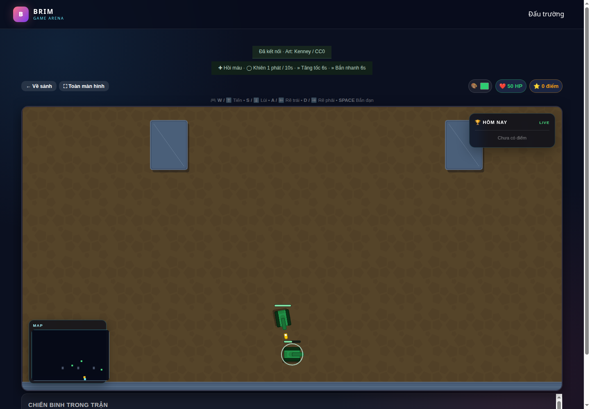

# BRIM Game Platform

Multi-game platform with Spring Boot, Kafka, WebSocket supporting real-time and turn-based games.

## Games Included
- **Snake** (Real-time, WebSocket + Phaser)
- **Tank Battle** (Real-time, WebSocket + Phaser)
- **Chess** (Turn-based, WebSocket; optional Kafka learning mode)
- **Chinese Chess** (Turn-based, WebSocket; optional Kafka learning mode)
- **Connect Four** (Turn-based, WebSocket; 7×6, two players or bot)
- **Caro** (15×15, freestyle: five or more in a row, two players or bot)
- **Othello** (8×8, automatic pass, two players or bot)
- **Battleship** (10×10, manual/automatic fleet placement, private player snapshots, two players or bot)
- **Match-3** (single player, 10 seeded levels, cascade, collection targets and obstacles)
- **Bomberman** (real-time, 2–4 players including bots, server-owned bombs, chain reactions and items)
- **Sơn Hà — Hợp cờ Hoa Lư** (match-3 combat: 12-chapter campaign, HP/energy/skills, gold/XP/upgrades and two-player PvP rooms)

## Sơn Hà — Hợp cờ Hoa Lư

Trong lobby chọn **Vào Sơn Hà**, hoặc mở `/warlords`. Ghép kiếm gây sát thương, ghép năng lượng để dùng Phá trận/Hồi quân/Thiết bích; có hồi máu, khiên, vàng và kinh nghiệm. Chiến dịch có bản đồ 12 chương lấy cảm hứng từ thời 12 sứ quân, mở dần địa danh và nâng cấp trong doanh trại. Có thể tạo bàn **Sơn Hà · Đấu tướng**, mời bạn qua link phòng và đấu theo lượt trực tiếp; PvP dùng chỉ số ngang nhau.

Vàng, XP, nâng cấp và chương đã mở lưu trong Redis theo phiên guest hiện tại. Các trận và thứ tự chương là sáng tác dựa trên bối cảnh lịch sử, không phải niên biểu. Xem [luật, phần thưởng, nguồn lịch sử và giới hạn bản đầu](docs/WARLORDS.md).

## Các game trong roadmap

Tất cả sáu game trong [GAME_ROADMAP.md](docs/GAME_ROADMAP.md) đã có phiên bản chơi được. Tạo phòng trong lobby, chọn game, rồi mời người chơi hoặc thêm bot. Match-3 chỉ cần một người; các game mới còn lại cần ít nhất hai người. Tất cả có nút chơi lại cho chủ phòng.

| Game | Luật và điều khiển |
|---|---|
| Caro | Chọn ô trống trên bàn 15×15. X đi trước; từ 5 quân ngang/dọc/chéo là thắng, kể cả chuỗi dài hơn 5 hoặc bị chặn hai đầu. Không áp dụng luật cấm của Renju. |
| Othello | Đen đi trước; ô có dấu chấm là nước hợp lệ. Lật tất cả hướng kẹp được. Tự bỏ lượt khi không có nước; cả hai hết nước thì so số quân, bằng nhau là hòa. |
| Battleship | Xếp 5 tàu dài 5/4/3/3/2 ô, chọn hướng ngang/dọc hoặc xếp tự động. Tàu được chạm nhưng không chồng. Hai bên luân phiên bắn một ô, kể cả khi trúng. Hết 17 ô tàu thì thua. |
| Match-3 | Chọn hai ô kề nhau để đổi. Nước không tạo match không trừ lượt. Đạt mục tiêu điểm, thu thập và phá hết lớp phủ để qua màn. Màn 4 trở đi có ô chắn; màn 6 trở đi có lớp phủ. Có chơi lại và chọn màn đã mở. |
| Bomberman | Mũi tên/WASD di chuyển, Space đặt bom; có nút cảm ứng. Bom nổ sau 2 giây, lửa 0,5 giây, có nổ dây chuyền. Tường phá được có thể rơi item tăng tầm nổ/số bom. Người sống cuối thắng; cùng chết hoặc hết 180 giây là hòa. |

Caro và Othello có bot Easy/Medium/Hard, tìm kiếm alpha–beta trên bản sao bàn với độ sâu tối đa 1/3/4 và ngân sách 100/450/1.500 ms. Caro giữ 12 ứng viên theo độ đe dọa để giới hạn CPU; không phải engine thi đấu chuyên nghiệp. Bot Battleship chọn từ thông tin đã bắn; bot Bomberman tránh vùng nguy hiểm và phá đường. Hai bot này chưa có ba mức khó riêng.

Match-3 đọc 10 màn từ `src/main/resources/games/match-three-levels.json`. Server xử lý seed, swap, hợp nhất match giao nhau, trọng lực bị chia bởi ô chắn, tối đa 50 cascade và tạo lại bàn khi hết nước. WebSocket trả chuỗi sự kiện để frontend diễn hoạt; giảm chuyển động sẽ hiển thị ngay kết quả. Màn đã mở và màn đang chọn lưu trong Redis theo danh tính phiên khách, giữ khi tạo phòng mới bằng cùng phiên. Trạng thái bàn hiện tại ở RAM: tải lại/reconnect giữ ván khi backend vẫn chạy; restart backend bắt đầu lại màn đã lưu. Chưa có special pieces, bản đồ progression hay tài khoản đăng nhập lâu dài.

Battleship chỉ phát bàn theo viewer tại `/topic/game/{roomId}/state/{playerId}`. Bàn địch chỉ có ô chưa bắn/trúng/trượt; không phát snapshot công khai hoặc `finalState` chung kể cả khi kết thúc. Guard chặn subscribe bàn người khác. REST room metadata không chứa vị trí tàu.

Bomberman đăng ký tick 100 ms trong `GameRuntime`, snapshot qua worker output; input hết hạn sau 500 ms nếu không được cập nhật. Bot, đặt bom, va chạm tường/bom và thắng/thua đều do server xử lý. Không gửi input Bomberman qua Kafka ngay cả khi bật chế độ học Kafka cho game theo lượt. Phòng đang chơi không nhận người mới, nhưng thành viên cũ có thể reconnect.

## Connect Four

Trong lobby, chọn **Connect Four** khi tạo phòng. Mời người thứ hai hoặc thêm bot, chọn **Sẵn sàng**, rồi chọn cột để thả quân. Đỏ đi trước; nối ít nhất bốn quân cùng màu theo hàng ngang, dọc hoặc chéo để thắng. Bàn đầy mà chưa có người thắng là hòa. Chủ phòng có thể chọn **Chơi ván mới** sau khi kết thúc.

Server kiểm tra lượt, cột đầy, input và kết quả; giao diện nhận bàn chơi qua WebSocket dùng chung luồng `/app/turn/{roomId}`. Payload nước đi là `{ "column": 0 }` với cột từ 0 đến 6. Bot Easy/Medium/Hard dùng tìm kiếm negamax với alpha–beta, độ sâu tối đa 1/3/6 và ngân sách 100/450/1.500 ms, chạy trên bản sao bàn trong BotExecutor.

## Chess and Chinese Chess bots

Both games use the built-in Java engine in `game/ai/AlphaBetaSearch.java`; no external engine or network calls are required for move selection. Select **Easy**, **Medium**, or **Hard** when creating a room, then add a bot.

| Difficulty | Maximum search depth (plies) | Search time budget per move |
|------------|-----------------------------|-----------------------------|
| Easy | 1 | 100 ms |
| Medium | 3 | 450 ms |
| Hard | 6 | 1,500 ms |

A ply is one move by one side. The engine searches increasingly deep iterations and returns the best move from the last completed iteration. Actual depth depends on the position and CPU speed. The time budget excludes waiting in the bounded bot worker queue and can overrun by the cost of one move-generation/evaluation operation.

Search uses negamax with alpha–beta pruning, capture ordering, a bounded per-search transposition table, and up to six additional plies of quiescence search for captures, promotions, and check evasions. Evaluation includes material, development, centralization, mobility, pawn progress, and a king pawn shield in chess. Xiangqi additionally rewards soldiers crossing the river. Search runs on a detached board copy.

Both players and bots must avoid self-check. Chess supports checkmate, stalemate, castling, en passant, and promotion; an omitted promotion defaults to queen, while the move API also accepts `ROOK`, `BISHOP`, and `KNIGHT`. Xiangqi enforces the flying-general restriction and treats having no legal moves as a loss. State messages include `check` and legal moves.

This is a custom engine, not a Stockfish integration. Opening books, endgame tablebases, chess repetition/fifty-move/insufficient-material draws, and Xiangqi repetition/perpetual-check adjudication are not implemented.

Run backend regression tests with `bash ./mvnw test` (PowerShell: `.\mvnw.cmd test`). Tests cover tactical traps, immediate wins, legal moves, special moves, state isolation, search depth, quiescence, and interruption/timeout cleanup.

## Tài liệu phát triển

- [Deploy Docker và chơi cùng phòng qua LAN/Internet](docs/DEPLOYMENT.md)
- [Kiến trúc, runtime và cách đăng ký game mới](docs/ARCHITECTURE.md)
- [Mạng kém, AOI, giới hạn CPU/RAM và đo tải](docs/NETWORKING_AND_PERFORMANCE.md)
- [Bài thực hành Kafka: topic, group, offset, retry, DLT, dedup](docs/KAFKA_LAB.md)
- [Lộ trình game mới: Connect Four, Caro, Othello, Battleship, match-3, Bomberman](docs/GAME_ROADMAP.md)
- [Lộ trình học Spring Boot bằng chính BRIM](docs/SPRING_BOOT_LEARNING.md)

## Lộ trình tài khoản và chat app

**Đây là các tính năng dự kiến, chưa được triển khai.** Hiện BRIM tạo playerId trên frontend và lưu trong localStorage; tên người chơi chưa phải tài khoản đã xác thực.

| Tính năng | Phạm vi triển khai đầu tiên |
|---|---|
| Đăng ký / đăng nhập | Tạo tài khoản, đăng nhập, hiển thị hồ sơ và lấy lại phiên khi tải lại trang |
| Đăng xuất | Hủy phiên đăng nhập ở server, đóng kết nối WebSocket của phiên đó và xóa dữ liệu tài khoản đang giữ trên client |
| Chat trong phòng game | Thành viên cùng phòng gửi/nhận tin nhắn tức thời, hiển thị người gửi và thời gian |
| Chat app riêng | Trang `/chat` với danh sách hội thoại, chat trực tiếp giữa hai tài khoản và số tin chưa đọc |
| Lịch sử và reconnect | Lưu tin nhắn, phân trang lịch sử, lấy lại tin bỏ lỡ khi kết nối lại và tránh hiển thị trùng |
| Trạng thái giao tiếp | Online/offline, đang nhập và thông báo lỗi gửi tin; bổ sung sau khi luồng chat cơ bản ổn định |

### Thứ tự thực hiện

1. **Tài khoản trước:** thêm module auth bằng Spring Security, lưu tài khoản trong PostgreSQL và mật khẩu dưới dạng hash. Chọn cơ chế phiên đăng nhập, làm rõ thời hạn và cách hủy phiên khi logout.
2. **Gắn danh tính vào kết nối:** REST và WebSocket cùng nhận diện tài khoản từ phiên đã xác thực. Server xác định người gửi; không tin playerId hoặc senderId do client tự khai. Logout phải vô hiệu hóa cả việc gửi/nhận qua kết nối cũ.
3. **Chat trong phòng:** thêm khung chat tại màn hình phòng và trong trận. Kiểm tra quyền thành viên khi gửi lẫn subscribe; giới hạn độ dài và tần suất tin nhắn, hiển thị nội dung dưới dạng văn bản.
4. **Lưu và khôi phục:** server cấp messageId và thời gian, lưu tin trước khi xác nhận gửi thành công. Client dùng messageId để tránh trùng và lấy lại tin bỏ lỡ sau reconnect. Mất kết nối tạm thời được xử lý riêng với thao tác logout chủ động.
5. **Chat app:** thêm trang `/chat`, hội thoại trực tiếp, lịch sử phân trang và số tin chưa đọc. Sau đó mới mở rộng nhóm chat, trạng thái đang nhập và thông báo khi người nhận offline.

Luồng chat đề xuất:

```text
Vue → WebSocket/STOMP → ChatController → ChatService → PostgreSQL
                                            ↓
                                WebSocket tới người nhận
```

REST phục vụ đăng nhập/đăng xuất, danh sách hội thoại và lịch sử; WebSocket phục vụ tin nhắn mới và cập nhật tức thời. Chat dùng chung tài khoản với các game, nhưng tách luật và lưu trữ chat khỏi simulation để không đưa truy vấn lịch sử vào game tick.

Kafka có thể nhận sự kiện `ChatMessageCreated` để học consumer thông báo hoặc thống kê sau này; bản chat đầu tiên không cần thêm chặng Kafka vào đường gửi tin. Khi mở rộng sang nhiều backend, cần thiết kế phân phối tin tới đúng instance đang giữ kết nối người nhận.

Tiêu chí hoàn thành đầu tiên: hai browser đăng nhập hai tài khoản, chat cùng phòng và chat trực tiếp được; tải lại trang vẫn xem được lịch sử; reconnect không nhân đôi tin; logout khiến phiên cũ không thể tiếp tục gửi/nhận tin; tài khoản ngoài phòng không đọc được chat của phòng đó.

## Lộ trình notification

**Dự kiến, chưa được triển khai.** Bắt đầu bằng trung tâm thông báo trong ứng dụng: biểu tượng chuông, số chưa đọc, danh sách phân trang, đánh dấu đã đọc và liên kết tới phòng/hội thoại liên quan.

| Loại thông báo | Ví dụ | Hành vi mong muốn |
|---|---|---|
| Lời mời | Bạn bè mời vào phòng hoặc gửi lời thách đấu | Mở phòng, kiểm tra còn chỗ và lời mời còn hiệu lực trước khi chấp nhận |
| Chat | Tin mới trong hội thoại đang không mở | Gộp theo hội thoại, tránh hiện một toast cho từng tin liên tiếp |
| Trận đấu | Đến lượt trong trận cờ, trận kết thúc, mở khóa thành tích | Thông báo do server tạo từ trạng thái đã xác nhận; không phát theo từng tick |
| Hệ thống | Bảo trì hoặc nội dung từ quản trị viên | Phân biệt mức độ, chỉ tài khoản có quyền mới được phát |

### Các bước triển khai

1. Sau khi có auth, thêm `NotificationService` và bảng PostgreSQL gồm `id`, `recipientId`, `type`, `sourceEventId`, `title`, `body`, `targetType`, `targetId`, `createdAt`, `readAt`. Mỗi thông báo thuộc một người nhận; chống tạo trùng theo người nhận, loại và sự kiện nguồn.
2. REST cung cấp lịch sử, số chưa đọc và đánh dấu đã đọc; WebSocket đẩy thông báo mới qua destination dự kiến `/user/queue/notifications`. Danh tính người nhận lấy từ tài khoản đã xác thực, kiểm tra quyền cả khi đọc lẫn cập nhật.
3. Lưu thông báo thành công trước khi đẩy realtime. Khi offline hoặc reconnect, client lấy lại dữ liệu từ REST và loại trùng theo notificationId. Có thể nhận qua socket không đồng nghĩa đã đọc; chỉ cập nhật readAt khi có thao tác đọc.
4. UI có chuông thông báo dùng chung cho mọi game, toast ngắn không che vùng điều khiển, tùy chọn tắt âm và mute thông báo chat. Đồng bộ số chưa đọc giữa các phiên đang kết nối.
5. Giai đoạn học Kafka: consumer nhận các event như `RoomInvitationCreated`, `ChatMessageCreated`, `MatchFinished`, rồi tạo thông báo. Với sự kiện cần bảo đảm không mất giữa ghi DB và phát Kafka, bổ sung transactional outbox và consumer xử lý trùng an toàn.
6. Browser push khi đóng trang và email là giai đoạn riêng sau này; notification trong app qua WebSocket chỉ tới được kết nối đang hoạt động. Thiết kế lựa chọn nhận thông báo trước khi thêm các kênh này.

Luồng bản đầu: **sự kiện nghiệp vụ → NotificationService → PostgreSQL → WebSocket tới người nhận**. Không chạy truy vấn notification trong vòng tick simulation. Khi thêm Kafka, consumer gọi cùng NotificationService thay vì tạo thêm một hệ thống thông báo song song.

Tiêu chí hoàn thành: hai tài khoản chỉ thấy thông báo của mình; offline rồi đăng nhập lại vẫn thấy lịch sử; gửi lại cùng sự kiện không tạo trùng; đánh dấu đã đọc được giữ sau khi tải lại trang; mở lời mời hết hạn được báo rõ.

Nguồn tham khảo: [Spring STOMP user destinations](https://docs.spring.io/spring-framework/reference/web/websocket/stomp/user-destination.html), [outbox event router và event ID](https://debezium.io/documentation/reference/stable/transformations/outbox-event-router.html).

## Hướng phát triển tiếp theo

Các mục dưới đây là đề xuất, chưa phải tính năng đang có. Ưu tiên làm từng luồng hoàn chỉnh trước khi tăng số game hoặc số dịch vụ.

| Ưu tiên | Hướng phát triển | Kết quả đầu tiên |
|---|---|---|
| 1 | Tài khoản và phân quyền | Đăng nhập/logout hoàn chỉnh, danh tính được kiểm tra ở cả REST và WebSocket |
| 2 | Notification cơ bản và chat phòng | Lưu lịch sử, nhận realtime, reconnect đúng và không lộ dữ liệu giữa tài khoản |
| 3 | Bạn bè, mời chơi, phòng riêng | Thêm bạn, gửi lời mời có hạn, tham gia phòng riêng theo quyền được cấp |
| 4 | Lịch sử trận và hồ sơ | Xem đối thủ, kết quả và thống kê theo từng game; điểm cạnh tranh do server xác nhận |
| 5 | Trải nghiệm chơi | Tutorial, điều khiển mobile, cài đặt âm thanh/chuyển động, trạng thái mạng rõ ràng |
| 6 | Match-3 theo màn | Board engine và 10 màn đầu tiên theo [roadmap game](docs/GAME_ROADMAP.md) |
| 7 | Ghép trận và xếp hạng | Queue theo game, hủy tìm trận, timeout, rating theo kết quả đã xác nhận |
| 8 | Quản trị và vận hành | Báo cáo/block người chơi, xử lý spam, theo dõi độ trễ/queue/CPU/heap, CI chạy build và test |
| 9 | Replay và mở rộng backend | Thử replay game theo lượt bằng state ban đầu và lệnh; sau đó thiết kế room ownership, phục hồi trận và định tuyến WebSocket trước khi tăng replica |

## Architecture

Vue/Phaser → REST/STOMP → backend sở hữu simulation. Realtime dùng worker tick chung, snapshot theo vùng nhìn và worker output riêng. Bot cờ dùng pool CPU có giới hạn. Kafka xử lý điểm/sự kiện nền; nước cờ mặc định xử lý trực tiếp, có tùy chọn bật đường Kafka để học. Redis giữ room metadata và bảng điểm. Trạng thái trận vẫn ở RAM của **một backend**.

Tank có ba map Arena/Warehouse/Crossroads, item hồi máu/khiên/tăng tốc/bắn nhanh và [asset Kenney CC0](frontend/public/assets/kenney-tanks/SOURCE.md).



## Tech Stack

| Layer | Technology |
|-------|-----------|
| Backend | Spring Boot 3.2, Java 17 |
| Messaging | Apache Kafka |
| Session/Rooms | Redis |
| Realtime | STOMP over WebSocket (SockJS) |
| Frontend | Vue 3 + TypeScript + Vite |
| Game Rendering | Phaser 3 (Snake, Tank), DOM (board games, Match-3, Bomberman) |
| Infra | Docker Compose |

## Quick Start

Chạy trọn bộ bằng Docker:

```bash
docker compose -f docker-compose.deploy.yml up -d --build
# Mở http://localhost:8088
```

Phát triển bằng backend/frontend local:

### 1. Start Infrastructure
```bash
docker compose up -d
```

### 2. Run Backend

Dùng JDK 17 và đặt `JAVA_HOME` trỏ tới thư mục JDK (có cả `bin/java` và `bin/javac`). Dự án có Maven Wrapper, không cần cài `mvn` vào PATH. Lần chạy đầu cần Internet để tải Maven 3.9.10 và dependency vào cache của người dùng.

Git Bash / Linux / macOS:

```bash
bash ./run-backend.sh
# hoặc: bash ./mvnw spring-boot:run
# Kiểm tra Maven và Java đang dùng:
bash ./mvnw --version
```

PowerShell / CMD:

```powershell
.\mvnw.cmd spring-boot:run
```

Nếu gặp `mvn: command not found`, hãy dùng lệnh wrapper ở trên. Nếu wrapper báo `JAVA_HOME ... not defined correctly`, sửa `JAVA_HOME` tới JDK thực tế trên máy rồi mở lại terminal. Script `run-backend.sh` tự tìm thư mục dự án, không phụ thuộc đường dẫn của máy người viết.

Trong Git Bash, `run-backend.sh` cũng kiểm tra `JAVA_HOME`; nếu đường dẫn sai hoặc chưa đặt, script tìm JDK 17, 21 rồi 20 trong các thư mục cài đặt Java/Adoptium thông thường. Việc chọn JDK chỉ có hiệu lực trong tiến trình chạy backend. Khi gọi `mvnw` trực tiếp, cần đặt `JAVA_HOME` đúng trong terminal, ví dụ nếu máy đã có JDK 20 tại đường dẫn sau:

```bash
export JAVA_HOME="/c/Program Files/Java/jdk-20"
bash ./mvnw spring-boot:run
```

### 3. Run Frontend
```bash
cd frontend
npm install
npm run dev     # http://localhost:3000
```

### Chơi multiplayer trong mạng LAN
Backend và Vite dev server đã bind trên mọi interface mạng. Lấy IP LAN của máy host (ví dụ `192.168.1.25`) rồi cho người chơi khác mở:
```
http://192.168.1.25:3000
```
Mọi người cần cùng mạng LAN, máy host phải cho phép TCP port `3000` qua firewall. Vite sẽ proxy REST và SockJS/WebSocket `/api` về backend port `8080`, vì vậy người chơi chỉ cần mở port `3000`. Khi host qua Internet, cần port forward hoặc reverse proxy HTTPS cho port `3000` và dùng domain/IP công khai.

### 4. Build Frontend for production
```bash
cd frontend && npm run build   # output: dist/
```

## Access Points
- **Frontend dev**: http://localhost:3000
- **REST API**: http://localhost:8080/api/rooms
- **WebSocket**: ws://localhost:8080/api/ws/game (SockJS)
- **H2 Console**: http://localhost:8080/api/h2-console (user `sa`, no password)
- **Kafka UI**: http://localhost:8081

## REST API

### Create Room
```bash
curl -X POST http://localhost:8080/api/rooms \
  -H "Content-Type: application/json" \
  -d '{"name": "My Snake Game", "gameType": "SNAKE", "maxPlayers": 4}'
```

### List Rooms
```bash
curl http://localhost:8080/api/rooms
```

### Join Room
```bash
curl -X POST http://localhost:8080/api/rooms/{roomId}/join \
  -H "Content-Type: application/json" \
  -d '{"username": "Player1", "sessionId": "ws-session-id"}'
```

## WebSocket Protocol (STOMP over SockJS)

Endpoint: `/api/ws/game`

### Subscriptions (client subscribes)
| Destination | Payload |
|-------------|---------|
| `/topic/room/{roomId}/state` | `GameRoom` |
| `/topic/game/{roomId}/state` | Public board games, Match-3, Bomberman state |
| `/topic/game/{roomId}/state/{playerId}` | Snake / Tank snapshot trong vùng nhìn; Battleship snapshot riêng |
| `/topic/game/{roomId}/started` | `GameMessage` |
| `/topic/game/{roomId}/over` | `GameMessage` |
| `/user/queue/errors` | `GameMessage<string>` |

### Publish (client sends)
| Destination | Payload |
|-------------|---------|
| `/app/snake/{roomId}/join` | `GameMessage<Player>` |
| `/app/snake/{roomId}/move` | `GameMessage<{direction}>` |
| `/app/snake/{roomId}/ready` | `GameMessage` |
| `/app/tank/{roomId}/join` | `GameMessage<Player>` |
| `/app/tank/{roomId}/input` | `GameMessage<TankInput>` |
| `/app/turn/{roomId}/join` | `GameMessage<Player>` |
| `/app/turn/{roomId}/move` | `GameMessage<Move>` theo DTO từng game (bao gồm Bomberman input) |

## Project Structure

```
BRIM/
├── src/main/java/com/brim/game/
│   ├── config/              # WebSocket, Kafka, Redis configs
│   ├── game/
│   │   ├── snake/           # Snake game logic
│   │   ├── tank/            # Tank game logic
│   │   ├── chess/           # Chess game logic
│   │   ├── chinesechess/    # Chinese Chess logic
│   │   ├── connectfour/     # Connect Four rules and bot
│   │   ├── board/           # Shared Caro/Othello snapshots and bounded bot search
│   │   ├── caro/            # Freestyle Gomoku
│   │   ├── othello/         # Flips, automatic pass and scoring
│   │   ├── battleship/      # Hidden fleets and viewer snapshots
│   │   ├── matchthree/      # Seeded puzzle engine and level progression
│   │   └── bomberman/      # Server tick, bombs and items
│   ├── kafka/               # Kafka producer/consumer
│   ├── model/dto/           # DTOs (Room, Player, GameMessage...)
│   ├── service/             # RoomService, TurnBasedGameService
│   └── websocket/           # STOMP controllers + REST
├── frontend/                # Vue 3 + TS + Phaser
│   └── src/
│       ├── views/           # Lobby, Room, Snake, Tank, Chess...
│       ├── game/            # Phaser scenes
│       ├── composables/     # useStompClient, useGameRoom
│       ├── stores/          # Pinia
│       └── types/           # TS interfaces mirroring backend
├── docker-compose.yml       # Kafka, Zookeeper, Redis, PostgreSQL, Kafka-UI
└── pom.xml
```

## Configuration

Key settings in `src/main/resources/application.yml`:
```yaml
game:
  snake:
    grid-width: 20
    grid-height: 20
    tick-rate-ms: 150
  tank:
    map-width: 800
    map-height: 600
    tick-rate-ms: 50
```

Frontend proxy (`frontend/vite.config.ts`): `/api` → `http://localhost:8080`

## Extending with New Games

1. Backend: create `game/{newgame}/` with game logic
2. Frontend: create `views/{NewGame}View.vue` + Phaser scene if real-time
3. Add `GameType` enum value (backend) + `GAME_TYPE_INFO` (frontend)
4. Add route in `frontend/src/router/index.ts`

## License

MIT
