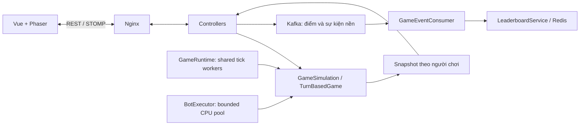

# Kiến trúc và cách mở rộng game

## Luồng đang triển khai



Đây là một ứng dụng có module, chưa phải microservices. Tách service theo nhu cầu đo được, không tách mỗi lớp thành một container.

## Trách nhiệm

| Thành phần | Trách nhiệm |
|---|---|
| Controller | Nhận payload, vào phòng, gọi game và phát snapshot |
| GameSimulation | Contract cho simulation realtime: player, tick, snapshot theo viewer |
| SnakeGame / TankGame | Luật, va chạm, spawn, item; không gọi Kafka/WebSocket |
| GameRuntime | Tick worker dùng chung; giới hạn số trận; hàng đợi output có giới hạn |
| BotExecutor | Pool CPU riêng cho tìm nước cờ, queue 32 công việc |
| TurnBasedGameRegistry | Khởi tạo game theo module đăng ký; không cần sửa switch trong service |
| BoardGameModules | Đăng ký factory cờ vua/cờ tướng |
| InterestArea | Vùng dữ liệu được phép gửi quanh viewer |
| SpatialIndex | Chia ô để kiểm tra va chạm thân rắn gần đầu rắn |
| Kafka / LeaderboardService | Điểm bất đồng bộ, chống áp dụng lại cùng sự kiện |

Mỗi tick và snapshot đọc/ghi simulation thông qua khóa của game. Một worker chỉ chạy một callback của một trận tại một thời điểm. Input là trạng thái mới nhất, không tạo một task tìm đường hay task simulation cho mỗi phím bấm. Output chậm không tạo thêm vô hạn snapshot: chỉ giữ một tác vụ output đang chờ/chạy cho mỗi room, các bản trung gian được bỏ.

Vòng lặp không còn dùng `new Thread()` cho mỗi room. Khi room biến mất hoặc không còn người thật, callback dừng và giải phóng slot. Room chỉ còn bot được dọn định kỳ. Simulation đang chờ nhưng room đã bị xóa qua REST cũng được giải phóng định kỳ; bản cờ đã xóa được loại khỏi danh sách chờ bot. Một callback cũ không được phép hủy lịch của trận mới sau restart.

## Thêm game theo lượt

1. Viết lớp luật Java thuần, triển khai `TurnBasedGameService.TurnBasedGame`.
2. `moveType()` trả về DTO input, không nhận tọa độ chưa kiểm tra rồi thay đổi bàn cờ trực tiếp.
3. `makeMove()` kiểm tra lượt, nước đi, trạng thái đã kết thúc.
4. `getState()` trả về snapshot tách khỏi object đang bị thay đổi; với game thông tin bí mật cần contract snapshot theo viewer, không dùng chung state công khai.
5. Đăng ký bean `TurnBasedGameRegistry.Definition` trong module riêng, ví dụ:

```java
@Bean
Definition connectFour() {
    return new Definition(GameType.CONNECT_FOUR, ConnectFourGame::new);
}
```

6. Bổ sung enum GameType, GameSettings, DTO frontend, router/view và điều hướng RoomView.
7. Viết test luật trước, sau đó test hai player cùng phòng. Chạy bot trong BotExecutor nếu tính toán nặng.

Registry giúp bỏ nhánh `instanceof` khi chuyển payload và switch khởi tạo trong service. Các enum/settings/UI vẫn cần đăng ký loại game mới; đây không phải hệ thống plugin tự khám phá mọi thể loại game.

## Thêm game realtime

1. Triển khai `GameSimulation<S>` với kiểu snapshot riêng.
2. Controller nhận input và lưu trạng thái điều khiển mới nhất. Tách luật khỏi giao thức STOMP.
3. Đăng ký callback với `GameRuntime.start(roomId, tickMs, tick)`; xử lý trường hợp bị từ chối vì hết slot.
4. Đọc simulation trong khóa của game; không làm network/DB chậm trong tick.
5. Dùng `runtime.publish()` để tạo/gửi snapshot; lọc InterestArea nếu thế giới lớn.
6. Gửi sự kiện tổng hợp điểm khoảng mỗi giây; không gửi mọi tọa độ qua Kafka.

Hai controller realtime vẫn có phần lifecycle tương tự nhau. Có thể tách thành RoomSessionService khi thêm thể loại thứ ba; chưa ép Tank và Snake dùng chung một DTO input vì luật khác nhau.

## Mở rộng nhiều backend: bước sau

Cần thiết kế room owner (`roomId -> backendId`), route người trong cùng room về owner, heartbeat/lease cho owner và quy trình recovery. Redis lưu room không làm bộ nhớ simulation tự chia sẻ. Kafka partition không đảm bảo consumer xử lý sự kiện ở đúng node đang sở hữu game.

Trước khi có room ownership, chỉ scale frontend và giữ một backend có admission limits. Bước tiếp theo là auth/session ownership, command sequence/ack, snapshot checkpoint, metric tick p95 và profiling CPU/GC.
