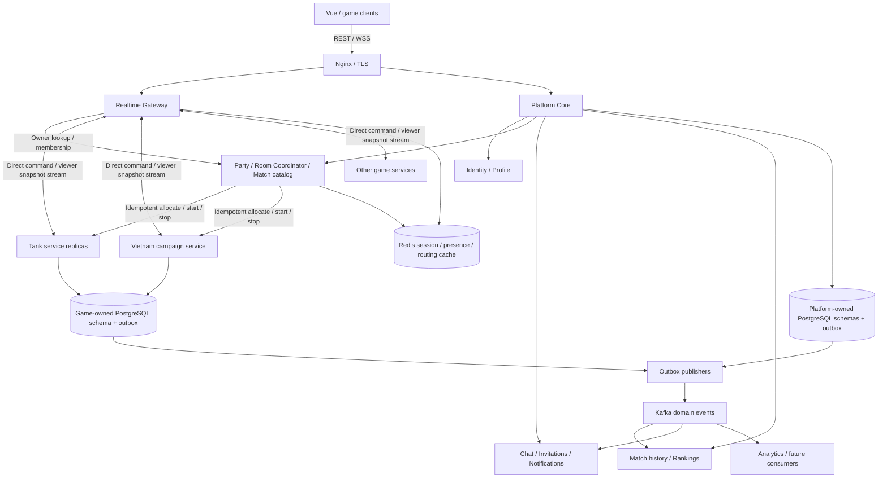

# Kế hoạch kiến trúc BRIM

Ngày: 19/10/2026. Trạng thái: đề xuất để thống nhất hướng phát triển; chưa phải kiến trúc đã triển khai.

## 1. Quyết định kiến trúc đề xuất

BRIM là nền tảng mini-game multiplayer: người chơi có danh tính lâu dài, lập nhóm, mời bạn, chuyển giữa nhiều game, lưu tiến trình và cạnh tranh theo thể loại.

**Hướng đích: mỗi game có ranh giới nghiệp vụ và khả năng deploy độc lập; Kafka phân phối sự kiện nghiệp vụ giữa các thành phần. Triển khai dần từ backend hiện tại, bắt đầu với Platform Core và một game service thí điểm.**

“Mỗi game một service” không có nghĩa mỗi room một container, mỗi game một Kafka cluster, hay mọi thao tác đều đi qua Kafka. Một instance game service xử lý nhiều trận; các replica của cùng service chia room theo cơ chế ownership. Các game ít tải có thể tiếp tục chạy chung một deployment trong thời gian đầu, nhưng không đọc trực tiếp trạng thái nội bộ của nhau.

Kafka là event backbone. Room Coordinator chịu trách nhiệm điều phối vòng đời trận và cấp owner. Game service quyết định luật, tick, kết quả và snapshot. Gateway quản lý kết nối và chuyển lệnh tới đúng owner.

| Quyết định | Lựa chọn ban đầu | Khi nào xem xét lại |
| --- | --- | --- |
| Kiểu kiến trúc | Modular monolith cho nền tảng + tách game từng bước | Khi một module có nhu cầu scale/release hoặc miền lỗi độc lập |
| Đơn vị tách đầu tiên | Tank service; giữ chế độ Classic và Assault trong cùng service | Sau khi chứng minh được routing, reconnect và result pipeline |
| Giao tiếp điều khiển | REST nội bộ cho cấp trận; stream hai chiều cho input/snapshot | Chọn giao thức cụ thể sau spike và đo p95 |
| Kafka | Domain events, kết quả, thông báo, projection, analytics | Không đưa input realtime qua broker nếu chưa có lý do được đo |
| Dữ liệu lâu dài | PostgreSQL | Chỉ thêm loại lưu trữ khác khi có truy vấn/tải cụ thể |
| Redis | Session, presence, cache routing, rate limit, leaderboard projection | Không dùng Redis như bộ nhớ simulation dùng chung giữa replica |
| Deployment | Docker Compose cho dev/pilot | Kubernetes hoặc nền tảng tương đương khi cần vận hành nhiều replica và đội có năng lực quản trị |

## 2. Hiện trạng trong repository

Đối chiếu [ARCHITECTURE.md](ARCHITECTURE.md), mã nguồn runtime/transport/security và cấu hình Compose tại thời điểm viết:

- Một backend Spring Boot giữ simulation trong RAM. `GameRuntime` dùng tick workers, output workers và admission limits; chưa có phân quyền sở hữu room giữa các process.
- Snake/Tank có controller realtime riêng. Các game theo lượt dùng `TurnBasedGameRegistry`; Bomberman và Dấu chân Việt dùng contract này với tick realtime 100 ms. Tên `TurnBasedGame` hiện bao gồm cả game realtime, cần làm rõ trước khi công bố SDK.
- REST và STOMP đã kiểm tra guest identity phía server, quyền room và subscription. Đây là nền tảng tốt, nhưng chưa có tài khoản lâu dài; các map session/connection cục bộ chưa tự hoạt động trên nhiều instance.
- WebSocket dùng Spring simple broker trong process. Tăng replica không tự phân phối snapshot hay `/user` messages tới đúng kết nối.
- Kafka đang phục vụ điểm và một số event; có đường chuyển nước đi game theo lượt qua Kafka cho mục đích học. Consumer group hiện không đồng nghĩa consumer sẽ sở hữu room nhận được.
- Redis giữ room metadata, bảng điểm và tiến trình theo guest. `LeaderboardService` đã có dedup bằng Lua với TTL; cơ chế này không thay thế sổ kết quả lâu dài hoặc chống nhận thưởng lại sau thời gian TTL.
- Có khai báo PostgreSQL trong hạ tầng/dependencies; các luồng tài khoản, lịch sử trận và tiến trình cần thiết kế persistence cụ thể, không suy ra rằng đã có đủ chỉ từ cấu hình.
- Gửi Kafka sau khi đổi RAM/Redis và chỉ log lỗi gửi chưa bảo đảm giữ được kết quả khi process chết. Chưa có transactional outbox cho kết quả trận.

Đây là bản thiết kế tương lai. Các tên API, event, bảng và SLO dưới đây là đề xuất, không mô tả contract đang tồn tại.

## 3. Sơ đồ hướng đích



`GameDB` trên sơ đồ biểu thị vùng dữ liệu do từng service sở hữu, không phải cho phép các game dùng chung bảng. Ban đầu có thể dùng cùng một PostgreSQL cluster, schema và DB role riêng. Không có foreign key xuyên service, không truy vấn chéo schema từ code ứng dụng.

Gateway và các module Platform Core có thể nằm trong cùng binary/deployment lúc thí điểm. Sơ đồ phân chia trách nhiệm, không yêu cầu triển khai ngay một container cho mỗi ô. Dữ liệu simulation realtime vẫn nằm trong RAM của owner; PostgreSQL/outbox dành cho kết quả, checkpoint và dữ liệu cần bền vững.

### Ranh giới trách nhiệm

| Thành phần | Sở hữu | Không sở hữu |
| --- | --- | --- |
| Identity | User ID, tài khoản, credentials hoặc liên kết OIDC, session/revocation, liên kết guest | HP, luật game, thứ hạng riêng từng trận |
| Party / Room Coordinator | Party, lời mời, membership, room visibility, admission, allocation, owner lease/epoch | Tick và nước đi hợp lệ của game |
| Gateway | WebSocket, xác thực kết nối, rate limit, định tuyến, backpressure | Kết quả, phần thưởng, luật game |
| Mỗi game service | Match simulation, rules version, bot, snapshot riêng từng viewer, kết quả gốc, tiến trình/nâng cấp riêng game | Session đăng nhập, friend graph, dữ liệu game khác |
| Match history / Rankings | Tiếp nhận và xác nhận kết quả, lịch sử, rating theo game/mode/season | Suy luận thắng thua từ điểm client gửi |
| Chat / Notifications | Hội thoại, message history, delivery/read state, notification preferences | Input/tick của trận |
| Profile | Hồ sơ chung và bản tổng hợp thành tích từ sự kiện | Tự sửa trực tiếp inventory/checkpoint riêng game |

Mô hình dữ liệu phân biệt `partyId` (nhóm bạn), `roomId` (sảnh tổ chức), `matchId` (một lượt chơi), `playerId` (danh tính) và `connectionId` (một kết nối). Chơi lại tạo `matchId` mới. Không tiếp tục dùng roomId làm định danh cho mọi lượt và mọi lần trả thưởng.

## 4. Hai luồng giao tiếp

### 4.1. Gameplay cần phản hồi nhanh

```text
Browser → authenticated Gateway → current owner của match → game engine
Browser ← Gateway ← snapshot đã lọc theo viewer / command ACK ← owner
```

Input di chuyển/bắn không đi qua Kafka. Tick không chờ Kafka, truy vấn DB, gửi notification hoặc gọi game khác. Việc ghi kết quả/checkpoint chạy ngoài tick; trạng thái hoàn thành được giữ là `FINALIZING` cho đến khi đã ghi bền vững.

- Realtime: thay thế ý định di chuyển cũ bằng input mới; giữ các discrete action như bắn một lần, reload, tương tác theo chính sách riêng để không mất thao tác khi gộp input.
- Game theo lượt: mỗi command có `commandId`, `expectedRevision`; owner chấp nhận một lần, trả ACK và revision mới. Retry cùng command trả cùng kết quả, không đi thêm một nước.
- Snapshot có `matchId`, `ownerEpoch`, `revision` hoặc `tick`, `lastAppliedInputSeq`, `protocolVersion`. Client bỏ snapshot cũ, reconnect nhận full snapshot trước khi dùng delta.
- Gateway ràng buộc người gửi bằng session đã xác thực. Game kiểm tra context nội bộ được tin cậy, membership/seat, epoch và luật; không tin `playerId` tự khai trong payload browser.
- Dữ liệu bí mật được lọc tại game service. Gateway chỉ chuyển snapshot dành cho đúng viewer, không nhận full state rồi giao browser tự ẩn. Áp dụng cả reconnect, spectator, game-over và replay.
- Giới hạn queue theo kết nối/room. Snapshot trung gian có thể bỏ; ACK, terminal state và action không được âm thầm bỏ. Kết nối quá chậm được resync hoặc đóng có mã lỗi rõ ràng.

Hợp đồng nội bộ có thể dùng HTTP cho lifecycle và gRPC streaming cho gameplay. Lựa chọn gRPC là phương án thí điểm, cần đo khả năng batching/fan-out; không tạo một stream mạng mới cho mỗi phím bấm. Tránh làm SDK chứa luôn Spring Controller, KafkaTemplate hoặc RedisTemplate.

### 4.2. Sự kiện nghiệp vụ

```text
Game kết thúc
→ Game DB: match result + outbox, cùng transaction
→ Outbox publisher → Kafka: MatchCompleted
→ Platform xác nhận result và ghi history + outbox: MatchFinalized
→ Kafka → rating / achievement / notification / profile projections
```

`MatchCompleted` là kết quả game báo cáo; `MatchFinalized` là kết quả platform đã chấp nhận. Platform kiểm tra game/service identity, match allocation, roster, rules version, result revision và owner epoch hợp lệ. Unique constraint bảo đảm một kết quả canonical cho một match; gửi lại cùng event không cộng điểm lần nữa. Sự kiện cũ đã được commit hợp lệ trước lúc owner đổi cần được đối chiếu với lịch sử allocation; không đơn giản so với cache epoch mới nhất rồi loại nhầm kết quả.

Nguồn kết quả phải được xác thực: pilot dùng topic kết quả theo game, producer principal riêng và Kafka ACL; result ingestion đối chiếu topic được broker bảo vệ với gameId trong allocation. Không tin trường `producer` tự khai. Nếu sau này gộp kết quả vào shared topic, cần cơ chế xác thực nguồn tương đương, chẳng hạn chữ ký event hoặc trusted ingress; schema validation không thay thế xác thực service.

Profile tổng hợp, rating và phần thưởng cấp nền tảng dùng `MatchFinalized`. Tiến trình riêng game được game cập nhật bền vững cùng kết quả/receipt. Với ranked/reward-bearing match, chỉ công bố tiến trình thưởng sau khi kết quả được chấp nhận; cơ chế đó phải được kiểm thử trước khi bật ranked cho game vừa tách. Màn offline/solo có thể chấp nhận kết quả nội bộ theo chính sách riêng, không tự đổi thành rating multiplayer.

Một trận có thể hiển thị “đã kết thúc, đang đồng bộ kết quả” khi pipeline nền chậm. Các service không được gọi nối tiếp nhau thành chuỗi bắt buộc để trả snapshot.

## 5. Kafka: topic, ordering và độ tin cậy

### Topic khởi đầu

| Topic đề xuất | Producer | Key | Consumer group độc lập |
| --- | --- | --- | --- |
| `brim.identity.events.v1` | Identity | `playerId` | Profile, notification provisioning |
| `brim.room.events.v1` | Room Coordinator | `roomId` | Presence projection, notifications, analytics |
| `brim.match.results.<gameId>.v1` | Game tương ứng | `matchId` | Result ingestion |
| `brim.match.finalized.v1` | Result ingestion | `matchId` | History projection, rating ingestion, achievement, notification |
| `brim.social.events.v1` | Chat / invitation modules | `conversationId` hoặc `invitationId`, theo event | Notification, analytics |
| `brim.progress.events.v1` | Game progression modules | `playerId` | Profile summary, achievement |

Đây là tập topic theo miền và yêu cầu xử lý. Topic kết quả tách theo game ngay khi có service độc lập để broker ACL ràng buộc danh tính producer; các topic khác chỉ tách theo game khi cần ACL, retention, throughput hoặc consumer độc lập. Không tạo topic cho từng room, player hoặc match. Room invitation chỉ chứa metadata cần thiết, không đẩy bí mật invite token lên event bus.

Envelope ví dụ, dùng tên contract độc lập với Java class:

```json
{
  "eventId": "uuid",
  "eventType": "MatchCompleted",
  "schemaVersion": 1,
  "occurredAt": "2026-10-19T03:00:00Z",
  "producer": "tank-service",
  "aggregateId": "match-uuid",
  "aggregateVersion": 12,
  "correlationId": "trace-or-request-uuid",
  "causationId": "previous-event-or-command-uuid",
  "data": {
    "matchId": "match-uuid",
    "roomId": "room-uuid",
    "gameId": "tank",
    "mode": "classic",
    "rulesVersion": "tank-rules-1",
    "ownerEpoch": 7,
    "resultRevision": 1,
    "participants": [{ "playerId": "player-uuid", "outcome": "WIN" }],
    "endedAt": "2026-10-19T03:00:00Z"
  }
}
```

Các quy tắc bắt buộc:

1. Kafka consumer groups truyền thống giữ ordering theo partition; key ổn định giúp gom một aggregate vào cùng partition. Không có ordering toàn cục hoặc ordering giữa các topic. Partition tăng thêm có thể thay đổi ánh xạ key; thay partition phải có kế hoạch cutover cho event đang chạy. Consumer xử lý song song vẫn phải giữ thứ tự theo aggregate nếu luật phụ thuộc thứ tự. [Nguồn: thiết kế Apache Kafka](https://kafka.apache.org/35/design/design/).
2. Không dùng consumer assignment làm room ownership. Rebalance của Kafka và việc chuyển một simulation đang chạy là hai quy trình khác nhau.
3. Mỗi loại subscriber cần consumer group riêng. Các replica notification chia cùng notification group; rating và notification không dùng chung group nếu cả hai phải nhận sự kiện.
4. Mặc định thiết kế cho at-least-once. Outbox publisher có thể gửi trùng khi chết giữa publish và mark-sent. Consumer có inbox/receipt unique `(consumerName,eventId)` và cập nhật nghiệp vụ cùng transaction, commit offset sau khi transaction thành công.
5. Kafka transactions/idempotent producer không tự tạo exactly-once cho ghi PostgreSQL/Redis hoặc gọi dịch vụ ngoài. Chống trùng còn cần khóa nghiệp vụ, ví dụ unique `matchId`, `rewardGrantId`, `notificationSourceId`. [Nguồn: phạm vi semantics của Kafka](https://kafka.apache.org/35/design/design/).
6. Polling outbox trong giai đoạn đầu là đủ: row locking, stable event ID và giữ thứ tự theo aggregate. Cân nhắc Debezium CDC khi số lượng publisher/outbox và tải vận hành đáng kể; không cài thêm Kafka Connect chỉ để có tên công nghệ. [Tham khảo Debezium Outbox Event Router](https://debezium.io/documentation/reference/stable/transformations/outbox-event-router.html).
7. Retry có giới hạn, exponential backoff, DLT và cảnh báo. Chuyển một event sang retry topic/DLT có thể phá ordering; consumer phụ thuộc thứ tự phải chặn/quarantine aggregate lỗi hoặc reconcile bằng version, không mặc định xử lý tiếp như chưa có gì xảy ra. Re-drive giữ nguyên eventId và có audit.
8. Rating cần quy tắc thứ tự riêng: event key `matchId` không xếp thứ tự mọi trận của cùng player. Bản đầu serialize updates theo `(gameId,mode,seasonId)` và dùng canonical `finalizationSequence` trong miền đó. Chỉ tăng concurrency sau khi có partition strategy/rating algorithm bảo đảm cập nhật chung hai người an toàn. Điểm daily cộng dồn độc lập với Elo/Glicko.
9. JSON Schema là đủ cho pilot; CI kiểm tra backward compatibility. Schema registry là lựa chọn triển khai sau. Không dùng Java serialization/type headers nội bộ làm contract liên service lâu dài.
10. Retention, partition count và replication được chọn bằng tải và RPO đo được. Compose hiện tại là môi trường dev một broker/replication 1, không phải topology HA production. Không nâng Kafka/framework trong cùng đợt tách game đầu tiên nếu chưa cần.

Kafka không tự chạy saga, rollback hay quyết định bù trừ. Nếu start-match cần nhiều bước, Room Coordinator lưu state machine/saga và timeout; Kafka chỉ truyền sự kiện tiến triển của quy trình đó.

## 6. Ownership, start-match và reconnect

### State machine và cấp trận

Room: `OPEN → ALLOCATING → IN_MATCH → OPEN/CLOSED`. Match: `ALLOCATING → READY → RUNNING → FINALIZING → COMPLETED`, với nhánh `ABORTED`/`INTERRUPTED` có reason.

1. Host gửi Start với idempotency key. Coordinator xác nhận membership, ready state, mode, capacity; transaction tạo match/roster và reservation. Chặn hai Start đồng thời bằng constraint/version.
2. Chọn một game instance còn capacity, gọi `AllocateMatch` với `matchId`, roster, rules version, `allocationId`, `ownerEpoch`. Retry cùng allocation không tạo simulation thứ hai.
3. Game reserve slot và trả ready. Coordinator commit assignment, cấp join ticket ngắn hạn, thông báo client. Chỉ chuyển RUNNING khi quyền sở hữu và ready state đã xác nhận.
4. Nếu call timeout, query trạng thái allocation bằng ID trước khi retry. Reservation có expiry, compensation `ReleaseAllocation` idempotent và job reconcile để dọn room/slot mồ côi.
5. Lease/heartbeat theo instance có danh sách match, hoặc batch renew; tránh ghi DB riêng cho mọi tick của mọi room. Authority nằm trong PostgreSQL bằng transaction/CAS; Redis chỉ cache route. Số lần renew và expiry phải được đo trước khi chốt TTL.

Ownership record tối thiểu: `matchId, gameId, instanceId, ownerEpoch, leaseUntil, status, rulesVersion, checkpointRef`. Epoch tăng mỗi lần cấp lại owner; routing cache được invalidate sau assignment commit. Không dựa vào sticky session của load balancer để quyết định quyền ghi.

Lease phải có fencing: owner mất lease dừng nhận command/tick; gateway/client bỏ output epoch cũ; checkpoint/result sink kiểm tra quyền ghi bằng authority/conditional version, không chỉ tin số epoch process tự gửi. Timeout mạng, clock assumptions và process pause phải nằm trong fault test. Một khóa Redis có TTL riêng lẻ không đủ để chứng minh chỉ có một owner ghi dữ liệu. [Redis cũng khuyến nghị fencing tokens khi thiết kế distributed locks](https://redis.io/docs/latest/develop/clients/patterns/distributed-locks/).

### Reconnect

- `playerId` không đổi giữa REST và WebSocket; `connectionId` đổi khi reconnect. Xác định một controller connection cho một seat, còn các tab khác read-only hoặc bị thay thế có thông báo.
- REST session dùng cookie Secure/HttpOnly, CSRF cho REST và STOMP CONNECT như nền hiện tại. Khi nhiều gateway, dùng Spring Session Redis hoặc cơ chế session tập trung tương đương; những map authorization local phải được rehydrate/revalidate trên gateway mới.
- Browser lấy join ticket có `audience`, `matchId`, `playerId`, seat, session version, epoch và expiry; service xác minh context từ gateway qua mTLS/service identity. Ticket không nằm trên URL/log công khai; không dùng ticket tồn tại lâu làm thay thế revocation/logout.
- Sau reconnect: xác thực lại → kiểm tra membership và logout/revocation → resolve owner hiện tại → lấy full snapshot riêng viewer và last applied command/input → tiếp tục từ sequence hợp lệ. Không replay hàng loạt input di chuyển đã hết hạn.
- Mất socket chỉ làm player disconnected/presence lease; game áp dụng grace period theo thể loại. Logout, kick, rời phòng chủ động là quyết định riêng và phải thu hồi quyền gửi/subscribe, kể cả kết nối cũ đang mở.

### Kết nối khi nhiều instance

Chọn cho pilot: gateway giữ browser WebSocket, chuyển trực tiếp command và snapshot trên stream tới owner. Mỗi owner biết các viewer đang theo dõi match; snapshot đi tới đúng gateway/connection. Nhiều gateway không dùng chung simple broker trong RAM để broadcast toàn cụm.

Chat/notification cross-gateway có thể dùng routing theo user connection hoặc STOMP broker relay sau một spike riêng. Nếu dùng Redis Pub/Sub cho wake-up thì coi là tín hiệu không bền; client vẫn lấy notification chưa đọc từ DB. Kafka consumer group không tự phát một notification tới mọi gateway đang có kết nối của người nhận.

Spring xác định simple broker không phù hợp clustering; broker relay và user-destination routing là các lựa chọn cần cấu hình riêng. Kafka không phải STOMP broker relay. [Spring external broker](https://docs.spring.io/spring-framework/reference/web/websocket/stomp/handle-broker-relay.html), [Spring user destinations](https://docs.spring.io/spring-framework/reference/web/websocket/stomp/user-destination.html). Các trang này mô tả cơ chế; BRIM vẫn cần kiểm tra API đúng phiên bản Spring đang dùng trước khi triển khai.

## 7. Dữ liệu, tài khoản và khôi phục

### Quyền sở hữu dữ liệu

| Miền | PostgreSQL bền vững | Redis / object storage |
| --- | --- | --- |
| Identity | users, identities, guest-account links, consent/account lifecycle | Session/revocation cache |
| Rooms | parties, invites, room members, matches, allocations/epochs | Presence, admission counters, owner lookup cache |
| Kết quả | accepted match results, participants, reward receipts, rating updates | Leaderboard sorted sets là projection có thể rebuild |
| Social | chat messages, invitations, notifications, read cursors | Online presence, delivery wake-up |
| Mỗi game | results/outbox, campaign progress, inventory/upgrades, checkpoint index | RAM cho live state; object storage cho checkpoint/replay lớn |

Một PostgreSQL cluster có nhiều schema/role vẫn có ranh giới sở hữu; chưa cần mua/vận hành một DB instance cho từng game. Mọi schema migration có owner và version. Không duy trì kết nối DB chéo để game đọc bảng user hoặc platform sửa bảng progress của game.

### Chuyển guest sang tài khoản

Giữ `playerId` ổn định nếu có thể khi nâng guest thành tài khoản. Nếu cần liên kết hai danh tính, lưu mapping/audit, yêu cầu chứng minh quyền sở hữu cả hai và chuyển dữ liệu bằng tác vụ idempotent. Không cho client nhập guestId tùy ý để nhận tiến trình.

Trước khi đổi key Redis hiện tại, có migration read-old/write-new có thời hạn và đối soát. Warlords/Vietnam/puzzle cần receipt và policy merge riêng: màn đã mở lấy hợp nhất phù hợp; tiền/vật phẩm không cộng mù hai hồ sơ; rating không tự gộp. PostgreSQL trở thành nguồn chính cho dữ liệu tích lũy; Redis leaderboard/progress cache có thể tạo lại.

### Owner chết hoặc server restart

- **Ban đầu:** đánh dấu match INTERRUPTED, không tính thua/ranked và không trả thưởng sai; history giải thích lý do. Đây là hành vi có kiểm soát, không hứa khôi phục trận khi chưa có checkpoint.
- **Theo lượt:** checkpoint sau mỗi nước đã chấp nhận, lưu command log, seed/RNG state, timers và rules version. Chỉ ACK “đã lưu” sau khi trạng thái/command cần thiết đã bền vững.
- **Realtime:** checkpoint định kỳ ngoài tick, immutable snapshot và độ trễ tối đa được đo. Muốn RPO thấp hơn checkpoint interval cần durable command/event log phù hợp. Redis room metadata hoặc Kafka domain events không đủ dựng lại mọi viên đạn/tọa độ.
- Khi failover: fencing owner cũ → reserve owner mới → restore checkpoint tương thích → reconcile timers/last input sequence → cấp epoch mới → resync client. Không để hai engine cùng ghi state kết quả.
- Khi rules/build không tương thích hoặc checkpoint hỏng: chuyển INTERRUPTED, có audit và chính sách hoàn trả. Không cố khôi phục bằng phiên bản code khác mà không có migration.

Replay và recovery là hai mục tiêu khác nhau. Replay theo lượt cần initial state + accepted commands + seed + rules version. Replay realtime cần giải quyết clock, RNG và tính xác định hoặc lưu state frames; không mặc định “có Kafka là có replay”.

## 8. Lộ trình bốn giai đoạn

Metrics tối thiểu, log có correlation và CI smoke được làm ngay từ giai đoạn 1 để biết hệ thống có hoạt động. Giai đoạn 3 đầu tư sâu vào tải và fault tolerance; không đợi đến đó mới có logging/CI.

### Giai đoạn 1 — Nền tảng người chơi và hợp đồng game

**Mục tiêu:** người chơi quay lại với cùng danh tính, vào đúng room và thấy lịch sử đáng tin cậy.

1. Tài khoản: chọn local credentials hoặc OIDC theo nhu cầu sản phẩm; định nghĩa stable playerId, guest upgrade, logout/revocation và session tập trung.
2. Tách module Identity, Room/Party, Match History và Game Hosting trong backend hiện tại. Đưa Room Coordinator interface, `matchId`, command/event envelope và game catalog vào code trước khi tách process.
3. Room private/unlisted/public, invite có expiry và quyền; mọi REST, SEND, SUBSCRIBE, final snapshot và reconnect được kiểm tra quyền.
4. Reconnect có ACK/sequence/full snapshot, grace policy và kiểm soát tab/session.
5. Lịch sử trận canonical trong PostgreSQL; progress theo account; result outbox + consumer inbox/unique business keys.
6. Chuẩn hóa game adapter và tests; Tank là pilot nhưng chưa chuyển tất cả game ra ngoài.

**Điều kiện hoàn thành:** cùng account có cùng dữ liệu sau đăng nhập lại/restart; giả mạo identity và đọc state người khác bị chặn; retry Start không tạo hai trận; reconnect/duplicate command không làm hành động hai lần; một kết quả chỉ trả thưởng một lần. Cần demo với hai browser và một test tự động cho mỗi luồng.

### Giai đoạn 2 — Giữ chân người chơi và tách service đầu tiên

**Game trọng tâm đề xuất:** Tank Classic cho multiplayer realtime và Connect Four cho ranked theo lượt. Dấu chân Việt/Warlords tập trung progression và nội dung, chưa dùng chung rating với game đối kháng.

- Chat room có quyền, rate limit và history; notification in-app có unread state/lời mời.
- Party cùng vào phòng; matchmaking cho một game trước, có cancel/accept timeout và kiểm tra allocation lại khi ready.
- Stats, achievements, leaderboard; ranked tách theo game/mode/rules/season. Không cộng điểm mọi thể loại thành một rating chung.
- Mobile input, onboarding, tutorial và đo tỷ lệ vào được trận/hoàn thành tutorial.
- Tách Tank service; triển khai ít nhất hai replica trong môi trường kiểm chứng ownership, một gateway/core ban đầu.
- Kafka dùng outbox cho match results và event cần bền vững. Notification chỉ là consumer của cùng domain contract, không có logic trả thưởng rải rác.

**Điều kiện hoàn thành:** Tank có thể release/scale riêng mà không đổi core; hai người ở hai gateway vẫn vào cùng owner và nhận đúng state; luồng invite → join → ready → start → reconnect → result có test; chat chậm hoặc notification lỗi không kéo chậm tick. Ranked chỉ bật sau khi chống trùng và xử lý interrupted match được chứng minh.

### Giai đoạn 3 — Độ tin cậy, tải và vận hành nhiều instance

- Dashboard latency, input age, tick duration/overrun, CPU, heap/GC, rooms/connections, output queue, disconnect/reconnect, DB pool, outbox age, Kafka lag/DLT.
- Load test theo workload riêng từng game: room size, tick rate, số entity, bot difficulty và snapshot bandwidth. Công bố hardware/build/dataset, không chỉ báo “hỗ trợ N CCU”.
- CI backend/frontend, contract compatibility, migration, two-browser multiplayer, secrets/dependency checks; staging fault drills.
- Recovery trước cho game theo lượt; realtime dùng checkpoint sau khi benchmark chi phí. Room ownership/epoch là điều kiện bắt buộc trước khi chạy nhiều game replica có người thật, không trì hoãn đến cuối giai đoạn này.
- HA/durability cho DB/Kafka/Redis theo RPO/RTO được chốt; backup và restore drill; deployment drain để không cắt trận đang chơi.
- Tách gateway hoặc notification khi tải/miền lỗi cho thấy cần. Không gắn release mọi service với cùng một shared Java domain model.

**Điều kiện hoàn thành:** có benchmark và capacity plan; fault test owner chết/lease hết hạn/consumer retry không sinh double result; restore drill đạt mục tiêu; rolling deploy không cấp thêm match vào instance đang drain; quá tải trả lỗi có kiểm soát thay vì queue vô hạn.

### Giai đoạn 4 — Nội dung và hệ sinh thái

- Tách thêm Vietnam/Warlords/các game khác khi ranh giới dữ liệu và khả năng release đã rõ. Mỗi game có pipeline rules/assets và bộ test riêng.
- Tournament/event trên `MatchFinalized`, có bracket state machine và retry, không đọc RAM game.
- Season: rating reset policy, rules version, phân loại game, kiểm toán thưởng, chặn thay đổi kết quả sau khi chốt mùa nếu chưa có quy trình điều chỉnh.
- Replay game theo lượt trước; spectator phải tôn trọng hidden information và độ trễ chống lợi dụng.
- Công cụ cấu hình nội dung có schema/validation và review/publish version. Game logic cộng đồng chạy code tùy ý cần một thiết kế sandbox riêng; không tải plugin không tin cậy vào JVM đang giữ tài khoản/game chính.

**Điều kiện lựa chọn:** dựa trên retention, số trận, phản hồi và năng lực đội. Không coi toàn bộ mục giai đoạn 4 là cam kết triển khai.

## 9. Các bước triển khai đầu tiên có thể giao việc

Thứ tự đề xuất theo phụ thuộc; chưa gán lịch khi chưa rõ quy mô đội, CCU và ngân sách:

| Mã | Công việc | Kết quả review được | Phụ thuộc |
| --- | --- | --- | --- |
| A1 | Baseline/ADR: CCU, game priority, SLO, auth option | Dashboard baseline + quyết định phạm vi/account model | Không |
| A2 | Identity bền vững, guest migration, session/revocation | Account flow + migration + REST/WS auth tests | A1 |
| A3 | Party/Room/Match model, privacy, invites, Start idempotency | API/schema + hai-browser happy/negative paths | A2 |
| A4 | Game hosting contract, catalog, command ACK/revision | Một local adapter giữ hành vi game cũ | A3 |
| A5 | Durable result, outbox/inbox, history projection | Kill/retry test không mất result đã commit hoặc trả thưởng hai lần | A3–A4 |
| A6 | Reconnect owner lookup và full snapshot | Socket reconnect/logout/private-state tests | A2–A4 |
| A7 | Extract Tank + gateway stream + allocation epoch | Compose dev: core + tank replicas; không cần chuyển game khác | A4–A6 |
| A8 | Observability/load/fault gate cho Tank | Benchmark, fault report, runbook và rollback | A7 |
| A9 | Chat, notification, pilot matchmaking/ranked | Luồng giữ chân người chơi trên nền result canonical | A5–A8 |

A1 cần trả lời: CCU/room đồng thời dự kiến, vùng triển khai và độ trễ chấp nhận, team vận hành, ngân sách hạ tầng, chính sách account/guest, game nào thực sự có ranked. Đây là các biến thiết kế cần chốt trước khi sizing, không phải lý do chặn việc phân module/contract trong code hiện tại.

### SDK và cấu trúc repository dự kiến

```text
platform/
  identity/ rooms/ history/ social/ gateway/
games/
  tank/ vietnam/ warlords/ connect-four/ ...
contracts/
  http/ commands/ events/ snapshots/
game-sdk/
  lifecycle/ clock/ rng/ snapshot/ testkit/
deploy/
  dev/ staging/ production/
```

Giữ monorepo trước. SDK chứa interfaces/testkit, không chứa entity DB hay luật các game. Mỗi game dùng SDK version được pin và có build artifact riêng; không buộc deploy toàn hệ thống khi thêm field backward-compatible.

Lifecycle contract tối thiểu: `Allocate`, `Start`, `ApplyCommand`, `GetSnapshot(viewer)`, `Checkpoint`, `Restore`, `Stop`, `ReportResult`, `Drain`, với capability flags cho game chưa hỗ trợ restore/replay. Giữ adapter cho `GameSimulation` và contract hiện tại; dần tách realtime/turn-based capabilities thay vì đổi tên diện rộng trong một PR.

Cutover Tank theo cohort room mới bằng feature flag; match đã chạy tiếp tục trên owner/build cũ. Shadow chạy engine mới chỉ so sánh, không gửi snapshot hoặc thưởng. Rollback đưa room mới về adapter cũ; room trên service mới drain hoặc dùng policy INTERRUPTED, không giả định có thể copy RAM giữa hai build.

## 10. Mục tiêu đo lường và rủi ro

Các con số sau là **mục tiêu ban đầu để kiểm chứng**, không phải năng lực BRIM đã được đo. Đo riêng RTT Internet; latency xử lý nội bộ đo trong cùng vùng triển khai.

| Chỉ số | Mục tiêu khởi đầu |
| --- | --- |
| Tick duration p95 / p99 | < 50% / < 80% tick interval của game; cảnh báo overrun liên tục |
| Gateway nhận input → owner áp dụng, p95 | < 1 tick interval trong điều kiện tải đã công bố |
| Command ACK game theo lượt, p95 | < 200 ms nội bộ, không gồm bot search budget |
| Reconnect full state, p95 | < 3 giây khi owner còn sống và mạng đã phục hồi |
| Kafka result → history projection, p95 | < 5 giây trong trạng thái khỏe; UI báo pending khi vượt ngưỡng |
| Double reward/canonical result | 0 trong duplicate, retry, rebalance và failover tests |
| Mất kết quả đã commit DB | 0 trong fault envelope/backup policy đã công bố; RAM chưa commit không được tính là đã lưu |
| Cấp trận khi quá tải | Từ chối/đợi có timeout; không vượt queue/room limits |

Capacity phải báo theo game/mode: `CPU ≈ tổng tick cost + bot cost + serialization`, network theo số viewer × snapshot size × snapshot rate; còn phải tính RAM mỗi match, DB/outbox write rate và headroom GC. Dùng benchmark để tìm ngưỡng admission, không scale theo CPU đơn lẻ hoặc dùng một giá trị maxRooms cho mọi game.

| Rủi ro | Xử lý trong kế hoạch |
| --- | --- |
| Mỗi game một service làm tăng deploy, migration và on-call | Tách pilot, templates/contract tests, chỉ mở rộng sau khi đo |
| Kafka outage làm đứng gameplay | Tick độc lập, outbox giữ pending có giới hạn; dừng cấp trận có thưởng khi durable backlog vượt ngưỡng |
| Broker chậm/DB lỗi làm backlog vô hạn | Quota, disk/backlog alerts, admission/degradation policy, không bỏ result âm thầm |
| Double owner sau timeout/GC pause | Lease + fencing + authority kiểm tra kết quả/checkpoint + epoch tại gateway/client |
| Gửi lặp/sai thứ tự làm sai ranking | Inbox/business keys, result canonical, rating sequencing và reconcile |
| Session/guest migration làm mất hoặc nhân đôi progress | Stable identity, receipts, policy merge theo game và audit |
| Game có hidden information rò qua kênh chung/replay | Viewer filtering tại owner, subscription tests và policy replay riêng |
| Shared SDK phát triển thành monolith phân tán | Contract nhỏ, version pin, dữ liệu riêng, không import service implementation |
| Thêm game mới luôn sửa nhiều switch | Game catalog + capability metadata; loại bỏ enum coupling từng bước, giữ type safety phía client |

## 11. Các quyết định cần phê duyệt trước implementation lớn

1. Chấp nhận kiến trúc hướng đích: game services độc lập, Platform Core dùng chung; Kafka cho domain events, gameplay đi trực tiếp.
2. Chọn Tank làm service thí điểm và Connect Four làm ứng viên ranked; thay đổi được nếu ưu tiên sản phẩm khác.
3. Chọn mô hình account/guest và chính sách migration trước khi làm nhiều progression mới.
4. Chốt SLO/CCU/region/ngân sách để sizing và quyết định topology HA; chưa chốt số partition/replica hoặc lịch triển khai bằng phỏng đoán.
5. Chấp nhận delivery tăng dần: giai đoạn đầu xử lý match INTERRUPTED rõ ràng; phục hồi/replay là capability bổ sung có test.

Tài liệu này là kế hoạch để review; không yêu cầu chuyển toàn bộ game thành microservices trong một lần hoặc thay hạ tầng production ngay.
