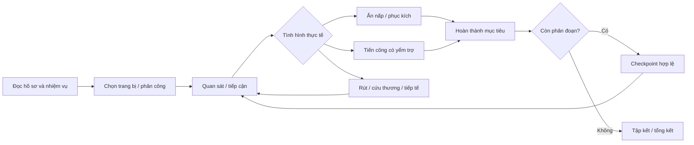
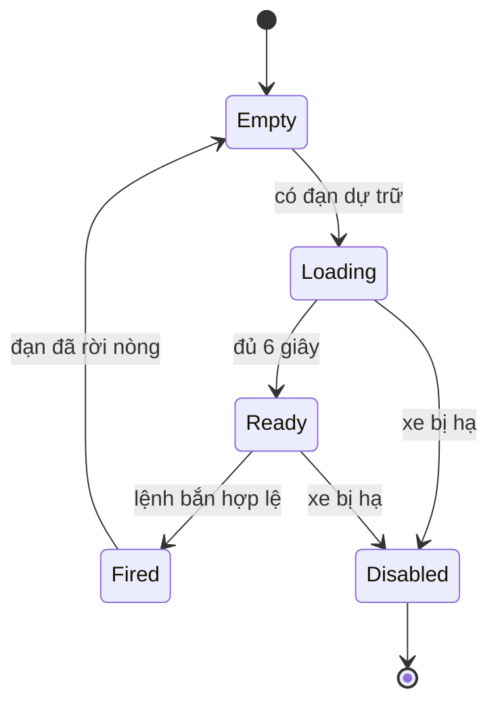

# Dấu chân Việt — đặc tả gameplay chiến thuật và kế hoạch triển khai

Ngày cập nhật: 19/10/2026. Trạng thái: **đặc tả đề xuất, chưa triển khai các cơ chế mới trong tài liệu này**.

Tài liệu dùng để triển khai tiếp từ bản chơi hiện có vào buổi chiều. Các thông số là giá trị khởi đầu để cân bằng bằng playtest, không phải thông số khí tài hoặc mô tả chiến thuật ngoài đời. Kế hoạch kiến trúc toàn nền tảng nằm tại [ARCHITECTURE_ROADMAP.md](ARCHITECTURE_ROADMAP.md).

Đọc để bắt đầu triển khai: mục **4–5** chốt luật và thông số; mục **11** chốt ranh giới code/contract; mục **13** chọn việc P0; mục **14** là tiêu chí test. Các phần vai trò và màn mới triển khai sau nền cơ chế.

## 1. Mục tiêu trải nghiệm

Người chơi cần cảm nhận sức nặng của khí tài, giới hạn tiếp tế, sự nguy hiểm khi lộ vị trí và trách nhiệm giữ đồng đội sống sót. Một màn phải có chuẩn bị, tiếp cận, xử lý tình huống, hoàn thành nhiệm vụ và rút/tập kết; không kết thúc chỉ vì đã đi qua vài điểm trên bản đồ.

Các lựa chọn cốt lõi:

- Bắn ngay để giải nguy hay giữ viên đạn cho mục tiêu quan trọng hơn?
- Đi nhanh qua khoảng trống hay vòng xa qua chiến hào/vật che?
- Đưa tank lên trước hay dùng bộ binh trinh sát?
- Giữ chốt, phục kích, tiến công hay rút về lấy tiếp tế?
- Tiếp tục nhiệm vụ với tổn thất hiện tại hay quay lại checkpoint?
- Ở vai chỉ huy: đặt mục tiêu và phân công; ở vai trực tiếp: tự di chuyển, quan sát, ngắm và thao tác.

Độ khó đến từ thông tin chưa đầy đủ, tài nguyên hữu hạn, vị trí và hậu quả. Tăng HP đơn thuần, tăng số địch vô hạn hoặc cho AI biết mọi vị trí không đáp ứng mục tiêu này.

### Dấu hiệu một bản triển khai đạt yêu cầu

1. Giữ chuột bắn không giúp bỏ qua thời gian nạp pháo.
2. Tank chịu được nhiều đòn nhưng không thể lao vào mọi tình huống mà không cần quan sát.
3. Giữ lực lượng ở vị trí che chắn tạo khác biệt đo được so với đi giữa đường trống.
4. Hết đạn/hỏng xe buộc người chơi thay đổi kế hoạch; đổi vai, reconnect hoặc tải lại không làm đầy tài nguyên.
5. Người chơi không được biết trước chính xác tâm nổ/phạm vi sát thương của viên đạn chưa tới đích.
6. Chỉ huy, bộ binh và dân quân phòng không có hành động, giới hạn và mục tiêu riêng; không chỉ thay skin.
7. Mỗi màn có ít nhất hai cách tiếp cận có thể hoàn thành, cùng một tuyến dự phòng khi tài nguyên giảm.

## 2. Phạm vi sản phẩm và hiện trạng

### 2.1. Hai sản phẩm liên quan

| Sản phẩm | Hướng phát triển | Phạm vi áp dụng |
| --- | --- | --- |
| Tank Battle / Classic | Giữ chế độ đối kháng cũ làm lựa chọn riêng | Không tự áp luật chiến dịch lịch sử vào Classic |
| Tank Battle / Assault | Bản chiến đấu tank có nhịp chậm, đạn hữu hạn, quan sát và tiếp tế | Thí điểm các cơ chế xe nặng, pháo nạp lâu, giới hạn thông tin |
| Dấu chân Việt | Game chiến dịch riêng ở `/vietnam`, loại phòng `VIETNAM_CAMPAIGN` | Nhập vai theo bối cảnh, chỉ huy tổ đội, tài nguyên xuyên phân đoạn, nhiệm vụ nhiều bước |

“Dân quân bắn máy bay” thuộc một màn riêng trong Dấu chân Việt. Không thêm máy bay hoặc bộ binh lịch sử vào mọi map Tank theo cách dùng chung một skin.

### 2.2. Đã có trong code trước đợt thay đổi này

- Ba màn: Điện Biên Phủ, Củ Chi và Tiến vào Dinh; một người chơi với đồng đội AI.
- Tick máy chủ 100 ms cho Dấu chân Việt; input chỉ là ý định, có hết hạn khi ngừng cập nhật.
- Mục tiêu nhiều bước, chui hầm giữa hai lớp ở Củ Chi, băng đạn và thao tác nạp đạn.
- Tank Assault có đạn nổ tại đích hoặc vật cản đầu tiên, sát thương lan giảm theo khoảng cách và tự sát thương.
- Bản đồ nhỏ, hồ sơ bối cảnh có nguồn, lưu màn đã mở theo phiên guest.
- Bản hiện tại còn nhanh, tài nguyên nạp lại chưa hữu hạn, AI đơn giản, vùng nổ còn được báo trước ở Tank, chưa có chế độ chỉ huy hoặc màn phòng không.

**Các tính năng từ mục 3 trở đi là đặc tả tương lai.** Không sửa tài liệu thành “đã có” cho tới khi code, test và playtest tương ứng hoàn tất.

### 2.3. Phần chưa làm trong lần đầu

Không triển khai đồng thời multiplayer co-op, tách microservice, mô phỏng giáp vật lý chi tiết, nội thất xe, toàn bộ khí tài lịch sử, nhiều tầng địa đạo chính xác hoặc hệ thống chiến dịch Việt Nam đầy đủ. Ranh giới code cần cho phép bổ sung dần các phần đó.

## 3. Vòng lặp chiến dịch và hành trình



### 3.1. Trước trận

Hồ sơ màn hiển thị:

- Thời gian, địa điểm, vai nhập và nguồn lịch sử.
- Nhiệm vụ chính, điều kiện thất bại và mục tiêu cần bảo vệ.
- Quân số, loại vũ khí, đạn mang theo, nhiên liệu, thuốc và dụng cụ sửa chữa.
- Tin tình báo có mức độ chắc chắn: vị trí đã xác nhận, khu vực nghi có địch, tuyến chưa trinh sát.
- Địa hình quan trọng: đường chính, đường vòng, chiến hào, điểm tiếp tế, cửa hầm, nơi tập kết.

Không hiển thị danh sách/vị trí sống của mọi địch. Không bắt người chơi chọn trang bị mà code chưa có tác dụng khác biệt; loadout đầu tiên có thể cố định nhưng phải hiển thị đúng giới hạn.

### 3.2. Trong trận

Mục tiêu phải yêu cầu ít nhất một hành động có ý nghĩa ngoài di chuyển: trinh sát rồi ra lệnh, kiểm soát khu vực đủ thời gian, vận chuyển vật tư hữu hạn, giữ đồng đội, sửa xe, báo động/sơ tán hoặc bảo vệ trận địa.

Điểm tiếp tế là tài nguyên trong thế giới. Một hòm dùng hết không tự xuất hiện lại sau vài giây. Màn cần công bố hoặc gợi ý tuyến dự phòng; không âm thầm tạo thêm đạn khi người chơi gần thua.

### 3.3. Sau trận

Tổng kết ưu tiên nhiệm vụ và bảo toàn lực lượng:

- Mục tiêu hoàn thành, quân số trở về, dân đã sơ tán, vật tư còn lại.
- Số phát bắn, tỷ lệ trúng, tiếp tế đã dùng, số lần bị phát hiện và thời gian ngoài chỗ che.
- Cách tiếp cận đã dùng và lý do thất bại nếu có.
- Phần thưởng chỉ nhận một lần theo receipt; không thưởng lại bằng reload/checkpoint.

Không dùng số tiêu diệt làm điều kiện duy nhất cho mọi màn. Bảo vệ dân, vận chuyển và rút an toàn có thể đạt kết quả tốt hơn việc cố đánh hết quân địch.

## 4. Bộ thông số khởi đầu

Đơn vị khoảng cách là **world unit**, không ghi là mét. Thời gian tính bằng giây trong cấu hình; simulation chuyển sang tick theo tick rate. Những số dưới đây phục vụ build Standard đầu tiên, phải đo lại sau khi có một màn hoàn chỉnh.

### 4.1. Tank chiến thuật

| Thuộc tính | Giá trị khởi đầu | Ý nghĩa / kiểm tra |
| --- | --- | --- |
| HP thân xe người chơi | 1.200 | Nhiều hơn bộ binh rõ rệt; không đồng nghĩa bất tử |
| HP tank địch thông thường | 900 | Địch không chỉ là cùng một bot được nhân HP |
| Tốc độ tiến tối đa | 45 unit/s | Assault cũ khoảng 180 unit/s ở cấu hình 5 unit/tick, 50 ms; giảm nhịp rõ rệt |
| Tốc độ lùi tối đa | 25 unit/s | Rút ra khỏi vị trí xấu cần thời gian |
| Gia tốc / giảm tốc | 20 / 35 unit/s² | Không đổi từ đứng yên sang tốc độ tối đa tức thì |
| Quay thân xe | 35°/s | Giảm khi đang chạy nhanh |
| Quay tháp pháo | 50°/s | Độc lập thân xe; phải đợi tháp pháo quay tới hướng ngắm |
| Tầm pháo tối đa | 700 unit | Chỉ báo được phép hiển thị |
| Đạn xuất phát | 8 viên HE | Hữu hạn, không cộng lại khi đổi vai hoặc reconnect |
| Sức chứa mang theo | 12 viên | Tiếp tế vượt sức chứa để lại trong hòm |
| Nạp một viên pháo | 6 s | Có state machine; không bắn liên tục |
| Ổn định ngắm | 1,5 s đứng yên | Giảm độ tản; không tạo một vòng nổ dự đoán |
| Vận tốc đạn | 500 unit/s | Có thời gian bay và va chạm dọc quãng đường |
| Sát thương HE ở tâm | 220 trước giáp | Mọi faction dùng cùng luật bán kính |
| Bán kính nổ | 120 unit | Chỉ được biểu diễn khi vụ nổ đã xảy ra |
| Giáp trước / sườn / sau | Hệ số sát thương 0,55 / 0,8 / 1,0 | Mô hình gameplay đơn giản, không phải dữ liệu xe thật |
| Nhiên liệu | Đủ khoảng 3.000 unit đường chuẩn | Đo theo quãng đường, không theo số packet input |
| Bộ sửa chữa | 1 bộ, hồi tối đa 180 HP | 8 s đứng yên, bị tấn công thì ngắt |
| Giới hạn sửa chữa dã chiến | Tối đa 70% HP gốc | Không chữa xe về đầy máu ngay trong giao tranh |

MVP chỉ có HE. AP, xuyên giáp, đứt xích và hỏng tháp pháo là bước sau; không tạo enum đầy đủ nhưng mọi loại đạn vẫn hành xử giống nhau. Khi có AP phải cân bằng lại tồn kho, hiệu quả trước từng mục tiêu và UI lựa chọn loại đạn.

Nhiên liệu cần một profile chung đo bằng `fuelPerWorldUnit`. Không dùng “mỗi input trừ 1” hoặc “mỗi frame trừ 1”. Nếu tăng tick rate, mức tiêu hao không được tăng theo.

### 4.2. Bộ binh

| Thuộc tính | Giá trị khởi đầu |
| --- | --- |
| HP | 100 |
| Đi / khom / bò | 65 / 35 / 20 unit/s |
| Băng đạn | 12 viên |
| Đạn dự trữ | 24 viên ban đầu, sức chứa 60 |
| Nhịp bắn | Tối thiểu 0,7 s/phát; có độ tản |
| Thay băng | 3 s, lấy đạn thật từ kho dự trữ |
| Thuốc cá nhân | 1 lần, hồi 35 HP trong 5 s nếu an toàn |
| Quan sát thường | 450 unit có đường nhìn |
| Quan sát sát người | Vùng nhận biết ngắn 70 unit, không xuyên tường |
| Gây áp chế | Đạn bay gần, vụ nổ hoặc đồng đội bị hạ làm tăng suppression |

Đồng đội AI cũng có đạn và thuốc. Bản đầu có thể dùng cùng thông số lính người chơi, khác tham số kỹ năng/ngắm và khả năng quyết định. Không để AI đồng đội tự sinh đạn vì người chơi đang ở vai chỉ huy.

### 4.3. Độ khó

Ba profile sau khi Standard đã ổn định:

- **Làm quen:** hướng dẫn rõ hơn, thêm một hòm tiếp tế và thời gian phản ứng AI dài hơn.
- **Standard:** các giá trị ở trên; không báo trước vị trí nổ/địch khuất.
- **Thử thách:** ít tài nguyên hơn, AI phối hợp tốt hơn, thời gian phát hiện ngắn hơn; không tăng HP mọi đối tượng theo cùng một hệ số.

Chưa cân bằng ba profile đồng thời. Mỗi profile lưu version; save/checkpoint ghi lại profile và balance version.

## 5. Luật bắn, giáp và tài nguyên

### 5.1. State machine pháo



Quy ước inventory để tránh đếm trùng:

- `reserveShells`: viên chưa nạp; `chamberShell`: tối đa một viên đã tách khỏi reserve.
- Bắt đầu loading chuyển một viên từ reserve sang trạng thái đang nạp, không sinh viên mới.
- Fired tiêu thụ viên chamber đúng một lần và tạo đúng một projectile.
- Checkpoint phải lưu cả reserve, chamber, loading progress và weapon cooldown.
- UI hiển thị ví dụ `1 đã nạp + 7 dự trữ`; không hiển thị “8 viên” rồi cộng thêm viên trong nòng.
- Đổi vai, mất socket và reconnect không reset thời gian nạp. Role switch không phải cách hủy rồi nạp nhanh.
- Nếu ngắt nạp do đổi trang bị, hoàn/trừ viên theo một luật duy nhất có test; MVP không đổi loại đạn giữa loading.

Giữ nút bắn cho phép gửi ý định bắn, nhưng máy chủ chỉ khai hỏa khi Ready. Bản đầu có thể tự nạp viên tiếp theo; không cần bắt người chơi bấm R mỗi viên pháo. R dùng cho thao tác nạp đạn có ý nghĩa, không để bấm nhiều lần làm cộng đạn.

### 5.2. Ngắm bắn

- Tọa độ chuột là hướng/điểm mong muốn, không phải bảo đảm đạn trúng điểm đó.
- Tháp pháo có tốc độ quay riêng. Chặn bắn khi lệch quá ngưỡng cấu hình hoặc bắn theo hướng nòng thực tế; **MVP chọn bắn theo hướng nòng thực tế** và thể hiện nòng rõ ràng.
- Khi đứng yên đủ thời gian, độ tản giảm từ khoảng ±3° còn ±0,6°. Khi chạy, đang quay hoặc chịu áp chế, độ tản lớn hơn theo profile.
- RNG thuộc simulation, có seed/state trong checkpoint. Client không tự tính kết quả bắn.
- Không dùng một buff “đứng yên gây gấp đôi damage” để thay thế ngắm/che chắn. Giá trị của phục kích đến từ quan sát, sẵn sàng, vị trí và việc chưa bị phát hiện.
- Projectile bay theo hướng đã chốt, tới cự ly yêu cầu hoặc tối đa của vũ khí. Không tự bám mục tiêu đang di chuyển.

### 5.3. Va chạm và nổ

Dùng swept collision trên đoạn từ vị trí cũ đến vị trí mới; lấy va chạm đầu tiên, không phụ thuộc thứ tự mảng vật cản. Tường mỏng và mục tiêu nằm đúng cuối đoạn đều phải được phát hiện.

MVP chốt:

1. Đạn pháo chạm vật cản hoặc phương tiện sẽ nổ tại điểm chạm; tới điểm đích/tầm tối đa cũng nổ.
2. Bộ binh có thể bị sát thương lan; không dùng body nhỏ của lính để làm pháo tự nổ quá sớm nếu chưa có collider rõ ràng.
3. Nguồn nổ tự chịu sát thương nếu còn trong bán kính. Tự hủy không có kill credit/reward.
4. Không có damage qua lớp địa đạo khác hoặc qua một tường đặc không bị phá hủy.
5. Với splash và tường che, kiểm tra line-of-effect từ tâm nổ tới điểm nhận sát thương, bỏ qua collider tạo ra chính điểm chạm bằng offset/epsilon đúng hướng. Phải test hai phía của tường và người bắn sát tường để không vô tình loại tự sát thương.
6. Địa hình phá hủy được là feature sau; `blocksProjectile` và `blocksBlast` phải tách biệt trong model ngay từ đầu.

Công thức khởi đầu:

```text
radialDamage = maxDamage × max(0, 1 − distance / blastRadius)
finalDamage  = round(radialDamage × armorMultiplier × coverMultiplier)
```

Nếu outside radius hoặc bị chặn hoàn toàn thì damage bằng 0. Mục tiêu bị damage một lần cho một explosion ID. Xác định góc giáp bằng hướng thân xe và hướng tới tâm nổ, không bằng hướng chuột của người bị bắn. Nổ trên thân có `impactNormal`/vùng giáp; không lấy điểm tâm xe rồi suy ra một hướng bất kỳ khi distance gần 0.

### 5.4. Hồi máu, sửa xe và tiếp tế

- Hòm có ID, loại, số lượng còn lại và trạng thái exhausted. Không refill tự động theo tick hoặc khi load lại.
- Tương tác server-side kiểm tra khoảng cách, layer, loại actor, dung lượng còn trống và cooldown.
- Lấy 2 viên trong hòm 4 viên khi chỉ còn trống 2 phải để lại 2 viên; không xóa cả hòm.
- Hòm có thể dùng chung cả tổ đội; chuyển đạn giữa người phải bảo toàn tổng inventory.
- Sửa xe/điều trị là hành động kéo dài. Bắn, di chuyển hoặc bị damage ngắt; không hoàn thành âm thầm khi đã rời vị trí.
- Thuốc/bộ sửa được reserve lúc bắt đầu và commit khi hoàn thành; quy tắc hoàn vật tư khi ngắt cần thống nhất. MVP: ngắt trước hoàn tất trả lại vật tư, không hồi phần HP; không dùng đó để tạo vật tư trùng.
- Không cộng đầy HP và đạn chỉ vì qua một objective. Checkpoint tiếp tục trạng thái hao hụt hiện tại.
- Hết nhiên liệu không tự làm xe nổ: xe ngừng chạy nhưng vũ khí có thể còn hoạt động; đồng đội có thể tiếp tế nếu màn có cho phép.
- Nếu không còn phương án hoàn thành, UI giải thích và cho quay checkpoint/chơi lại. Không buộc chờ hết 10 phút để biết đã thua.

## 6. Quan sát, che chắn và phục kích

### 6.1. Ba khái niệm riêng

| Khái niệm | Tác dụng | Ví dụ |
| --- | --- | --- |
| Che đạn — cover | Chặn projectile hoặc giảm damage | Tường, bờ hào, công sự |
| Che tầm nhìn — concealment | Giảm khả năng phát hiện, có thể không chặn đạn | Bụi cây, bóng tối, khói |
| Địa hình di chuyển | Thay tốc độ/passability | Đường, bùn, hành lang hầm |

Không dùng một field `wall=true` để đại diện tất cả. Map phải mô tả height/category hoặc capability tối thiểu: `blocksMovement`, `blocksVision`, `blocksProjectile`, `blocksBlast`, `coverClass`, `movementCost`, `layer`.

### 6.2. Phát hiện

AI không biết vị trí thật của mọi actor trong simulation cho mục đích chọn mục tiêu. `PerceptionSystem` tạo observation trước; `AISystem` chỉ được dùng observation và memory của đơn vị.

Giá trị bắt đầu:

- Tầm quan sát bộ binh khoảng 450 unit, tank khoảng 500; binocular/trinh sát dùng hành động riêng khoảng 650.
- Cần line-of-sight và tích lũy detection thay vì nhìn thấy ngay một actor vừa ló ra trong một frame.
- Đứng yên, khom/bò, có concealment giảm tích lũy; đi giữa đường, chạy hoặc khai hỏa tăng detection.
- Khai hỏa tạo sound/contact trong vùng giới hạn và làm lộ vị trí tạm thời, không thông báo tọa độ chính xác tới toàn bộ bản đồ.
- Mục tiêu mất dấu có `lastSeenPosition`, `observedAt`; sau khoảng 4 giây, marker thành thông tin cũ và không bám theo tọa độ thật.
- Đồng đội chia sẻ thông tin theo policy tổ đội; MVP chia sẻ trong cùng squad. Commander nhận tập observation đó, không tự mở toàn map.

Các giá trị như detection duration, reveal duration, sound radius phải nằm trong balance data. Không trộn thời gian wall-clock với simulation ticks.

### 6.3. Quy tắc xuất snapshot

Fog of war phải thực thi ở server. Chỉ làm `sprite.visible=false` ở frontend vẫn làm lộ vị trí qua WebSocket.

- Enemy chưa phát hiện: không gửi entity/HP/position/target trong viewer snapshot.
- Enemy đã mất dấu: chỉ gửi contact memory, không gửi trạng thái sống hiện tại nếu người chơi chưa có cách biết.
- Không còn danh sách `enemyMarkers` chứa mọi địch sống. Minimap dùng `VisibleContact` cùng chính sách như màn hình chính.
- Không hiển thị số địch còn lại chính xác, trừ màn có mục tiêu/trinh sát công khai lượng địch đó.
- Projectile đang bay được gửi theo vùng quan sát; không gửi endpoint dự đoán của đạn địch chỉ để frontend vẽ vòng nổ.
- Spectator, reconnect và game-over tiếp tục dùng policy dữ liệu phù hợp; không broadcast state đầy đủ lên một topic chung.

### 6.4. Phục kích có ý nghĩa

Một đơn vị phục kích:

1. Di chuyển đến cover/điểm được giao.
2. Dừng di chuyển, giữ hướng quan sát và kiềm chế khai hỏa.
3. Quan sát khu vực chờ địch đi vào điều kiện của lệnh.
4. Chỉ nổ súng khi có lệnh, bị phát hiện/bị tấn công hoặc mục tiêu hợp lệ vào vùng kích hoạt.
5. Sau khai hỏa có thể đổi vị trí theo lệnh rút đã giao.

Không có việc chọn “phục kích” rồi đứng ngoài đường vẫn vô hình. AI kiểm tra cover, khoảng cách, line-of-sight và đạn còn lại. Nếu điểm không hợp lệ phải báo lý do hoặc chọn điểm cover gần nhất trong bán kính giới hạn, không teleport.

## 7. Nhập vai và chỉ huy

### 7.1. Vai trò và quyền hành động

| Vai | Điều khiển | Thao tác chính | Giới hạn |
| --- | --- | --- | --- |
| Bộ binh | Một actor còn sống trong squad | Đi, đổi tư thế, ngắm, bắn, nạp, cứu thương, lấy vật tư, vào hầm | Băng đạn, stamina/suppression, khả năng mang vật tư |
| Kíp xe | Phương tiện được giao và crew của nó | Lái xe nặng, xoay tháp pháo, khai hỏa, sửa/tiếp liệu | Không chui hầm, không biến thành bộ binh bằng một phím giữa giao tranh |
| Chỉ huy | Góc nhìn điều phối squad; simulation vẫn chạy | Chọn tổ, đặt waypoint, giao lệnh, phân phối đạn/vật tư | Chỉ dùng thông tin đã biết; không bắn trực tiếp trong command mode |
| Dân quân tự vệ | Nhân vật được giao trong màn phòng không | Báo động, sơ tán, tiếp đạn, lên/xuống vị trí phòng không, bắn máy bay bay thấp | Không đổi vai thành quân nhân/xe tăng ở mọi vị trí; có trình tự lên khí tài |

“Chỉ huy” là phương thức điều khiển tổ đội, không tự phong một nhân vật lịch sử thành người ra mọi mệnh lệnh do người chơi tùy ý nhập. Vai danh nhân/nhân vật thật phải được đối chiếu bối cảnh; tổ đội và hội thoại sáng tác được ghi rõ.

### 7.2. Đổi vai

- `RoleController` và `controlledActorId` tách biệt. Đổi UI mode không tạo actor mới.
- Vào commander giữ actor hiện tại trong thế giới; actor đó chuyển sang AI giữ vị trí/cover, không miễn nhiễm và không biến mất.
- Chọn điều khiển trực tiếp chỉ áp dụng cho actor thuộc squad, còn sống, cùng layer và được màn cho phép.
- Đổi actor không làm mới HP, đạn, cooldown, suppression hoặc tải lại đường đi của cả squad.
- Lên xe/lên súng phòng không yêu cầu tới đúng interaction point. Chỉ huy không thể chuyển điều khiển một khí tài chưa tiếp cận hoặc không có quyền.
- Actor bị hạ không thể được chọn lại; actor mới nhận điều khiển kế thừa trạng thái của chính nó, không của người vừa bị hạ.
- MVP commander hoạt động theo thời gian thực, không tự pause. Pause single-player là feature riêng, không để Tab tạo lợi thế đóng băng địch.

### 7.3. Lệnh tổ đội

| Lệnh | Hành vi | Điều kiện / fallback |
| --- | --- | --- |
| FOLLOW | Theo actor dẫn đội, giữ khoảng cách và tìm cover khi dừng | Không đi xuyên tường; nếu không có đường thì báo không tới được |
| HOLD | Giữ vùng đang đứng, không truy địch ra ngoài bán kính | Tự vệ khi bị đánh; vẫn có thể tìm cover gần |
| ADVANCE | Đi tới waypoint, tìm cover khi tiếp cận | Waypoint thuộc map, cùng layer, không ở trong collider |
| AMBUSH | Tới cover rồi kiềm chế khai hỏa trong hướng được giao | Kích hoạt khi có điều kiện hợp lệ, giữ fire discipline |
| RETREAT | Rút về rally point hoặc điểm được chọn | Ưu tiên sống sót, không quay lại truy địch |
| FOCUS | Ưu tiên một contact đã phát hiện | Mất contact thì dùng last seen, không theo entity ID ẩn |

MVP triển khai FOLLOW, HOLD, ADVANCE, AMBUSH và RETREAT; FOCUS làm sau khi contact memory ổn định. Lệnh được ACK với `ACCEPTED`, `INVALID_TARGET`, `NO_PATH`, `WRONG_LAYER`, `NO_AUTHORITY` hoặc `ACTOR_UNAVAILABLE`.

Lệnh không được ngốn một tài nguyên “mana chỉ huy” tùy ý. Giới hạn ban đầu là cooldown chống spam ngắn, độ trễ thực thi, đường đi, observation và năng lực của squad. Mạng liên lạc/đài pin hữu hạn chỉ bổ sung khi có thiết kế màn và nguồn hợp lý.

### 7.4. Đạn, thương vong và áp chế của squad

- Mỗi actor có inventory; tổng đạn không đổi khi phân công/chuyển vai.
- AI báo `LOW_AMMO`, `PINNED`, `WOUNDED`, `NO_PATH` với cooldown thông báo để không spam.
- Suppression làm giảm độ chính xác, chậm di chuyển ngoài cover và tăng ưu tiên tìm cover; không xóa quyền điều khiển quá lâu.
- MVP có alive/downed/dead: downed có thời gian cứu, một đồng đội có thể hỗ trợ nếu đủ thuốc và an toàn. Sau khi dead không hồi bằng chuyển vai.
- Không buộc AI cứu thương chạy vào vùng chết; commander có thể yêu cầu rút trước khi cứu.
- Màn có condition `minimumSurvivors`; bảo toàn quân là một phần mục tiêu, không chỉ animation.

## 8. Màn dân quân phòng không — hồ sơ mới

### 8.1. Bối cảnh và giới hạn

Đề xuất một hồ sơ Hà Nội tháng 12/1972, tập trung dân quân tự vệ bảo vệ mục tiêu, cảnh giới, sơ tán, tiếp tế và đánh máy bay bay thấp.

Tư liệu về lực lượng vũ trang Thủ đô có ghi nhận việc tổ chức trận địa phòng không của dân quân tự vệ, hoạt động chuẩn bị và phối hợp bảo vệ thành phố. Đây là căn cứ cho lựa chọn vai trò, không phải giấy phép gán một thành tích lịch sử cho nhân vật hư cấu. [Báo Quân đội nhân dân: lực lượng vũ trang Thủ đô trong chiến dịch phòng không tháng 12/1972](https://www.qdnd.vn/quoc-phong-an-ninh/nghe-thuat-quan-su-vn/luc-luong-vu-trang-thu-do-trong-chien-dich-phong-khong-thang-12-1972-712959).

Không dựng gameplay súng trường cá nhân bắn hạ B-52 ở tầm cao. Máy bay trong bản đầu là mục tiêu bay thấp được cách điệu, không nhận là phục dựng chính xác đường bay hoặc một trận đánh xác định. Chưa dùng tên model máy bay/khí tài cụ thể nếu chưa kiểm chứng tương quan thời gian, loại vũ khí và vai trò.

### 8.2. Chuỗi nhiệm vụ đề xuất

| Phân đoạn | Vai và hành động | Điều kiện hoàn thành | Có thể thất bại vì |
| --- | --- | --- | --- |
| Chuẩn bị | Dân quân lấy hòm đạn và kiểm tra điểm trực | Đã mang vật tư tới đúng vị trí | Bỏ qua vật tư, không đủ tiếp tế cho giai đoạn sau |
| Báo động | Tới điểm cảnh giới, phát cảnh báo | Alarm state chuyển active đúng một lần | Chậm báo động khiến thời gian sơ tán ít hơn |
| Sơ tán | Chỉ huy hướng các nhóm dân tới nơi trú | Đủ số dân tới shelter còn dùng được | Đường bị chặn, nơi trú hỏng, thiếu người dẫn đường |
| Trực chiến | Tiếp cận khẩu đội, lên vị trí | Mounted đúng actor và đủ điều kiện vũ khí | Đến sai vị trí, thiếu đạn, khí tài bị hỏng |
| Phòng không | Quan sát, đón đường bay, bắn loạt ngắn | Bảo vệ mục tiêu qua số đợt quy định | Bắn quá nhiệt, hết đạn, mục tiêu bảo vệ mất HP |
| Khắc phục | Rời vị trí, cứu trợ/đưa dân còn lại tới nơi an toàn | Hoàn thành mục tiêu người và vật tư | Chỉ đuổi theo kill count mà bỏ bảo vệ dân |

Điều kiện thắng ưu tiên mục tiêu bảo vệ và sơ tán. Không bắt buộc bắn rơi tất cả máy bay. Số máy bay bị hạ là thành tích phụ hoặc điều kiện trong một phân đoạn huấn luyện đã nói rõ.

### 8.3. Luật phòng không trong game

- Máy bay có layer/altitude band riêng, HP, vận tốc, đường vào/ra và thời điểm tấn công được simulation quản lý.
- Vũ khí chỉ tác động layer/altitude cho phép. Rifle/tank HE không tự có khả năng tiêu diệt mọi máy bay vì đường ngắm trên màn hình trùng tọa độ.
- Có thời gian bay của đạn; giữ tâm ngắm vào vị trí hiện tại của mục tiêu đang chạy nhanh có thể trượt. Không hiện marker “bắn vào đây chắc trúng”.
- Vũ khí phòng không có ammo reserve, nhịp bắn, heat, cooldown và giới hạn góc quay.
- Khởi đầu: burst ngắn 3 viên, nghỉ tối thiểu 0,8 s; tăng heat theo loạt và giảm khi ngừng bắn. Ngưỡng overheat khóa khai hỏa tạm thời, không làm mất vô cớ toàn bộ inventory.
- Một chỗ bắn chỉ có một operator trực tiếp; cần E để lên/xuống. Đạn tiếp tế được mang tới điểm và chuyển vào kho của khẩu đội.
- Không lấy `dy` của nhân vật mặt đất làm độ cao máy bay. Ground map và aiming plane phải có transform/camera rõ ràng.
- Aircraft không tự reset HP khi quay lại vòng bay. Một pass kết thúc có outcome `EXITED`, `SHOT_DOWN` hoặc `ABORTED`; không cùng lúc vừa gây attack vừa nhận kill reward.
- Sơ tán và hoạt động mặt đất vẫn tiếp diễn khi người chơi đang ngắm lên trời. Chỉ huy có giá trị vì không thể tự làm mọi việc cùng lúc.

### 8.4. Đường bay và độ công bằng

Máy bay phải có cue cảnh giới/âm thanh/observer report trước khi tấn công. Không spawn ngay trên đầu rồi gây damage không thể phản ứng. Không dùng vòng tròn báo trước tâm nổ; người chơi nhận biết nguy cơ qua cảnh giới và diễn biến quan sát được.

MVP script 2–3 đợt hữu hạn, với nhịp nghỉ để tiếp đạn/cứu trợ. Mission validator bảo đảm đủ tổng ammo và thời gian để người chơi ở mức kỹ năng mục tiêu hoàn thành. Mục tiêu bay ngoài tầm phải được nhận biết, không khiến người chơi tiêu đạn vào thứ game không cho phép trúng.

## 9. Thiết kế lại các màn hiện có

### 9.1. Điện Biên Phủ — vai bộ binh và chỉ huy tổ

Giữ đúng bối cảnh chiến dịch, chỉ huy và mốc thời gian trong hồ sơ nguồn; tuyến giao tranh cụ thể là mô phỏng.

**Chuỗi chơi:** nhận quân/kiểm tra đạn → trinh sát từ hào → chọn tuyến tiếp cận → đặt HOLD/AMBUSH cho một tổ → điều khiển một lính tiếp cận điểm liên lạc → phối hợp dọn công sự → giữ công sự đủ thời gian → tập kết cùng số quân tối thiểu.

Yêu cầu bản đồ:

- Tuyến hào an toàn hơn nhưng chậm và có nút hẹp.
- Đường vòng kín giúp tiếp cận sườn, phải trinh sát mới có ích.
- Khoảng trống ngắn nhưng chịu hỏa lực mạnh; không phải tuyến tối ưu chỉ vì ngắn hơn.
- Điểm tiếp tế hữu hạn ở phía sau, buộc quyết định ai quay về và ai giữ chốt.
- Công sự có đường vào, các điểm spawn không nằm trong tường và có đường rút.

Mục tiêu chiếm không chỉ là nhấn E khi gần đó: phải giữ vùng trong khoảng 8 s, không còn áp lực địch vượt ngưỡng và còn số quân theo mission definition. Có thể ngắt capture, không reset mọi quân địch.

### 9.2. Củ Chi — vai giao liên, tổ bảo vệ và vận chuyển

**Chuỗi chơi:** quan sát tuần tra → chọn thời điểm tới cửa hầm → xuống hầm → đi nhánh/kho đúng nhiệm vụ → mang cứu trợ hữu hạn → chuyển tới bệnh xá → tổ chức người đi theo/giữ cửa → lên ở cửa khác → tập kết.

Yêu cầu:

- Cửa hầm có interaction volumes rõ, không trùng ưu tiên với bệnh xá/kho.
- `InteractionResolver` ưu tiên mục tiêu mission phù hợp trước thao tác đổi layer, hoặc hiển thị lựa chọn khi hai hành động cùng hợp lệ.
- Đường hầm chỉ đi được trong volume thật; không trượt xuyên tường khi giữ hai phím.
- Mang hàng giảm tốc nhẹ; drop/retrieve giữ nguyên item ID và số lượng.
- Surface không hoàn toàn đứng yên khi nhân vật xuống hầm. Surface AI, tuần tra và nhiệm vụ bảo vệ cửa tiếp tục chạy; chúng không bắn xuyên layer.
- Không tạo phép miễn thương toàn squad bằng việc cho actor điều khiển xuống hầm. Tổ còn trên mặt đất vẫn có thể bị phát hiện.
- Nhiều tầng/không khí/đèn pin là phần sau, cần asset và thiết kế riêng. MVP chưa có mô phỏng sức khỏe/không khí.

### 9.3. Tiến vào Dinh — kíp xe và hành trình tiếp cận

Hồ sơ tiếp tục phân biệt xe 390 húc cổng chính và Bùi Quang Thận trên xe 843 kéo cờ. Không thay bằng một cảnh bắn phá Dinh để tạo độ khó.

**Chuỗi chơi:** kiểm tra xe và đội hình → trinh sát/tiếp tế trên tuyến mô phỏng → xử lý đoạn đường bị chặn → bảo vệ đoàn xe và bộ binh dẫn đường → đưa đội hình qua điểm tập kết → tiếp cận cổng → vào sân, kết thúc đúng vai nhập.

Độ khó nên đến từ nhiên liệu, chướng ngại, đường vòng, sửa chữa và phối hợp. Nếu thêm giao tranh hoặc ổ phục kích trên tuyến tiếp cận phải ghi rõ là tình huống sáng tác cho gameplay, không nhận là sự kiện tại một vị trí lịch sử chưa có nguồn.

MVP không cần thêm một tank địch cạnh Dinh chỉ để có thứ bắn. Có thể xây một phân đoạn chiến đấu huấn luyện/giả định riêng trước đoạn hồ sơ lịch sử, với tiêu đề và mục tiêu tách rõ.

### 9.4. Thứ tự hồ sơ và save compatibility

Không đổi ý nghĩa chapter ID cũ để chèn Hà Nội 1972 vào vị trí của Tiến vào Dinh.

- Giữ mapping cũ `1=Điện Biên`, `2=Củ Chi`, `3=Tiến vào Dinh`; hồ sơ phòng không có ID mới.
- `displayOrder`/thời gian trình bày tách khỏi ID và điều kiện unlock. UI có thể xếp niên biểu mà không sửa ID dữ liệu.
- Khi có nhánh chiến dịch, chuyển từ một số `unlocked` sang `completedChapterIds` và `unlockedChapterIds`/prerequisites có version.
- Migration số cũ chỉ suy ra các chương chắc chắn hoàn thành; giữ quyền vào những màn đã mở. Không giả định người có `unlocked=3` đã hoàn thành chương 3 vì schema cũ bị chặn ở giá trị tối đa.
- Migration idempotent, không mất save khi deploy lặp. Room đang chạy tiếp tục rules version đã cấp; không đổi chapter nghĩa giữa trận.

## 10. UI, điều khiển và phản hồi

### 10.1. Những gì phải bỏ

Trong Tank Assault và Dấu chân Việt chiến thuật:

- Vòng preview bán kính nổ quanh điểm chuột.
- Vòng preview vị trí nổ của đạn địch.
- Dự đoán chính xác điểm va tường/tâm nổ trước khi khai hỏa.
- Marker địch sống cập nhật trên minimap dù chưa phát hiện.
- Hồi đầy tài nguyên chỉ vì qua một waypoint hoặc đổi vai.

Hiệu ứng của **vụ nổ đã xảy ra** vẫn được phép vẽ. Đây là phản hồi chiến đấu, khác với preview của phát bắn tương lai.

### 10.2. Những gì phải có

- Vòng/đường biểu thị tầm tối đa của vũ khí tính từ xe, không từ con trỏ; có tùy chọn giảm độ sáng/ẩn.
- Crosshair nhỏ chỉ vị trí muốn ngắm; nòng thể hiện hướng thực tế, không có lời hứa trúng.
- Trạng thái pháo: đang nạp, sẵn sàng, hết đạn, không thể bắn; progress bar theo state máy chủ.
- Tổng HP/giáp, nhiên liệu, loaded/reserve ammo, thuốc và bộ sửa.
- Squad panel: quân số, HP tóm tắt, ammo warning, lệnh hiện tại, suppression/downed.
- Mục tiêu hiện tại, tuyến/điểm đã biết, thông tin nghi vấn có timestamp hoặc độ chắc chắn.
- Lý do lệnh bị từ chối, tại sao chưa thể bắn/tương tác, vì sao nhiệm vụ thất bại.
- Chỉ báo được phát hiện/âm thanh nguy cơ ở mức vừa đủ; không tiết lộ chính xác địch chưa nhìn thấy.

### 10.3. Mapping đề xuất

| Input | Hành động |
| --- | --- |
| WASD / mũi tên | Di chuyển actor; tank tiến/lùi và quay thân theo scheme đã chọn |
| Chuột / cần ngắm cảm ứng | Hướng/điểm ngắm mong muốn |
| Chuột trái / Space | Yêu cầu khai hỏa |
| R | Thay băng/nạp theo vũ khí, không tạo đạn |
| C | Giữ để khom người |
| Z | Bật/tắt bò khi actor và địa hình cho phép |
| E | Tương tác tại điểm gần, lên/xuống khí tài, cửa hầm |
| Tab / nút Chỉ huy | Đổi command mode và direct mode; chặn hành vi mặc định khi đang điều khiển game |
| 1 / 2 / 3 / 4 / 5 trong command mode | FOLLOW / HOLD / ADVANCE / AMBUSH / RETREAT |
| Click trong command mode | Đặt waypoint/hướng cho lệnh đang chọn; không khai hỏa |
| F / nút hỗ trợ | Điều trị/sửa chữa nếu có vật tư và điều kiện |
| Esc | Mở menu; không mặc định pause simulation |

Tank dùng scheme trọng lượng: W/S tiến lùi, A/D quay thân; không di chuyển tức thời theo vector WASD như bộ binh. Trên mobile có nút mode rõ ràng, không yêu cầu giữ nhiều nút khó chạm cùng lúc. Khi blur/mất focus phải xóa held input, không xóa lệnh squad đã giao hoặc làm đầy tài nguyên.

### 10.4. Âm thanh và khả năng tiếp cận

Âm thanh dự kiến: động cơ theo tốc độ, tiếng nạp pháo, vỏ đạn, radio báo lệnh, cảnh giới máy bay, bước chân theo bề mặt và âm hầm. Có phụ đề/chỉ báo tương đương cho cue bắt buộc, không buộc nghe âm thanh mới có thể thắng.

Reduced motion giảm rung camera, zoom đột ngột và flash, không thay luật phát hiện hoặc làm biến mất thông tin bắt buộc. Không dùng màu đỏ/xanh duy nhất để phân biệt trạng thái.

## 11. Kiến trúc code đề xuất

Giữ backend hiện tại; đợt gameplay không đồng thời tách service hoặc thay hệ thống account. Dùng các ranh giới phù hợp với roadmap để sau này tách được.

```text
game/vietnam/
  VietnamGame                 # facade/lifecycle, không chứa toàn bộ luật
  campaign/
    CampaignCatalog           # chapter metadata, lịch sử, prerequisites
    MissionDefinition         # objectives, triggers, win/fail, resources
    MissionSystem             # state machine, idempotent objective completion
  simulation/
    BattlefieldState          # authoritative state, tick, RNG, revision
    MovementSystem            # tốc độ, tăng/giảm tốc, va chạm
    WeaponSystem              # reload, chamber, fire discipline
    ProjectileSystem          # quãng bay, swept collision, impact
    DamageSystem              # splash, armor, cover, downed/dead
    InventorySystem           # ammo, fuel, medkit, repair, transfers
    PerceptionSystem          # LOS, detection, sound, contact memory
    SquadCommandSystem        # validation, ACK, order state
    AISystem                  # finite-state behavior + pathfinding budget
    InteractionSystem         # hầm, supply, bệnh xá, mount points
    AircraftSystem            # capability riêng cho màn phòng không
    ViewerSnapshotFactory     # lọc dữ liệu theo người xem
  content/
    missions/*.json
    balance/*.json
    history/*.json
```

Đây là trách nhiệm logic, không bắt buộc tạo mọi file/class trong PR đầu. Không chuyển từ một file lớn sang hàng chục class rỗng. Trích xuất lần lượt theo test và thứ tự triển khai.

Tank Assault dùng chung các pure mechanics có lợi như projectile collision, damage falloff, weapon timing và balance DTO. Không dùng chung mission objectives hoặc nhân vật lịch sử của Dấu chân Việt. Không import `VietnamGame` vào Tank controller.

### 11.1. Thứ tự một tick

1. Đọc continuous input mới nhất và discrete command đã dedup.
2. Validate quyền điều khiển, role, actor, layer và phase.
3. Cập nhật action timers, reload/repair/heal và trạng thái downed.
4. Perception/observation cho AI theo tần suất budget; lệnh mới dùng observation hiện hành.
5. AI quyết định intention từ observation/memory, không truy cập vị trí địch ẩn.
6. Movement và interaction volume.
7. Weapon fire từ nòng thực tế, tiêu thụ tài nguyên đúng một lần.
8. Projectile movement, collision, damage, suppression và thương vong.
9. Mission evaluate: xử lý fail trước/đồng thời với win theo luật ưu tiên đã chốt.
10. Tạo immutable snapshot/events ngoài vùng state mutation; lọc viewer trước transport.

MVP chốt: nếu actor/đối tượng bắt buộc bị hạ trong cùng tick với việc tới đích, không nhận win. Một mission không được vừa trả thưởng vừa thành thất bại ở cùng tick.

### 11.2. Contract máy chủ/client

Tách ý định liên tục khỏi hành động một lần:

```ts
interface ContinuousInput {
  matchId: string
  inputSeq: number
  controlledActorId: string
  movement: { forward?: number; turn?: number; x?: number; y?: number }
  aim: { x: number; y: number }
  stance: 'STAND' | 'CROUCH' | 'PRONE'
  triggerHeld: boolean
}

interface TacticalCommand {
  commandId: string
  controlledActorId: string
  expectedRevision?: number
  action: 'RELOAD' | 'INTERACT' | 'CHANGE_CONTROL'
        | 'SQUAD_ORDER' | 'TRANSFER_SUPPLY' | 'TREAT' | 'REPAIR'
  payload: unknown // DTO riêng theo action, validate ở server
}
```

Định danh người gửi do server lấy từ phiên đã xác thực. Không tin playerId do client khai. Server kiểm tra `controlledActorId` thuộc squad/seat, còn sống và được mission cho phép.

Continuous input có thể thay thế input cũ theo sequence; discrete command không được mất khi gộp input. Retry cùng command ID trả cùng ACK; không lấy supply/đổi tầng/tiêu thuốc hai lần. Thời hạn input mặc định 500 ms; intention hết hạn thì dừng, squad order vẫn tồn tại theo policy riêng.

Contract minh họa cần adapter với STOMP envelope đang có, không bắt buộc thay tất cả endpoint trong một PR. Các game khác tiếp tục dùng protocol cũ tới khi được migrate rõ ràng.

### 11.3. Snapshot đề xuất

```ts
interface TacticalSnapshot {
  protocolVersion: number
  rulesVersion: string
  missionVersion: string
  revision: number
  tick: number
  lastAppliedInputSeq: number
  controlledActorId: string
  controlMode: 'DIRECT' | 'COMMAND'
  visibleActors: VisibleActor[]
  visibleProjectiles: VisibleProjectile[] // không có future blast preview
  contacts: ObservedContact[]             // current hoặc last-seen
  squad: OwnedSquadStatus[]
  inventory: OwnedInventoryView
  weapon: { state: string; remainingMs: number; chamber: number; reserve: number }
  knownInteractions: InteractionView[]
  objectives: ObjectiveView[]
  missionStatus: 'RUNNING' | 'FINALIZING' | 'COMPLETED' | 'FAILED'
}
```

Không gửi toàn bộ `BattlefieldState` rồi để renderer lọc. Metadata lịch sử, map tĩnh được phép biết và visual assets tải riêng theo version, không phát lại toàn bộ mỗi tick.

### 11.4. Checkpoint và tiến trình

Checkpoint cần chứa ít nhất:

- Mission/rules/balance versions, tick và RNG state.
- Actor/vehicle states: HP, ammo, fuel, cooldown, downed timer, suppression.
- Reload state gồm reserve/chamber/loading progress; đang heal/repair có reservation.
- Supply IDs và số lượng còn lại; đồ đang mang/đã drop.
- Objective/trigger states, aircraft pass states, civilians/shelter state.
- Lệnh squad, controlled actor, role/mode, perception memory cần thiết.
- Receipt cho completion/reward và checkpoint sequence.

Reconnect giữ simulation đang sống. Backend restart chỉ resume khi đã có checkpoint bền vững và phiên bản tương thích; hiện tại chưa có thì báo interrupted/chơi lại, không quảng cáo “giữ nguyên trận sau restart”.

Checkpoint tạo ở rally point/objective an toàn theo mission. Không tự save đúng thời điểm một shell đang chạm để nhân đôi damage/reward. Có thể serialize pending projectile nếu muốn checkpoint giữa giao tranh; P0 chỉ checkpoint tại safe boundary đã validate.

## 12. Nội dung, địa hình và độ chính xác lịch sử

### 12.1. Mỗi màn cần bộ hồ sơ riêng

- `historicalFacts`: sự kiện được nguồn hỗ trợ, có link và mô tả ngắn.
- `fictionalElements`: squad, route, nhiệm vụ phụ, hội thoại hoặc tình huống sáng tác.
- `terrainReference`: đặc trưng địa hình/kiến trúc, thời kỳ và giới hạn tỷ lệ.
- `unitRoster`: faction/role/khí tài, điều kiện xuất hiện và capability.
- `missionGraph`: objectives, branches, fail conditions, supplies và rally points.
- `visualProfile`: palette, props, background layers, camera/light, audio cues.

Không lấy một map chung, đổi tên thành Hà Nội/Điện Biên/Củ Chi rồi nhận là sát lịch sử. Đồ họa cần có tài sản tương ứng: đồi/hào/công sự; rừng/mặt cắt địa đạo; đại lộ/cổng/sân Dinh; mái nhà, cảnh giới, trận địa và chỗ trú trong màn phòng không.

### 12.2. Nguồn nền hiện có

- [Bảo tàng Lịch sử quốc gia: quyết định của Đại tướng Võ Nguyên Giáp](https://baotanglichsu.vn/vi/Articles/2001/66681/mot-quyet-djinh-mang-tinh-lich-su-cua-djai-tuong-vo-nguyen-giap.html).
- [Cục Du lịch Quốc gia Việt Nam: Địa đạo Củ Chi](https://vietnamtourism.vn/index.php/tourism/items/274/10).
- [Di tích lịch sử Dinh Độc Lập](https://dinhdoclap.gov.vn/lich-su-dinh-doc-lap/).
- [VOV: xe tăng 390 và kíp xe](https://vov.vn/xa-hoi/xe-tang-390-la-bao-vat-quoc-gia-234427.vov).
- [Báo Quân đội nhân dân: lực lượng vũ trang Thủ đô tháng 12/1972](https://www.qdnd.vn/quoc-phong-an-ninh/nghe-thuat-quan-su-vn/luc-luong-vu-trang-thu-do-trong-chien-dich-phong-khong-thang-12-1972-712959).

Các nguồn này hỗ trợ hồ sơ bối cảnh; chúng không cung cấp tự động bộ tọa độ, model 3D, thông số balance hoặc lời thoại của màn. Tư liệu ảnh/âm thanh dùng làm asset phải có quyền sử dụng được kiểm tra. Không đưa công trình tưởng niệm xây sau chiến tranh vào cảnh thời chiến.

### 12.3. Mỹ thuật theo thứ tự đầu tư

1. Greybox kiểm tra gameplay và đường đi: collider, lớp địa hình và cue rõ ràng.
2. Art pass 2D theo reference đã đối chiếu: tỷ lệ tương đối, props đúng thời kỳ, loại bỏ chi tiết hiện đại lạc bối cảnh.
3. Animation/âm thanh/ánh sáng và các điểm nhấn lịch sử.
4. Review nội dung và playtest; ghi rõ những gì còn cách điệu.

Không cố chứng minh lịch sử bằng cách thêm filter màu cũ. Không dùng lời thoại sáng tác như trích dẫn thật của nhân vật lịch sử.

## 13. Thứ tự triển khai để bắt đầu buổi chiều

Tài liệu chi tiết toàn hướng phát triển; **không coi tất cả phần này là khối lượng có thể hoàn tất trong một buổi**. Buổi đầu ưu tiên một lát cắt chơi được với luật chắc chắn, rồi mới nhân rộng.

### P0 — Xe nặng, tài nguyên và thông tin chiến đấu

| Việc | File/ranh giới chính | Điều kiện hoàn thành |
| --- | --- | --- |
| Chốt `TacticalBalance` và đơn vị thời gian | DTO/config, không rải magic number | Profile validate, tick-rate independent |
| Tách loaded/reserve/reload state | WeaponSystem, inventory | Không sinh đạn; held fire không bỏ qua reload |
| Tank HP, tốc độ, gia tốc, quay thân/tháp | TankGame + campaign adapter | Thể hiện xe nặng, backend không tin movement packet |
| Đạn bay/collision/nổ/giáp | ProjectileSystem, DamageSystem | Tường mỏng, endpoint, self damage, cover tests |
| Bỏ blast prediction | TankScene, campaign renderer, minimap | Chỉ có range/crosshair; không nhận future blast marker |
| HUD tài nguyên và reload | TankView, VietnamGameView, DTO frontend | Đọc từ server; hiển thị rõ hết đạn/nhiên liệu |
| Supply hữu hạn và tương tác | Inventory/InteractionSystem | Lấy đúng số cần, phần còn thừa không mất, không respawn vô hạn |
| Chốt snapshot visibility tối thiểu | Snapshot factory | Địch khuất không bị lộ qua payload/minimap |

**Kết thúc P0:** một tình huống tank chơi được, có cover/tiếp tế và hai tuyến tiếp cận. Chưa thêm máy bay hoặc viết nhiều mission khi luật nền chưa qua test.

### P1 — Bộ binh, chỉ huy và một mission hoàn chỉnh

- Trích xuất squad actor state và inventory cá nhân, `controlledActorId`.
- Commander/direct mode, FOLLOW/HOLD/ADVANCE/AMBUSH/RETREAT có ACK.
- Perception memory, cover selection và pathfinding có budget.
- Downed/rescue/suppression ở mức tối thiểu có tác dụng gameplay.
- Làm lại một màn Điện Biên hoặc một tình huống thử nghiệm tách biệt: nhận quân → trinh sát → bố trí tổ → xử lý mục tiêu → tập kết.
- Hoàn thành mission graph và test cả tuyến thận trọng lẫn tuyến rút/tiếp tế.

**Kết thúc P1:** chọn giữ chốt/ẩn nấp/ra lệnh có ảnh hưởng rõ tới kết quả; squad không chỉ chạy theo nhân vật và tự bắn vô hạn.

### P2 — Chất lượng hành trình và các màn hiện có

- Mission definitions dạng data, ID ổn định và migration tiến trình.
- Củ Chi: surface AI vẫn chạy, hàng mang có identity, tương tác không trùng sai ưu tiên.
- Kíp xe: tiếp liệu/sửa chữa/chướng ngại/đội hình; kết thúc Dinh đúng vai trò lịch sử.
- Checkpoint an toàn, resume/refuse rõ ràng, không farm tài nguyên/thưởng.
- Art/audio pass và mobile controls theo capability.

### P3 — Dân quân phòng không

- Aircraft layer, mounted weapon, burst/heat, flight/collision và mục tiêu bảo vệ.
- Cảnh giới, báo động, civilian evacuation path và shelter state.
- Màn hữu hạn 2–3 đợt, có thời gian tiếp đạn/khắc phục.
- Hồ sơ Hà Nội 1972 được review, không dùng nhầm vũ khí/độ cao/mô hình thành tích.
- Contract/snapshot/UI cho air aiming và chuyển vai được test riêng.

### P4 — Cân bằng, tối ưu và mở rộng

- Playtest ghi nhận ammo sử dụng, thời gian núp/đi, damage nhận, tỷ lệ sống của squad và lý do fail.
- Điều chỉnh Standard trước; sau đó mới mở profile dễ/khó.
- Tối ưu LOS/pathfinding bằng shared query cache/spatial grid, đo tick p95/p99.
- Bổ sung co-op, loại đạn, hỏng bộ phận và nhiều mission chỉ khi core đã ổn định.

## 14. Ma trận kiểm thử bắt buộc

### 14.1. Vũ khí và phương tiện

- W01: giữ fire 20 s chỉ tạo số phát đúng theo chamber/reload, kể cả gửi input 100 lần/s.
- W02: reserve=0 không thể reload; reload khi đầy không tiêu đạn.
- W03: retry cùng command không nạp/tiêu hai lần; input/action reset không làm mất reload.
- W04: chuyển vai, đổi actor, disconnect/reconnect không reset ammo, reload, fuel hoặc repair item.
- W05: đúng một viên trong nòng khi save/restore giữa loading; tổng ammo được bảo toàn.
- W06: tốc độ/gia tốc/quay tháp không đổi khi thay tick interval; không chạy chéo nhanh hơn.
- W07: projectile không xuyên tường mỏng, chọn vật cản đầu tiên dù thứ tự mảng đảo; endpoint vẫn trúng.
- W08: damage giảm theo bán kính; ngoài rìa bằng 0; owner tự chịu; không tự nhận kill reward.
- W09: hướng thân quyết định giáp; tank đang quay tháp không tự đổi giáp trước/sau.
- W10: tường che splash đúng hai phía; explosion ngay mặt tường vẫn có thể gây tự sát thương phía người bắn.
- W11: xe hết nhiên liệu không di chuyển nhưng không tự nổ hoặc tự mất đạn.
- W12: snapshot và renderer không chứa/vẽ future blast preview; chỉ vẽ hiệu ứng nổ sau impact.

### 14.2. AI và quan sát

- A01: AI không nhắm địch sau tường hoặc chưa có observation.
- A02: contact mất dấu giữ vị trí cũ, không bám vị trí server thật.
- A03: fog áp dụng cả snapshot/minimap/reconnect/spectator, không chỉ sprite.
- A04: HOLD không truy mục tiêu ra ngoài vùng; RETREAT không quay lại vì thấy địch mới.
- A05: AMBUSH không tự nổ súng sớm nếu chưa đạt điều kiện; bị tấn công có phản ứng đúng policy.
- A06: waypoint trong tường/sai layer bị từ chối; không teleport nếu path lỗi.
- A07: AI cũng hết đạn, báo warning, không tự refill khi đổi người điều khiển.
- A08: giới hạn pathfinding/LOS giữ tick trong budget với số actor tối đa của mission.

### 14.3. Inventory, mission và hầm

- M01: hòm 4 viên, người còn trống 2 chỉ lấy 2; transfer không làm tăng tổng số.
- M02: claim/retry supply cùng command chỉ áp dụng một lần.
- M03: qua objective/checkpoint không tự đầy HP/ammo/fuel.
- M04: chết và tới đích cùng tick không nhận thưởng rồi thất bại; completion receipt không lặp.
- M05: ít nhất một tuyến hoàn thành thực tế cho mỗi mission, có asserts về nguồn tài nguyên đủ cho tuyến đó.
- M06: tuyến dự phòng khi thiếu đạn hoặc có một đồng đội downed vẫn hoạt động nếu design cho phép.
- M07: spawn, hòm và interaction không trong collider/ngoài graph; mục tiêu có thể tiếp cận bằng actor đúng kích thước.
- M08: E gần kho/bệnh xá/cửa hầm thực hiện đúng ưu tiên, không đổi layer nhầm.
- M09: xuống hầm không freeze surface AI; không damage xuyên lớp; chỉ actor có quyền được qua cửa.
- M10: load checkpoint giữ hòm exhausted, vật tư đang mang, quân số và objective states.
- M11: upgrade/migration tiến trình chạy hai lần không mất entitlement hoặc mở sai nghĩa chapter cũ.

### 14.4. Chỉ huy và phòng không

- C01: command mode không bắn trực tiếp, không tự pause world, không làm actor biến mất.
- C02: không chọn actor ngoài squad, đã dead, sai layer hoặc khí tài chưa mount.
- C03: order retry có cùng ACK, không phát sinh nhiều action/path jobs vô hạn.
- F01: ground weapon không tác động target altitude ngoài capability.
- F02: đạn phòng không có thời gian bay; mục tiêu dịch chuyển có thể tránh phát bắn vào vị trí cũ.
- F03: burst, heat, reload và reserve vẫn đúng khi spam command hoặc đổi operator.
- F04: aircraft một pass chỉ kết thúc một lần; không vừa attack sau khi bị hạ vừa trả thưởng lặp.
- F05: báo động/sơ tán hoạt động khi người chơi đang mounted; commander không trực tiếp di chuyển mọi civilian.
- F06: shelter/mục tiêu bảo vệ mất thì fail đúng reason; bắn rơi nhiều máy bay không ghi đè thất bại bảo vệ dân.

### 14.5. Playtest cần người chơi thật

Ít nhất một lượt keyboard/mouse và một lượt mobile cho mỗi vai. Ghi build, balance profile, tuyến đi, thời gian hoàn thành, số lần reload, ammo còn lại, số đồng đội sống và lý do retry.

Các câu hỏi review:

1. Người chơi có hiểu vì sao không bắn được, vì sao trượt và vì sao bị phát hiện?
2. Có buộc phải trinh sát/giữ quân, hay vẫn có thể chạy thẳng và giữ fire để thắng?
3. Tank có nặng và bền nhưng vẫn cần support không?
4. Có tuyến rút/tiếp tế hữu ích, hay chỉ là đi bộ thêm cho dài?
5. Commander có giúp đưa ra quyết định khác direct mode không?
6. Màn phòng không có giá trị sơ tán/bảo vệ, hay lại thành bắn tất cả mục tiêu để tăng điểm?
7. Có chi tiết nào làm người chơi hiểu nhiệm vụ sáng tác là sự kiện lịch sử thật không?

## 15. Checklist trước khi bắt đầu implementation

- [ ] Thống nhất P0 trước, không gộp toàn bộ P0–P3 vào một PR.
- [ ] Chốt Standard profile và đơn vị; mọi số chưa đo được đánh dấu tunable.
- [ ] Lưu baseline branch/diff, giữ các thay đổi đang có của người dùng.
- [ ] Tách tests cho ammo/reload/collision trước khi đổi movement và UI.
- [ ] Thống nhất shell chamber accounting, precedence win/fail và policy splash cover.
- [ ] Quyết định snapshot viewer-private cho dữ liệu tactical; kiểm tra guard SEND/SUBSCRIBE tương ứng.
- [ ] Chuẩn bị greybox có cover, tuyến vòng và supply hữu hạn để playtest.
- [ ] Định nghĩa các trường/endpoint chuyển tiếp, giữ game khác hoạt động.
- [ ] Chạy backend tests, frontend type-check/build và các luồng room/reconnect có liên quan.
- [ ] Chơi thử trực tiếp, ghi nhận kết quả; không dùng việc “test xanh” để kết luận cảm giác gameplay đã đạt.

**Kết quả mong đợi của vòng đầu:** một lát cắt chiến đấu chiến thuật có thể chơi, kiểm thử và cân bằng được. Những cơ chế chưa có phải được ghi đúng trạng thái trong tài liệu và UI; không công bố cả chiến dịch/mọi vai đã hoàn thành chỉ vì đã tạo enum hoặc nút điều khiển.
