# Dấu chân Việt — review ảnh baseline và yêu cầu thiết kế v2

**Ngày lập:** 20/10/2026 · **Mã nguồn nền:** `7853f00` và working tree hiện tại · **Profile:** `tactical-standard-1`.

Tài liệu giữ ảnh bản chơi ngày 20/10 để đối chiếu. **Sau góp ý của bạn, hướng thiết kế đã thay đổi:** xem [đặc tả v2 đầy đủ](VIETNAM_CAMPAIGN.md), [HTML](VIETNAM_CAMPAIGN.html) hoặc [PDF](VIETNAM_CAMPAIGN.pdf). Các mục 1–10 bên dưới mô tả baseline P0 và yêu cầu cũ; tham chiếu mục/phase ở đó thuộc [spec P0 lưu trữ](archive/VIETNAM_CAMPAIGN_P0_2026-10-19.md). Mục 11 cập nhật toàn bộ góp ý mới. Không sửa gameplay hoặc tạo ảnh giả tính năng mới trong đợt docs này.

**Bộ review gồm:** 22 ảnh thực tế, hồ sơ và chuỗi nhiệm vụ của cả ba màn, ảnh bố cục mobile, 24 nhóm đối chiếu yêu cầu, danh sách phần chưa triển khai và phiếu góp ý theo mã ảnh.

| Màn | Kết quả tuyến chụp | Tài nguyên khi hoàn thành |
| --- | --- | --- |
| Điện Biên | Hoàn thành | 40/100 HP, băng 4, dự trữ 24 |
| Củ Chi | Hoàn thành, trở lại mặt đất | 100/100 HP, băng 12, dự trữ 24 |
| Tiến vào Dinh | Hoàn thành, không khai hỏa | 1.200/1.200 HP, 1 viên đã nạp + 7 dự trữ, nhiên liệu khoảng 47,8% |

Đây là kết quả chạy tuyến bằng thao tác UI tự động để chụp ảnh, **chưa phải nghiệm thu cảm giác gameplay của người chơi thật**. Các số không đại diện cho mọi tuyến hoặc mọi cách chơi.


> **Ưu tiên review mới:** map lớn và hành trình dài; camera thứ ba chéo, người dễ nhìn và asset nghiêm túc; Shift, bleeding/băng gạc, loot, cover và báo động; hội thoại chỉ cách qua màn; hầm hẹp nhiều nhánh; màn riêng Lượm/làng/rừng/phòng không/chỉ huy. Các ảnh dưới đây là bản cũ cần thay đổi, không là hình ảnh của thiết kế v2.

## 1. Cách đọc và phạm vi ảnh

- **Đã có trong code:** tìm thấy logic/config tương ứng; không đồng nghĩa đã cân bằng hoặc nghiệm thu.
- **Ảnh thực tế:** chụp Chrome từ frontend Vue/canvas đang nhận snapshot backend local; không phải ảnh concept hay AI tạo.
- **Còn thiếu:** yêu cầu trong đặc tả chưa có triển khai đầy đủ. Không dùng ảnh màn hiện tại để khẳng định phần này đã hoàn thành.
- **Cần nghiệm thu:** cần người chơi đánh giá nhịp độ, độ khó, đường đi và cảm giác điều khiển.

Ảnh desktop dùng viewport 1440 × 1000; ảnh mobile dùng 390 × 844. Ảnh giữ nguyên giao diện, không vẽ thêm địch, công trình hoặc hiệu ứng. JSON đi kèm các ảnh tình huống ghi thời điểm UTC, viewport và trạng thái khi chụp; giờ Việt Nam bằng UTC+7. Phiên guest riêng được mở quyền vào màn 1–3 để review; thao tác này chỉ bỏ qua khóa hồ sơ, không bỏ va chạm, tài nguyên, mục tiêu hoặc điều kiện thắng trong trận. Vì vậy ảnh không phải bằng chứng cho luồng mở khóa tự nhiên.

### Mục tiêu trải nghiệm cần bạn đánh giá

| Mã | Yêu cầu trước đó | Dấu hiệu đạt khi chơi |
| --- | --- | --- |
| EXP-01 | Xe nặng, pháo nạp lâu, không giữ bắn để bỏ qua luật | Cảm nhận gia tốc, quay thân/tháp và khoảng chờ giữa hai phát |
| EXP-02 | Giữ quân, che chắn và trinh sát có ý nghĩa | Đi theo hào/cover giữ lực lượng tốt hơn chạy thẳng |
| EXP-03 | Tài nguyên hữu hạn buộc đổi kế hoạch | Hết đạn/nhiên liệu phải tìm tiếp tế hoặc rút; reconnect không refill |
| EXP-04 | Không lộ thông tin tương lai | Không có vòng tròn tâm nổ dự đoán, địch khuất không hiện qua minimap |
| EXP-05 | Vai trò khác nhau về hành động và giới hạn | Bộ binh, kíp xe, chỉ huy, dân quân có vòng chơi riêng; hai vai cuối còn thiếu |
| EXP-06 | Mỗi màn có hai tuyến và một phương án dự phòng | Hoàn thành được bằng cách thận trọng và cách vòng/rút; hiện chưa nghiệm thu |
| EXP-07 | Tôn trọng bối cảnh, phân biệt nội dung sáng tác | Không biến màn Dinh thành nhiệm vụ bắn phá Dinh; nhân vật hư cấu được ghi rõ |

## 2. Tổng quan các hồ sơ

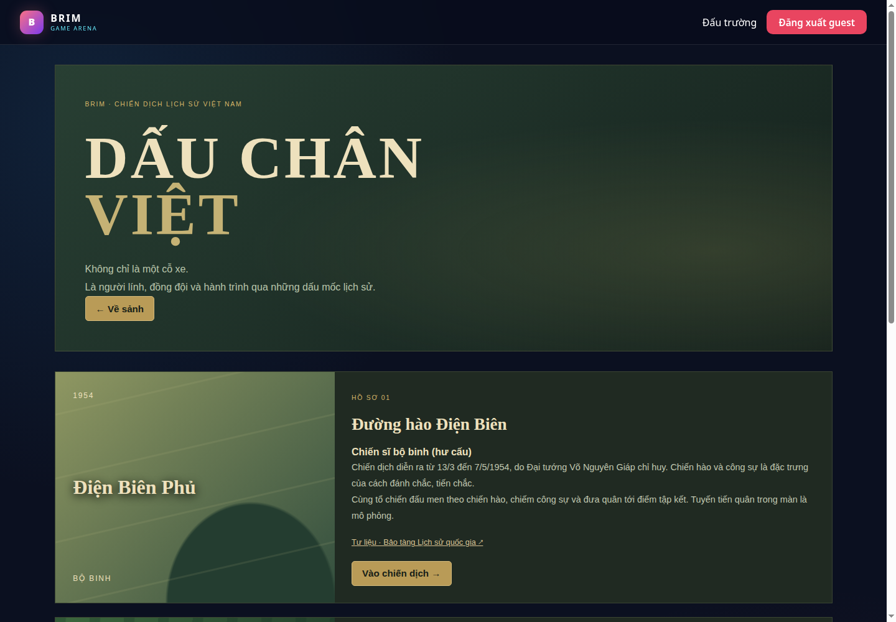

**HUB-01:** trang `/vietnam`. Ảnh chụp viewport; các ảnh hồ sơ bên dưới cho thấy lần lượt từng thẻ ở vị trí dễ đọc hơn.

| ID ổn định | Màn đang có | Vai trực tiếp | Chuỗi mục tiêu hiện tại | Trọng tâm góp ý |
| --- | --- | --- | --- | --- |
| 1 | Đường hào Điện Biên | Bộ binh hư cấu, hai AI đồng đội | Điểm liên lạc → chiếm công sự → tập kết | Hào, cover, phối hợp, lượng đạn |
| 2 | Mạch ngầm Củ Chi | Giao liên hư cấu | Vào hầm → lấy cứu trợ → bệnh xá → ra cửa B | Nhận biết lối đi, ưu tiên E, cảm giác mang hàng |
| 3 | Tiến vào Dinh | Kíp xe 390, xe 843 đồng hành | Hội quân → tương tác cổng → vào sân | Xe nặng, đội hình, hành trình và bối cảnh |
| Chưa có ID trong catalog | Dân quân phòng không | Vai dự kiến, chưa chơi được | Chuẩn bị → báo động → sơ tán → phòng không → cứu trợ | Thiết kế P3; không có ảnh gameplay thực tế |

**Ranh giới sản phẩm:** Tank Classic là chế độ riêng; Tank Assault là nơi thí điểm chiến đấu xe nặng; Dấu chân Việt là chiến dịch riêng. Không áp luật chiến dịch vào Classic. Các hồ sơ 1/2/3 không được đổi nghĩa khi thêm màn phòng không.

## 3. Màn 1 — Đường hào Điện Biên

### 3.1. Hồ sơ và vai nhập

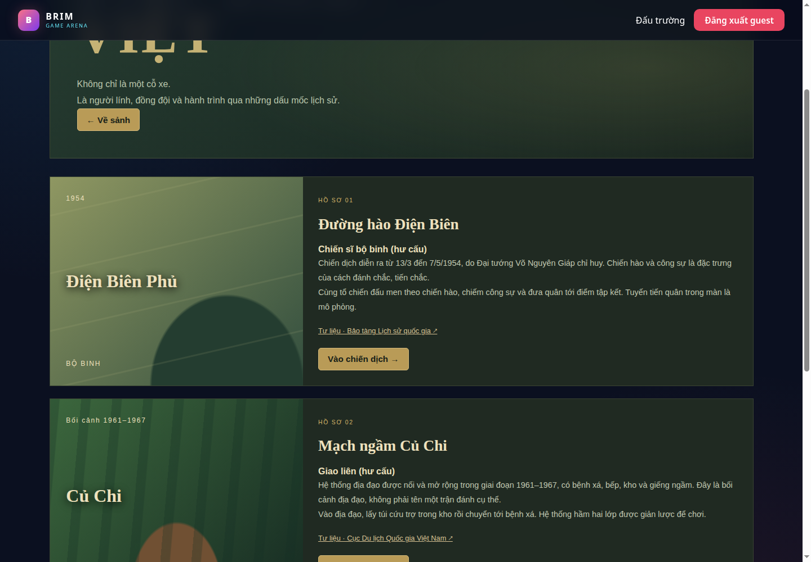

Theo catalog trong repo: bối cảnh Điện Biên Phủ 1954; vai người chơi là chiến sĩ hư cấu, đồng đội An/Bình là nhân vật hư cấu. Địa hình, vị trí chiến đấu và tuyến đi là mô phỏng gameplay. Tài liệu review không kiểm chứng lịch sử độc lập; nguồn nền nằm trong thẻ hồ sơ và `VietnamCampaign.java`.

**Trang bị hiện tại:** 100 HP, băng 12 viên, dự trữ 24 viên, thay băng 3 giây. Đi thường 65 unit/s, khom 35 unit/s. Hai hòm đạn ban đầu mỗi hòm 24 viên; tiếp tế hữu hạn. AI đồng đội cũng có băng và dự trữ hữu hạn.

### 3.2. Các bước chơi hiện tại

| Bước | Hành động / mốc world unit | Điều kiện qua bước | Rủi ro cần xem |
| --- | --- | --- | --- |
| Xuất phát | Từ khoảng (120,800), đi theo hào đứng | Còn sống, đi qua được địa hình | Có hiểu ai là người chơi và đâu là đồng đội? |
| 1 | Tới điểm liên lạc gần (400,390) | Vào vùng mục tiêu đúng layer | Hiện chủ yếu là đi tới điểm; chưa có trinh sát/ra lệnh |
| 2 | Tiếp cận công sự gần (780,210), nhấn E | Không còn địch sống trong bán kính kiểm tra 210 quanh mục tiêu | Chưa có giữ vùng 8 giây hoặc điều kiện quân số theo mission definition |
| 3 | Đưa nhân vật tới điểm tập kết gần (1430,160) | Vào vùng mục tiêu và chưa thất bại | Chưa phải kiểm tra đầy đủ quân số tổ về điểm tập kết |

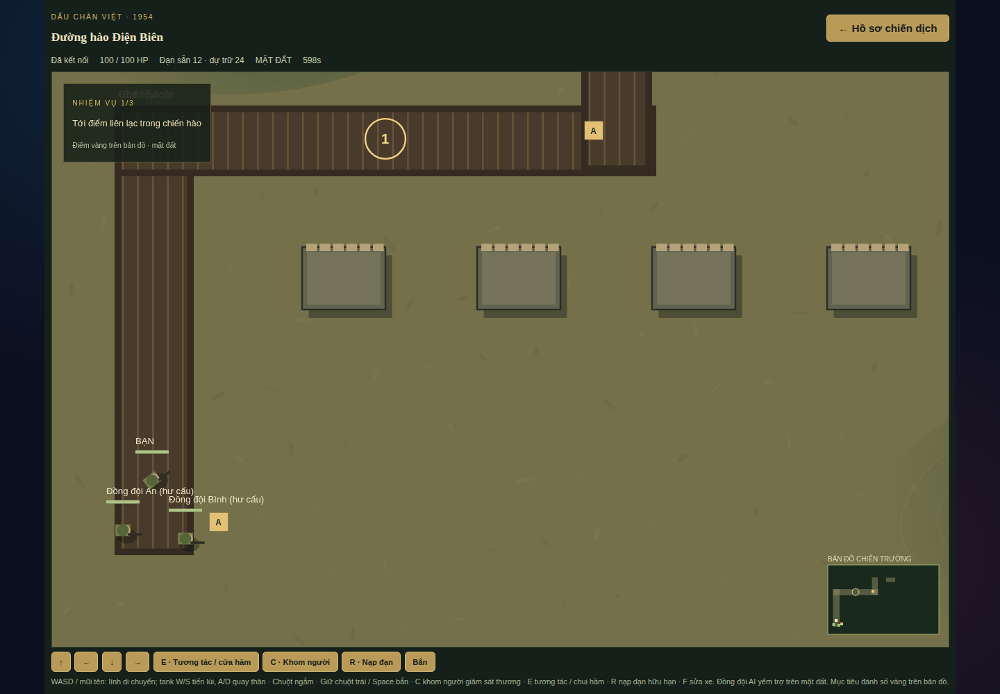

**DB-02:** HUD trên cùng thể hiện HP, băng/dự trữ, layer và thời gian. Khung nhiệm vụ ở góc trái; điểm vàng là mục tiêu hiện tại. Hòm chữ A là đạn; minimap ở góc dưới phải.

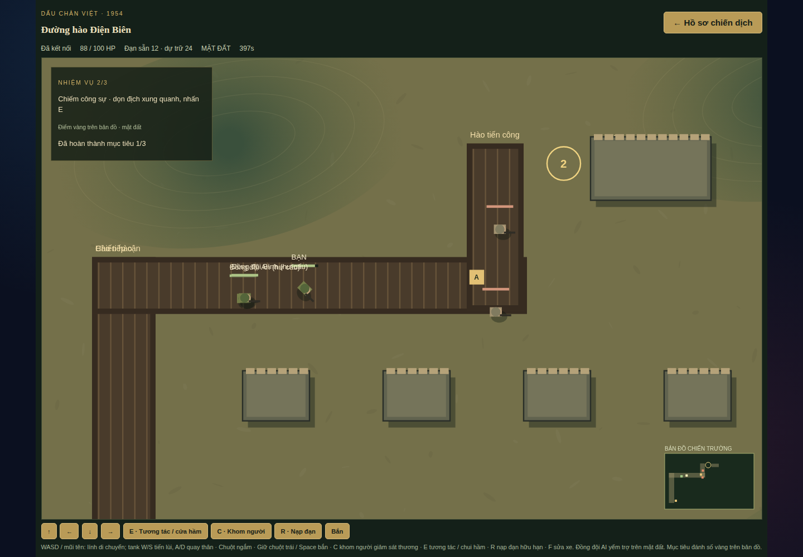

**DB-03:** xem chiều rộng hào, khả năng đọc đường đi và cách camera giữ nhân vật. Đây là tuyến hào đang chơi được, chưa chứng minh tuyến thứ hai đã được nghiệm thu.

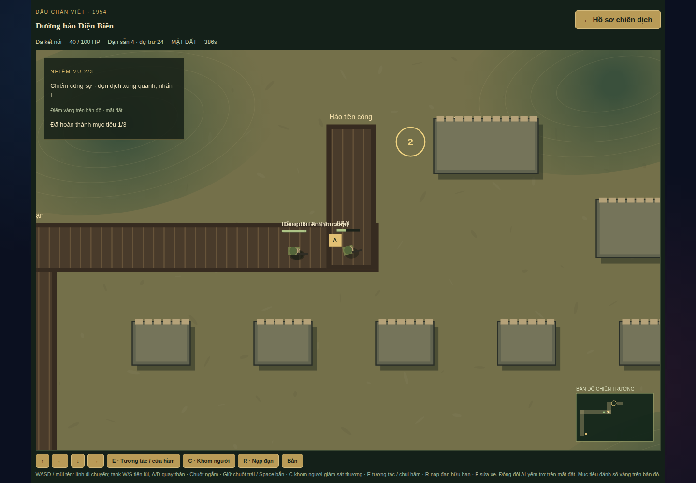

**DB-04:** tại thời điểm ảnh, nhân vật còn 40 HP, 4 viên trong băng và 24 dự trữ; không còn địch sống trong snapshot nhìn thấy. Quan sát vai trò hỗ trợ của AI và mức dễ đọc của thanh HP/đạn. Ảnh không đủ chứng minh thuật toán suppression hoặc chỉ huy, vì hai phần đó chưa có.

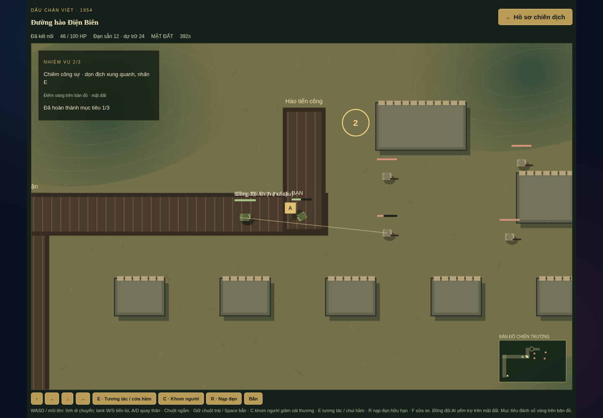

**DB-06:** tình huống ở đầu hào tiến công, trước phần bắn của tuyến review; có thể so sánh HP/đạn với DB-04.

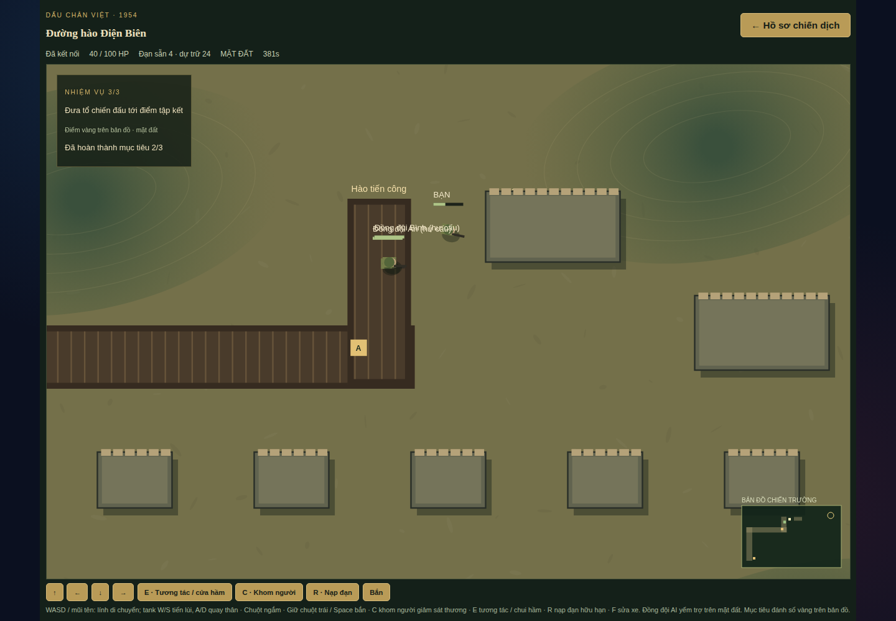

**DB-07:** vị trí tương tác công sự. Dùng ảnh này để góp ý khoảng cách E, nhãn mục tiêu và độ rõ của vật cản; không xem một khung hình là bằng chứng đã giữ vùng đủ 8 giây.

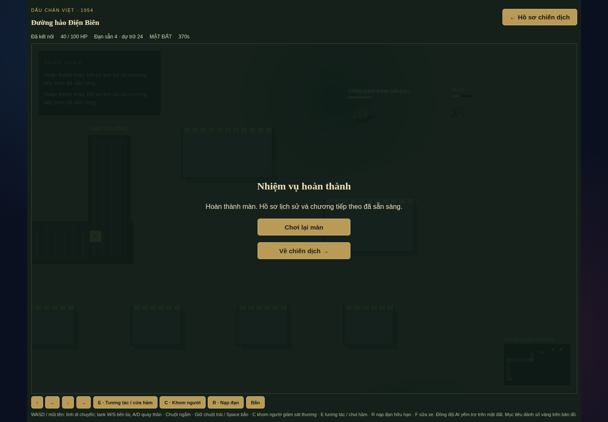

### 3.3. So với yêu cầu thiết kế lại

**Đã có:** hào, vật cản, địch/đồng đội, bắn/nạp hữu hạn, khom người, tiếp tế, mục tiêu công sự và điểm tập kết.

**Còn thiếu:** nhận quân/loadout có lựa chọn thực; trinh sát và trí nhớ phát hiện; HOLD/AMBUSH/ADVANCE/RETREAT; đổi actor; suppression/downed/cứu thương; chiếm giữ liên tục khoảng 8 giây; kiểm tra minimumSurvivors; bố trí và nghiệm thu hai tuyến cùng tuyến dự phòng; tổng kết quân số, tài nguyên và cách tiếp cận.

**Tuyến review hiện tại:** hào đứng → hào ngang → đoạn hào tiến công → công sự → vòng phía trên vật cản tới tập kết. Tuyến ngoài hào và đường rút về kho chỉ là phương án cần thiết kế/playtest, chưa công bố là tuyến hoàn thành đã cân bằng.

### 3.4. Góp ý cần chốt cho Điện Biên

1. Bạn muốn màn tập trung vào sinh tồn trong hào, chiếm công sự hay chỉ huy tổ?
2. Hào và công sự đã đủ gợi bối cảnh chưa; cần bổ sung chi tiết nào trước?
3. Việc ngắm, xác định địch và nhìn đồng đội có khó vì nhân vật nhỏ không?
4. Khi còn ít đạn, nên ưu tiên rút lấy đạn hay giao AI giữ chốt?
5. Điều kiện tập kết nên yêu cầu tối thiểu bao nhiêu người sống?

| Mã góp ý | Ảnh / bước | Hiện tại thấy gì | Muốn đổi thế nào | P0/P1/P2/P3 | Tiêu chí chấp nhận |
| --- | --- | --- | --- | --- | --- |
| DB-F01 | | | | | |
| DB-F02 | | | | | |
| DB-F03 | | | | | |

## 4. Màn 2 — Mạch ngầm Củ Chi

### 4.1. Hồ sơ và vai nhập

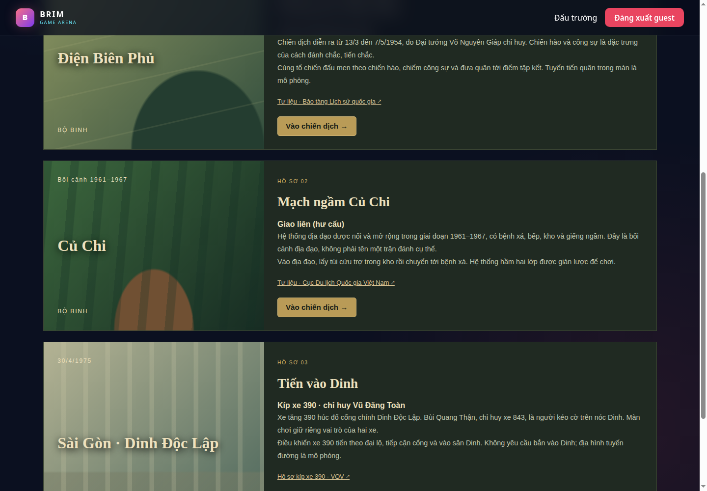

Theo catalog: bối cảnh địa đạo giai đoạn 1961–1967, không gán thành một trận đánh cụ thể. Người chơi là giao liên hư cấu. Bản chơi chỉ có mặt đất và một layer ngầm; không phải phục dựng địa đạo đúng tỷ lệ hay mô phỏng không khí.

Trang bị bộ binh giống màn 1. Có kho đạn mặt đất và kho đạn dưới hầm. Không thể dùng việc bắn dưới hầm để gây sát thương lên mặt đất.

### 4.2. Các bước chơi hiện tại

| Bước | Hành động / mốc world unit | Điều kiện qua bước | Nội dung cần góp ý |
| --- | --- | --- | --- |
| 1 | Tới cửa A gần (215,755), E xuống hầm | Đổi layer tại cửa thật, tới vùng mục tiêu layer 1 | Cửa đủ nổi bật không? Có biết E để xuống? |
| 2 | Theo trục hầm tới nhánh (710,760), lên kho (710,320), E | Đúng vùng tương tác nhiệm vụ | Hiện chủ yếu là chuyển objective, chưa có vật phẩm mang độc lập |
| 3 | Quay lại trục hầm, tới bệnh xá (1180,760), E | Tương tác mục tiêu ưu tiên | Cần phản hồi rõ đang mang gì và đã giao gì |
| 4 | Tới cửa B gần (1155,755), E lên mặt đất | Đúng cửa/layer rồi tới vùng hoàn thành | Bệnh xá và cửa gần nhau; phải xem ưu tiên E |


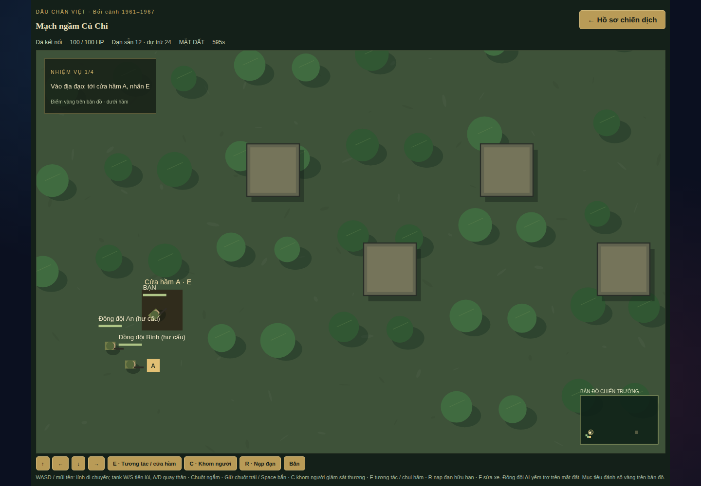

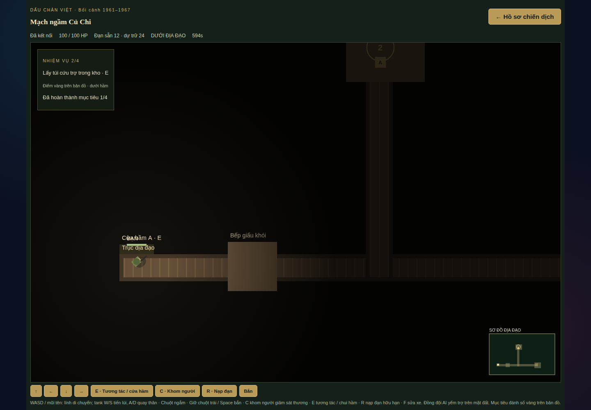

**CC-03:** quan sát độ tối, bề rộng hành lang, vùng nhìn và minimap. Nhân vật chỉ đi trong volume hầm; phần nền đen không phải vùng có thể đi tự do.

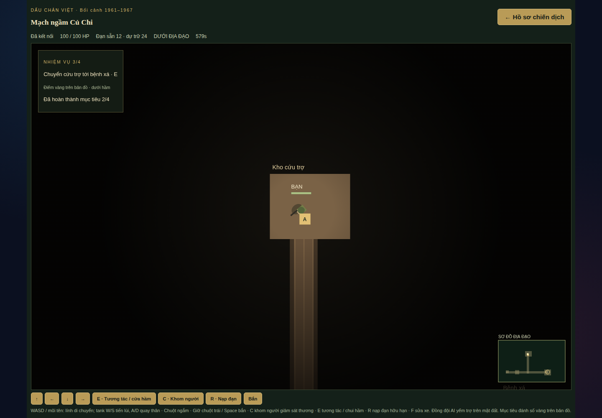

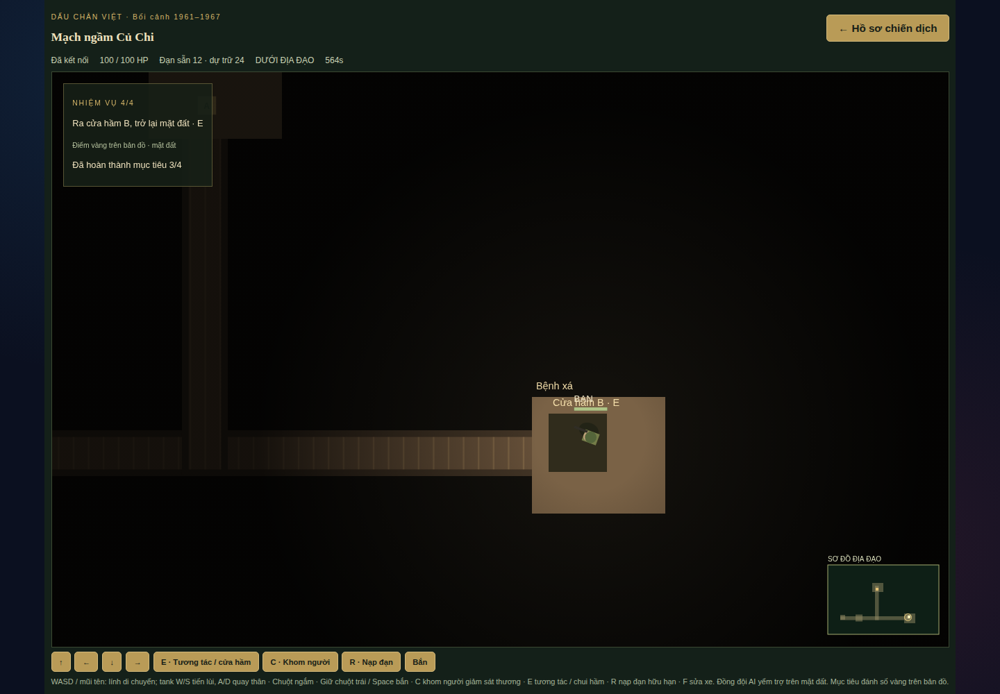

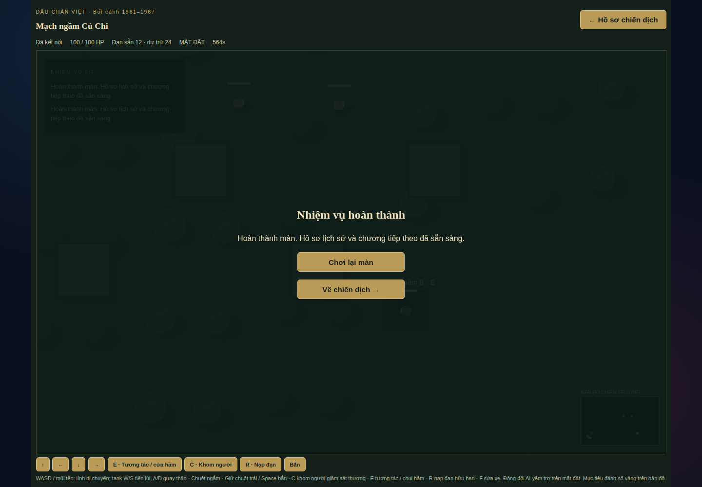

### 4.3. So với yêu cầu thiết kế lại

**Đã có:** hai layer, hai cửa, trục và nhánh hầm, kho/bệnh xá/bếp trên map, khóa di chuyển theo volume, mục tiêu lấy/giao cứu trợ, ưu tiên mục tiêu nhiệm vụ trước thao tác khác khi phù hợp.

**Còn thiếu:** hàng có item ID và số lượng độc lập; mang hàng giảm tốc; thả/nhặt lại không nhân bản; tổ giữ cửa và lệnh chỉ huy; tuần tra/perception mới; tuyến dự phòng; checkpoint bền vững; nhiệm vụ bảo vệ người/điểm trú.

**Giới hạn đáng chú ý:** code hiện có `if(layer==1) continue` trong vòng AI. Vì vậy AI mặt đất tạm dừng khi người chơi ở dưới hầm. Đây là phần **chưa đạt yêu cầu surface vẫn tiếp diễn**, cần sửa ở P2; ảnh dưới hầm không chứng minh AI mặt đất đang hoạt động.

### 4.4. Góp ý cần chốt cho Củ Chi

1. Lối đi có quá tối/hẹp hoặc khó phân biệt với tường không?
2. Nên có icon túi đang mang, số lượng và cảnh báo giao nhầm nơi thế nào?
3. Bạn muốn thêm nguy cơ ở mặt đất, tình huống bảo vệ cửa hay quản lý vật tư dưới hầm trước?
4. Khi cửa, hòm và bệnh xá gần nhau, E nên tự ưu tiên hay mở lựa chọn?
5. Âm thanh, ánh sáng và bản đồ cần bổ sung gì để tạo cảm giác địa đạo?

| Mã góp ý | Ảnh / bước | Hiện tại thấy gì | Muốn đổi thế nào | P0/P1/P2/P3 | Tiêu chí chấp nhận |
| --- | --- | --- | --- | --- | --- |
| CC-F01 | | | | | |
| CC-F02 | | | | | |
| CC-F03 | | | | | |

## 5. Màn 3 — Tiến vào Dinh

### 5.1. Hồ sơ và vai nhập

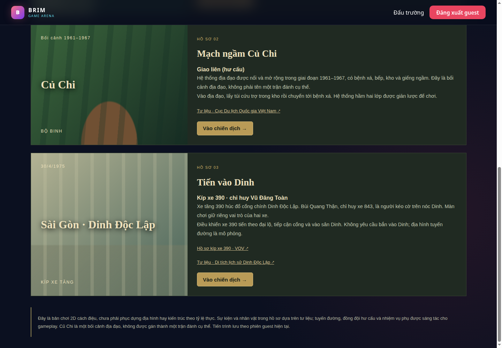

Catalog phân biệt xe 390 húc cổng chính và Bùi Quang Thận trên xe 843 kéo cờ. Người chơi điều khiển xe 390, AI đồng hành là xe 843. Tuyến đại lộ là mô phỏng. **Màn hiện tại không yêu cầu bắn vào Dinh và không bố trí địch chỉ để tạo giao tranh ở sân Dinh.**

### 5.2. Thông số xe hiện tại

| Nhóm | Giá trị profile | Ý nghĩa khi review |
| --- | --- | --- |
| Độ bền | 1.200 HP; cấu hình tank địch 900 HP | Không dùng việc không có địch trong màn này để kết luận tank đã cân bằng |
| Chuyển động | Tiến 45, lùi 25 unit/s; gia tốc 20, phanh 35 unit/s² | Xe cần lấy đà và khoảng dừng |
| Quay | Thân 35°/s, tháp 50°/s | W/S tiến lùi, A/D quay thân; chuột điều hướng tháp |
| Pháo | 8 viên tổng ban đầu, sức chứa 12, nạp 6 s | Viên đã nạp và dự trữ không đếm trùng |
| Đường đạn | Tầm 700, vận tốc 500 unit/s | Có thời gian bay, không bám mục tiêu |
| Nổ/giáp | 220 tâm nổ, bán kính 120; giáp trước/hông/sau 0,55/0,8/1,0 | Dùng để review combat ở Assault/tình huống thử riêng |
| Ngắm | Ổn định sau 1,5 s; tản khoảng ±3° khi động, ±0,6° khi ổn định | Không hứa trúng tại con trỏ |
| Nhiên liệu | Quãng chuẩn khoảng 3.000 unit | Tiêu theo quãng đường thực, không theo số input |
| Sửa | 1 kit ban đầu, 8 s, +180 HP, trần 70% HP gốc | Bị tấn công/ngắt thao tác không tự chữa đầy |

Tiếp tế trên map: hai hòm đạn, mỗi hòm 4 viên; một hòm nhiên liệu 750 đơn vị lượng tiếp liệu theo model; một hòm 1 kit sửa. Hòm còn dư giữ lại; không coi tiếp tế là điểm nâng cấp của Tank Assault.

### 5.3. Các bước chơi hiện tại

| Bước | Hành động / mốc world unit | Điều kiện qua bước | Rủi ro cần xem |
| --- | --- | --- | --- |
| Xuất phát | Xe 390 gần (120,800), xe 843 gần phía sau | Lái xe ra tuyến đường | Có hiểu sơ đồ lái khác bộ binh? |
| 1 | Hội quân gần (700,520) | Vào vùng mục tiêu | Chưa kiểm tra đầy đủ đội hình và bộ binh dẫn đường |
| 2 | Tới (1330,520), E tương tác cổng | Tương tác nhiệm vụ; trước đó không qua x≥1350 | Hiện là trigger tương tác, chưa có diễn hoạt va/húc cổng hoàn chỉnh |
| 3 | Lái vào sân gần (1470,520) | Vào vùng đích, kết thúc | Chưa có hành trình hậu cần nhiều phân đoạn |

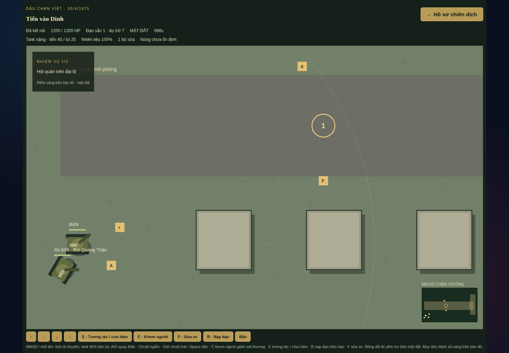

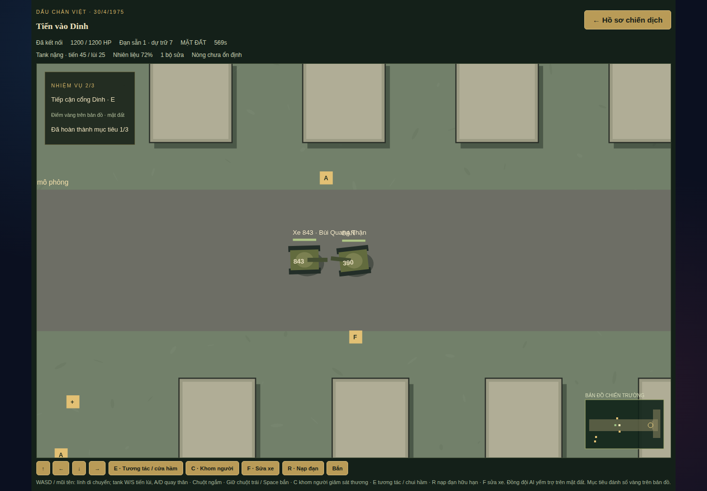

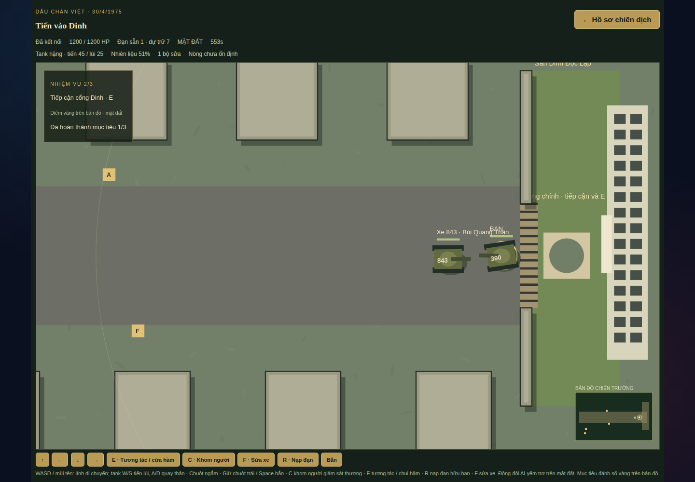

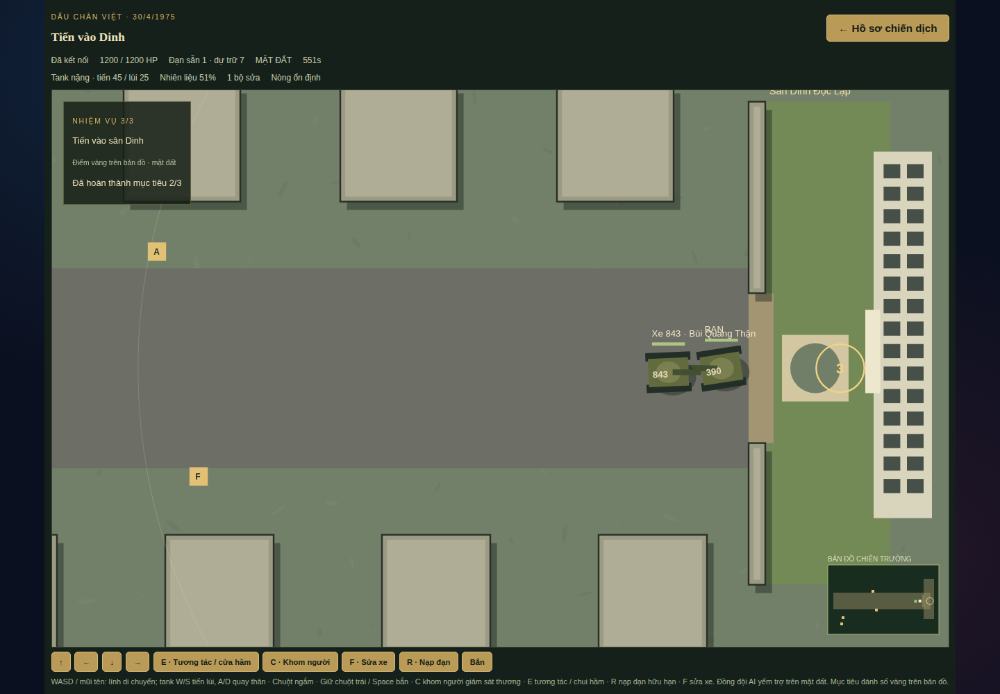

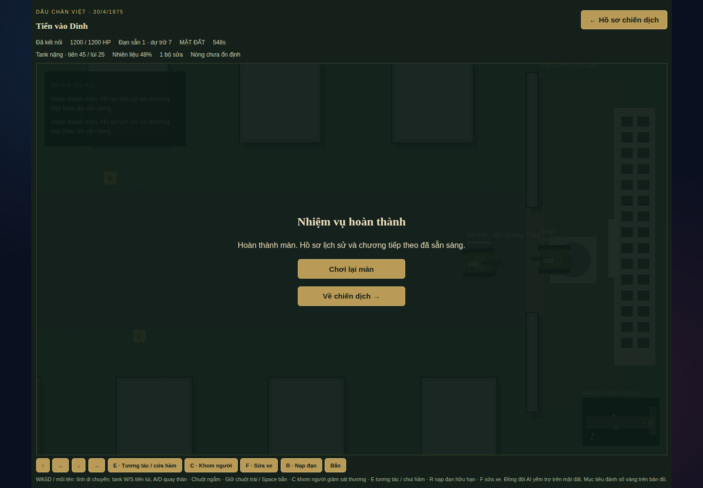

### 5.4. So với yêu cầu thiết kế lại

**Đã có:** xe nặng, thân/tháp độc lập, tài nguyên và tiếp tế hữu hạn, sửa xe, đồng hành 843, đại lộ, cổng và sân, ba mục tiêu, ranh giới trước tương tác cổng.

**Còn thiếu:** kiểm tra xe/loadout trước trận; phân đoạn trinh sát và đường bị chặn có lựa chọn; bộ binh dẫn đường; đội hình và điều kiện bảo toàn đoàn; tuyến vòng/rút được nghiệm thu; checkpoint xuyên phân đoạn; tổng kết quân số/vật tư; art/animation cổng và công trình ở chất lượng hoàn thiện.

**Cần tách riêng:** màn này phù hợp review cảm giác lái/hành trình; muốn đánh giá giáp, nổ, phục kích và hao đạn cần một tình huống chiến đấu Assault hoặc bài huấn luyện giả định riêng. Không thêm tank địch ở Dinh chỉ để đủ ảnh bắn nhau.

### 5.5. Góp ý cần chốt cho Tiến vào Dinh

1. Xe hiện quá chậm hay đã đủ nặng; quay thân có khó điều khiển không?
2. Có phân biệt được hướng thân xe với hướng nòng không?
3. Hành trình cần thêm sửa chữa, tiếp liệu, chướng ngại hay đội hình trước?
4. Cảnh cổng/sân nên diễn hoạt thế nào để rõ nhiệm vụ mà không thêm giao tranh sai bối cảnh?
5. Cần nâng chất lượng xe, Dinh, đường hay camera trước?

| Mã góp ý | Ảnh / bước | Hiện tại thấy gì | Muốn đổi thế nào | P0/P1/P2/P3 | Tiêu chí chấp nhận |
| --- | --- | --- | --- | --- | --- |
| DINH-F01 | | | | | |
| DINH-F02 | | | | | |
| DINH-F03 | | | | | |

## 6. Hồ sơ dự kiến — Dân quân phòng không

**Trạng thái: P3, chưa có màn chơi, chưa có ảnh gameplay để capture.** Không có enum/nút hoặc ảnh minh họa được coi là bằng chứng đã triển khai.

Sơ đồ đề xuất để góp ý: **nhận vật tư → cảnh giới/báo động → sơ tán → lên vị trí phòng không → bảo vệ qua 2–3 đợt hữu hạn → cứu trợ/tổng kết**. Theo đặc tả, đề xuất bối cảnh Hà Nội tháng 12/1972; cần hồ sơ nguồn riêng trước khi chốt nhân vật, khí tài và tình huống cụ thể.

| Nhóm yêu cầu | Thiết kế cần giữ | Hiện trạng |
| --- | --- | --- |
| Vai dân quân | Báo động, dẫn dân, tiếp đạn, E lên/xuống khí tài | Chưa có |
| Mục tiêu | Bảo vệ/sơ tán; không chỉ tính số máy bay hạ | Chưa có |
| Layer/capability | Mục tiêu bay thấp, vũ khí chỉ tác động độ cao cho phép | Chưa có |
| Đạn/heat | Burst 3 viên, nghỉ khởi đầu 0,8 s, hữu hạn, quá nhiệt khóa tạm | Chưa có |
| Công bằng | Cue cảnh giới trước tấn công; đạn có thời gian bay | Chưa có |
| Đồng thời | Mặt đất vẫn chạy khi người chơi đang mounted | Chưa có |
| Bối cảnh | Không làm gameplay súng trường bắn hạ B-52 tầm cao; không gán thành tích cho nhân vật hư cấu | Ràng buộc nội dung cần giữ |
| Dữ liệu | Chapter ID mới, displayOrder riêng, migration không mất quyền màn cũ | Chưa có |

**PK-F01:** Bạn muốn ưu tiên cảm giác cảnh giới/sơ tán hay thao tác khẩu đội? **PK-F02:** Mục tiêu bảo vệ là bệnh xá, khu dân cư hay kho? **PK-F03:** Mức độ khó về tiếp đạn/heat thế nào? Các lựa chọn này còn cần thiết kế, không phải tính năng đã có.

## 7. Đối chiếu đầy đủ các nhóm yêu cầu trước đó

| Mã | Nhóm yêu cầu / mục đặc tả gốc | Đã có hoặc giới hạn hiện tại | Phần phải làm / nghiệm thu |
| --- | --- | --- | --- |
| REQ-01 | Vòng lặp trước/trong/sau trận (§3) | Có hồ sơ, mục tiêu và màn kết quả cơ bản | Loadout có tác dụng, mission graph, debrief chi tiết, hai tuyến và fallback |
| REQ-02 | Xe nặng và profile/version (§4) | Có profile dùng chung và version | Playtest Standard trước; chưa có ba profile độ khó tactical hoàn chỉnh |
| REQ-03 | Chamber/reload/inventory (§5.1) | Có CannonState, đạn hữu hạn, ACK lệnh | Chưa có save/restore checkpoint bền vững giữa loading |
| REQ-04 | Ngắm/tháp/tản/RNG (§5.2) | Có hướng nòng thực, ổn định ngắm, tản | Checkpoint phải giữ RNG; cần nghiệm thu phản hồi bắn trượt |
| REQ-05 | Swept collision/nổ/giáp (§5.3) | Có mechanics, tự sát thương, vật che, phân loại obstacle | Test/code không thay playtest hai phía tường; AP và phá địa hình chưa có |
| REQ-06 | Tiếp tế/sửa/chữa (§5.4) | Hòm hữu hạn, giữ dư, nhiên liệu, kit sửa | Thuốc/cứu thương cá nhân, chia vật tư và carrying item còn thiếu |
| REQ-07 | LOS, contact, fog (§6) | Lọc snapshot; Assault có contact cũ 4 s | Campaign chưa có perception memory/âm thanh/độ chắc chắn hoàn chỉnh |
| REQ-08 | Commander/direct và đổi vai (§7) | Có bộ binh/xe trực tiếp và AI đi theo | Chưa có controlledActorId, đổi actor/command mode, kiểm tra actor quyền điều khiển |
| REQ-09 | Squad orders và ACK (§7) | ACK hiện cho thao tác input, chưa phải squad orders | FOLLOW/HOLD/ADVANCE/AMBUSH/RETREAT, waypoint/path budget, từ chối có lý do |
| REQ-10 | Suppression/downed/dead (§7.4) | HP, AI có đạn hữu hạn trong campaign | Cứu có thời hạn, ammo warning, minimumSurvivors, chính sách AI cứu/rút |
| REQ-11 | Phòng không (§8) | Chưa triển khai | Aircraft layer, mount, heat, flight, cảnh giới, sơ tán, ưu tiên bảo vệ dân |
| REQ-12 | Điện Biên mới (§9.1) | Giữ cấu trúc ba mục tiêu cũ | Giữ công sự 8 s, hai tuyến, trinh sát/lệnh tổ, hậu cần và quân số |
| REQ-13 | Củ Chi mới (§9.2) | Hầm hai lớp và chuỗi cứu trợ | Surface AI không dừng, item ID, carry/drop/retrieve, bảo vệ cửa |
| REQ-14 | Kíp xe/hành trình (§9.3) | Xe 390/843 và ba mục tiêu | Chướng ngại, tiếp tế/sửa có ý nghĩa, dẫn đường và bảo toàn đoàn |
| REQ-15 | Save compatibility (§9.4) | ID cũ 1/2/3, một số unlocked trong Redis | Tập ID/version/prerequisite, migration idempotent, giữ entitlement |
| REQ-16 | Bỏ blast preview (§10.1) | Không gửi endpoint projectile, renderer vẽ nổ sau impact | Tiếp tục kiểm tra payload/minimap/reconnect; vòng tầm không phải blast preview |
| REQ-17 | HUD/điều khiển (§10.2–3) | HP, đạn, reload, fuel, kit, objective; WASD/E/R/C/F | Squad panel, Z bò, Tab chỉ huy, 1–5 orders, menu Esc, lý do từ chối rõ hơn |
| REQ-18 | Mobile/audio/accessibility (§10.4) | Có nút cảm ứng, nhãn văn bản, pulse tôn trọng reduced motion | Ngắm cảm ứng cần kiểm chứng; audio pass, cue tương đương, nhiều vai chưa có |
| REQ-19 | Server authoritative/contract (§11) | Tick 100 ms, input ý định, sequence/ACK, private snapshot | Chưa có toàn bộ ECS/system; không cần tạo class rỗng để đủ sơ đồ |
| REQ-20 | Persistence/idempotency (§11.4) | Reconnect giữ simulation RAM; unlock Redis | Backend restart mất ván; checkpoint/receipt tài nguyên xuyên màn chưa có |
| REQ-21 | Lịch sử/art (§12) | Hồ sơ nguồn trong catalog, đồ họa 2D cách điệu | Art/audio pass, hồ sơ riêng cho màn mới; chưa phục dựng tỷ lệ thật |
| REQ-22 | P0–P4 (§13) | Nền P0 đã có | Đóng P0 sau playtest hai tuyến; P1 bộ binh/chỉ huy → P2 hành trình → P3 phòng không → P4 cân bằng |
| REQ-23 | Ma trận test (§14) | Repo có test luật, tactical, campaign và security | W01–12/A01–08/M01–11/C01–03/F01–06 cần gắn bằng chứng; không mặc định tất cả đã qua |
| REQ-24 | Playtest thực (§14.5) | Có phiên chụp bằng thao tác UI tự động trong đợt review | Chưa có nghiệm thu người chơi trên desktop/mobile từng vai, chưa kết luận nhịp độ đạt |

### Những giới hạn không được bỏ qua khi góp ý

1. Reconnect trong cùng backend giữ state; restart backend không khôi phục trận. Chơi lại là lượt mới, khác reconnect.
2. Đổi vai, squad commands và phòng không chưa có; không mô tả nút tương lai là đang dùng được.
3. Ba màn vẫn dùng mục tiêu cũ; P0 chủ yếu đổi nền cơ chế chứ chưa thay toàn bộ hành trình.
4. Classic/Assault/campaign có ranh giới luật khác nhau. AI bộ binh Assault vẫn theo cadence/wave cũ; không suy ra inventory hữu hạn campaign đã áp cho mọi đối tượng Assault.
5. Tài liệu gốc báo kết quả test của đợt 19/10; không dùng số đó làm kết quả chạy lại ngày 20/10. Ảnh review là bằng chứng UI tại thời điểm chụp, không thay toàn bộ suite.

## 8. Review điều khiển và màn hình nhỏ

| Input | Đang có trong campaign | Cần lưu ý |
| --- | --- | --- |
| WASD / mũi tên | Bộ binh đi; xe W/S tiến lùi, A/D quay thân | Xe không chạy ngang như bộ binh |
| Chuột / giữ chuột trái / Space | Ngắm / yêu cầu bắn | Server quyết định thời điểm và hướng nòng thực |
| E | Mục tiêu, hòm tiếp tế, cửa hầm | Cần phản hồi nếu ngoài tầm hoặc đủ đồ |
| R | Nạp băng bộ binh | Pháo tự nạp; R không sinh thêm đạn |
| C | Giữ để khom bộ binh | Không thay thế suppression/crawl |
| F | Sửa xe nếu đủ điều kiện | Không phải chức năng cứu thương hoàn chỉnh |
| Tab / 1–5 / Z | Chưa có chức năng như đặc tả | Không hướng dẫn người chơi dùng như tính năng đã xong |

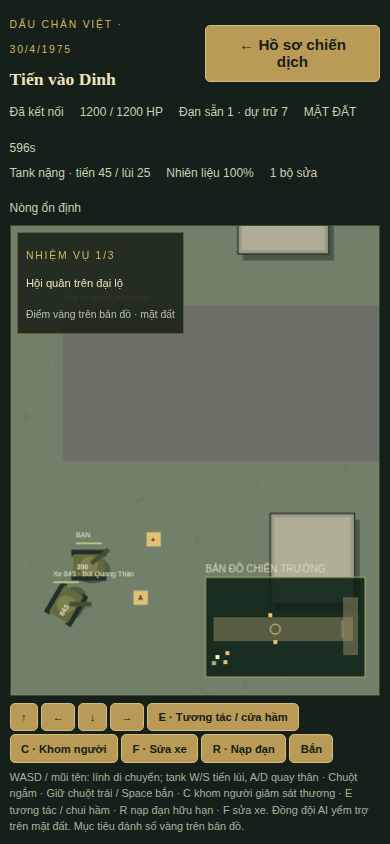

**MOB-01:** ảnh kiểm tra bố cục màn hình nhỏ, không tương đương nghiệm thu thao tác cảm ứng trên thiết bị thật. Góp ý kích thước nút, phần chiến trường còn nhìn được, số ngón tay cần dùng để lái/ngắm/bắn và việc nút có che mục tiêu không.

## 9. Phiếu nghiệm thu để đi từ góp ý sang việc cần làm

### Ghi nhận trực tiếp từ ảnh và code hiện tại

| Mã | Bằng chứng | Góp ý có thể đưa vào backlog |
| --- | --- | --- |
| OBS-01 | DB-04: nhãn An/Bình/BẠN bị chồng khi đứng gần | Tách nhãn theo khoảng cách hoặc chỉ hiện tên khi chọn/hover |
| OBS-02 | DB-05: sau hoàn thành vẫn thấy bộ đếm nhiệm vụ 4/3 phía sau overlay | Hiển thị Đã hoàn thành hoặc giới hạn chỉ số mục tiêu cuối |
| OBS-03 | Code Củ Chi dừng AI khi layer=1 | Surface cần tiếp tục chạy, không tạo miễn nguy hiểm cho tổ ở trên |
| OBS-04 | Trình tự E tại cổng Dinh hiện điều khiển bước nhiệm vụ | Cần thống nhất animation tiếp cận/húc cổng và phản hồi trước khi qua |

Các mục này là phát hiện để bạn review; đợt tài liệu chưa sửa gameplay hoặc UI.

Mỗi góp ý nên ghi theo mẫu: **“DINH-04 / REQ-14: trước cổng thiếu cảm giác đoàn xe; muốn xe 843 chờ đúng đội hình; đạt khi vào vùng hội quân chỉ hoàn thành nếu cả hai xe còn sống và cùng ở trong vùng.”** Đây là ví dụ đề xuất, chưa phải yêu cầu đã triển khai.

| Lượt | Build/profile | Màn/vai | Desktop/mobile | Tuyến | Thời gian | Reload | Đạn/fuel còn | Đồng đội sống | Lý do retry | Kết luận |
| --- | --- | --- | --- | --- | --- | --- | --- | --- | --- | --- |
| PT-01 | | Điện Biên/bộ binh | | Hào | | | | | | |
| PT-02 | | Điện Biên/bộ binh | | Tuyến thứ hai cần chốt | | | | | | |
| PT-03 | | Củ Chi/giao liên | | A → kho → bệnh xá → B | | | | | | |
| PT-04 | | Tiến vào Dinh/kíp xe | | Đại lộ | | | | | | |
| PT-05 | | Assault/tank | | Cover/tiếp tế, cần bố trí cố định | | | | | | |

Ưu tiên xử lý: **P0** lỗi chặn chơi/mất tài nguyên/lộ thông tin; **P1** luật và vai trò cốt lõi; **P2** hành trình/UI/art; **P3** mở màn phòng không. Đây là phân loại góp ý để sắp công việc, không tự thay định nghĩa phase trong đặc tả gốc.

### Kiểm tra trước khi chốt P0

- [ ] Hai tuyến hoàn thành có số liệu thời gian/đạn/fuel/tổn thất, cùng một tuyến rút/tiếp tế hữu ích.
- [ ] Giữ fire không bỏ qua 6 giây nạp; hết đạn không tự sinh; loaded/reserve hiển thị dễ hiểu.
- [ ] Chết khi nạp, reconnect, hết fuel và chơi lại có hành vi đúng, không lẫn lượt cũ/mới.
- [ ] Địch sau vật che và endpoint đạn không lộ trong payload/minimap.
- [ ] Cover tạo khác biệt đo được; không chỉ cộng HP để giả độ khó.
- [ ] Desktop và mobile có người chơi thật đánh giá, ghi lý do không bắn/tương tác được.
- [ ] Tách rõ phần lịch sử có nguồn và tuyến/nhiệm vụ sáng tác.

## 10. Nguồn code và cách chụp lại

| Nội dung | Nguồn trong repo |
| --- | --- |
| Hồ sơ / vai / nguồn bối cảnh | `src/main/java/com/brim/game/game/vietnam/VietnamCampaign.java` |
| Map / mục tiêu / layer / AI / tương tác | `src/main/java/com/brim/game/game/vietnam/VietnamGame.java` |
| Xe nặng / pháo / giáp / geometry | `src/main/java/com/brim/game/game/tactical/` |
| Thông số | `src/main/resources/games/tactical-standard.json` |
| Giao diện hồ sơ / trận | `frontend/src/views/VietnamHubView.vue`, `VietnamGameView.vue` |
| Đồ họa và minimap | `frontend/src/game/vietnam/render.ts` |
| Quyền SEND/SUBSCRIBE | `src/main/java/com/brim/game/security/GameMessageGuard.java` |
| Test route / tactical | `src/test/java/com/brim/game/game/VietnamGameTest.java`, `TacticalMechanicsTest.java`, `TankAssaultTest.java` |

Ảnh được chụp bằng `scripts/capture-vietnam-review.mjs`, dùng Chrome DevTools Protocol. `scripts/vietnam-review-controls.js` gửi phím vào handler UI; các file `scripts/vietnam-review-route-*.json` mô tả tuyến, không teleport hay sửa HP/đạn/mục tiêu. Cần backend :8080, Vite :3000 và Chrome profile riêng có CDP :9224. Chỉ dùng script trên môi trường review local; script không có cơ chế tự mở khóa và không nên chạy lại nguyên trạng trong phiên cá nhân đang chơi.

Lệnh mẫu sau khi chuẩn bị Chrome/profile review và quyền màn thích hợp:

```bash
node --experimental-websocket scripts/capture-vietnam-review.mjs init
node --experimental-websocket scripts/capture-vietnam-review.mjs hub
node --experimental-websocket scripts/capture-vietnam-review.mjs start 1
node --experimental-websocket scripts/capture-vietnam-review.mjs route scripts/vietnam-review-route-1.json
```

Bản HTML/PDF là bản xuất từ Markdown này. Khi sửa nội dung, chạy `python3 scripts/export-vietnam-review.py`, sau đó dùng chế độ `pdf` của script capture để xuất PDF qua Chrome.


## 11. Góp ý mới và bản thiết kế thay thế

**Trạng thái:** đã cập nhật yêu cầu tài liệu, chưa triển khai các cơ chế/camera/asset mới. Không có ảnh capture của tính năng chưa tồn tại. 22 ảnh cũ được giữ nguyên để bạn chỉ đúng vấn đề theo mã DB/CC/DINH/MOB.

### 11.1. Thay đổi cần thấy ở từng màn

| Màn / ảnh baseline | Thiết kế mới phải thể hiện | Bằng chứng cần chụp ở vòng sau |
| --- | --- | --- |
| Điện Biên, DB-02–07 | Hành trình 20–35 phút, nhiều encounter, 1–2 người theo và tổ giữ chốt xa, thoại nhận lệnh, băng bó/loot, hai tuyến/giữ vùng | Camera chéo, silhouette mới, trận đông hơn, bleeding/băng, đối thoại, tập kết đủ quân |
| Củ Chi, CC-02–07 | Hầm hẹp hơn, nhiều nhánh/ngách/cửa, khom/bò, thoại chỉ đường, mang hàng, surface không freeze | Trần thấp, ánh/âm ngột ngạt, sơ đồ nhánh, hàng có ID, nhóm giữ cửa |
| Tiến vào Dinh, DINH-02–06 | Nhiều chặng kiểm tra/tiếp liệu/sửa/đội hình/chướng ngại; thoại và diễn hoạt cổng | Đoàn xe xa/gần, hậu cần và route, cảnh cổng đúng vai; không thêm địch sân Dinh |
| Lượm, chưa có ảnh | Màn giao thư riêng, cảm hứng văn học, hỏi đường/né chốt/Shift/nhà trú | Nhân vật và tuyến riêng, thư/người nhận/nhật ký; không gán tiểu sử chưa xác minh |
| Nhà dân, chưa có ảnh | Nội thất, cửa trước/sau, tuần tra điều tra/đồ gây chú ý, người dân có thoại | Cắt mái/occlusion, ẩn náu không reset alert, thoát theo thời cơ |
| Rừng, chưa có ảnh | Bẫy game trừu tượng, phục kích, lựu đạn, lực lượng hữu hạn/đường rút | Tán nhiều lớp, vị trí tổ/địch cover, trạng thái trap và lệnh chờ |
| Phòng không, chưa có ảnh | Di chuyển ngôi ba → lên khí tài ngắm FPS; mục tiêu bay thấp nhanh/lượn; bom phá mục tiêu thì fail | Hai camera giữ cùng state, pass/cảnh giới/bom, cao trào nhiều lực lượng/B-52 đúng vai |
| Chỉ huy, chưa có ảnh | Mini dẫn 2–3 tổ đánh chiếm, HOLD/AMBUSH/RETREAT, fog, đạn và quân số | Bản đồ tình báo, ACK/reason, bố trí/yểm trợ/chiếm giữ |
| Trường Sơn, chưa có ảnh | VN-09 riêng: lái xe không kính chở lương thực, đoàn xe, dừng/sửa/tiếp liệu, biến cố đường và giao nhận | Cabin không kính, hàng/manifest, camera lái, xe bạn/đơn vị giữ tuyến, giao hàng và debrief lịch sử |

### 11.2. Những thay đổi xuyên suốt

Bỏ đường nối nhân vật–chuột và preview đường ném/tâm nổ; bắn theo hướng nhân vật/nòng thực, đạn thử nhanh hơn. Map chia chunk, preload vùng gần và cull theo camera; server vẫn mô phỏng sự kiện ngoài hình, lọc snapshot theo AOI/LOS. Art tối hơn theo bối cảnh nhưng không khó đọc. Asset cần source/license/scale/LOD, chưa tải pack trong đợt này.

Bleeding phải cầm bằng băng gạc, khác medkit hồi HP; vật tư/đạn từ địch và thùng có ID và số lượng hữu hạn, không farm qua reconnect. Hội thoại chứa chỉ dẫn thật và lưu nhật ký/fallback; cuối chiến dịch có thẻ lịch sử và lời trích có nguồn, chưa xác minh thì ghi tóm lược thay vì gán danh nhân.

Cao trào B-52 giữ ý tưởng nhiều đơn vị hiệp đồng, phân biệt vai tên lửa với mục tiêu bay thấp của dân quân; không dùng súng trường hoặc minigame bắn vịt để mô tả hạ B-52 tầm cao. Xem nguồn và phương án vai người chơi ở §13 của spec v2.

### 11.3. Truy vết từng góp ý

| Mã | Góp ý | Nghiệm thu / mục spec |
| --- | --- | --- |
| FB-01 | Địch ít | Nhiều encounter/tổ, mật độ/budget/tiếp viện hữu hạn (§3/6) |
| FB-02 | Trải nghiệm ngắn | Đạt thời lượng có quyết định, trừ AFK/chờ giả (§3/10) |
| FB-03 | Map nhỏ | Nhiều khu, hai tuyến và đường rút; không đất trống (§3/8) |
| FB-04 | Nhân vật ngộ nghĩnh/khó nhìn | Tỷ lệ/pose/animation mới, duyệt zoom chuẩn/mobile (§4/9) |
| FB-05 | Bleeding | Trúng đòn tạo state/FX, HP server, không reset (§5) |
| FB-06 | Băng gạc/hồi máu | Cầm máu khác hồi HP, consume/reserve đúng (§5) |
| FB-07 | Đồ rớt địch/map | Container ID, loot/kho hữu hạn, không reroll (§5) |
| FB-08 | 1–2 đi theo, quân khác xa | Hai loại nhóm có vai/vùng/state (§6.3) |
| FB-09 | Hội thoại nhân vật | Named speaker, phản ứng trạng thái, nhật ký (§7) |
| FB-10 | Thoại để biết vượt màn | Suy ra tuyến/NPC/thời điểm, fallback (§7) |
| FB-11 | Map sáng/thiếu thời chiến | Palette/props/audio theo bối cảnh vẫn dễ đọc (§9) |
| FB-12 | Asset tả thực | Backlog, manifest/license/scale/LOD, chưa tải (§9) |
| FB-13 | Đi tới đâu render tới đó | Chunk/culling/AOI, RAM ổn, không lộ địch (§8) |
| FB-14 | Đạn chậm | Vận tốc thử mới và swept collision (§4.2) |
| FB-15 | Ta/địch ẩn nấp | Cover/LOS hai phía, không nhìn xuyên (§6) |
| FB-16 | Hành trình thực tế | Thương tích/vật tư/thông tin xuyên phân đoạn (§3/16) |
| FB-17 | Đạn hạn chế, lấy địch/thùng | Budget bắt buộc, kho/loot/fallback (§5) |
| FB-18 | Phòng không ngôi ba/ngôi nhất | Switch mount đúng chỗ, không reset/pause (§13.1) |
| FB-19 | Bay nhanh/lượn/bắn vịt | Nhiều pass, aim có thời gian bay, không auto-hit (§13.2) |
| FB-20 | Bom trúng thì fail | Mục tiêu bắt buộc, policy rõ, fail trước reward (§13.3) |
| FB-21 | Đồng đội/B-52 cao trào | Hiệp đồng và vai tên lửa phù hợp (§13.4) |
| FB-22 | Thêm lịch sử | Nguồn/niên biểu/khí tài, không gán bừa (§10/15) |
| FB-23 | Giữ Shift chạy | Stamina/tốc độ/tiếng động server/mobile (§4.3) |
| FB-24 | Góc quay chéo | Thấy chiều sâu, không overhead cũ (§4.1) |
| FB-25 | Lựu đạn/ẩn nấp | Action/cover/impact, không preview (§6.2) |
| FB-26 | Một địch kéo nhiều địch | Alert có độ trễ/phạm vi/vị trí cuối (§6.1) |
| FB-27 | Vào nhà dân | Nội thất/cửa sau, không reset truy đuổi (§12.2) |
| FB-28 | Hóa thân Lượm | Màn giao thư riêng, chuyển thể ghi rõ (§12.1) |
| FB-29 | Đồ vật gây chú ý | Sound event/AI investigation/layer, không spam (§6.1) |
| FB-30 | Bẫy rừng/phục kích | Màn riêng, item/state/trigger/checkpoint (§6.2/10) |
| FB-31 | Ý tưởng là màn riêng | 9 design ID, briefing/mission/debrief riêng (§10) |
| FB-32 | Không kẻ đường tới chuột | Không aim line rifle/grenade/FPS/map (§4.2) |
| FB-33 | Lịch sử sau chiến dịch | Trích đúng hoặc tóm lược, nguồn/đọc lại (§15) |
| FB-34 | Chỉ huy bày binh/chiếm | Tổ/lệnh ACK/fog/giữ quân (§14) |
| FB-35 | Hầm chật/phức tạp/nhiều đường | Nhánh/tư thế/lối thoát/ánh âm, không kẹt (§11.2) |
| FB-36 | Xe không kính dọc Trường Sơn, lái chở lương thực | Màn vận tải VN-09 riêng: đoàn xe/đường khó/thoại, bảo toàn xe-người-hàng, giao nhận có receipt (§20) |


### 11.4. Phiếu góp ý cho v2

| Mã phản hồi | FB / màn / ảnh | Điều muốn thay | Mức ưu tiên | Điều kiện bạn chấp nhận |
| --- | --- | --- | --- | --- |
| V2-F01 | | | | |
| V2-F02 | | | | |
| V2-F03 | | | | |

Bước review tiếp: R0 prototype camera/nhân vật/ánh sáng/streaming; R1 sinh tồn và giao tranh; R2 một hành trình đủ dài; rồi mới nhân ra màn riêng. Đây là thứ tự mới, không dùng phase P1/P2/P3 ở ảnh baseline làm cam kết triển khai hiện tại.


### 11.5. Bổ sung — Xe không kính dọc Trường Sơn (FB-36)

**Màn vận tải riêng VN-09, chưa triển khai/chưa có ảnh capture.** Xem §20 trong [đặc tả](VIETNAM_CAMPAIGN.md) hoặc [PDF](VIETNAM_CAMPAIGN.pdf).

Người chơi lái xe tải không kính chở lương thực: nhận/kiểm hàng → chuẩn bị xe → theo đoàn vào rừng/dốc → vượt đoạn đường khó → nghỉ/sửa/tiếp nhiên liệu và nghe hội thoại → xử lý đường bị chặn/xe bạn gặp sự cố → chặng cuối → xuống xe bàn giao đúng NPC. Mục tiêu thử 25–40 phút, hai tuyến và checkpoint an toàn; không chỉ chạy xe tới một điểm vàng.

Trọng tâm là bảo toàn người-xe-hàng, hậu cần và tình đồng đội. Có người đi cùng, xe dẫn/xe bạn và lực lượng giữ tuyến ở xa. Xe có tải/quán tính/hư hại/nhiên liệu, hàng có ID/số lượng/tình trạng; có thể chuyển sang xe còn chỗ nếu mission cho phép. Không gắn pháo hoặc biến xe tải thành tank bằng đổi skin. Bom/sự cố có cảnh báo/phương án, thiếu hàng tối thiểu phải giải thích rõ và có retry phù hợp.

Ảnh cần chụp sau triển khai: cabin không kính và camera lái chéo; xuất bến với hàng; đoàn xe trên đường rừng; điểm nghỉ với hội thoại; biến cố và chuyển hàng; HUD hàng/nhiên liệu/hư hại; bàn giao và thẻ lịch sử. Không dùng ảnh xe tăng hiện có để minh họa như thể màn này đã xong.

Hồ sơ nguồn: [Bảo tàng Lịch sử quốc gia — Đường Trường Sơn](https://baotanglichsu.vn/VI/Articles/3096/18043/djuong-truong-son-con-djuong-noi-hau-phuong-va-tien-tuyen.html), [Báo Quân đội nhân dân — Bài thơ về tiểu đội xe không kính](https://www.qdnd.vn/van-hoa/doi-song/bai-tho-ve-tieu-doi-xe-khong-kinh-410246). Tuyến/thoại/sự cố game sáng tác, chưa gán chuyến đi/đơn vị cụ thể.
